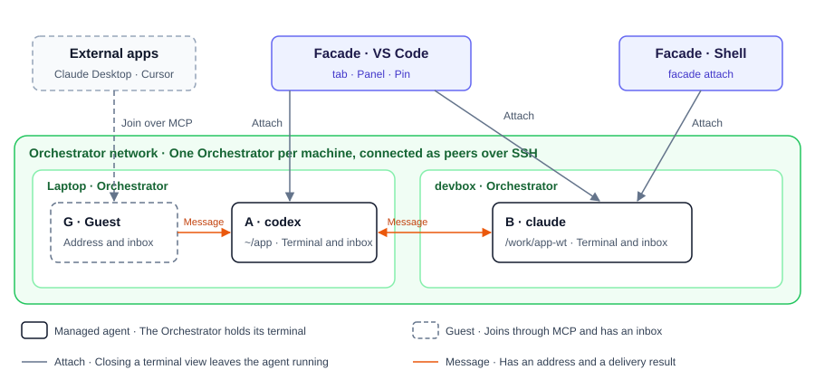

# Facade Code Product Guide

Facade Code runs coding CLIs such as Claude Code and Codex across your machines. Agents can find one another, send
messages, read terminal output and enter text. You can start and work with them from Shell, VS Code or an application
that supports MCP.



## Orchestrator and Facade

The **Orchestrator** manages agents on one machine. A machine is one Facade home, usually `~/.facade`. Separate
`FACADE_HOME` folders on the same computer run independently and can connect through `facade machine add` just
like separate computers.

Your Orchestrators form a peer network using the SSH connections you configure. They can forward work through
intermediate machines. If your laptop is awake and connected to both devbox and gpu-box, devbox can reach gpu-box
through the laptop.

**Facade** provides three ways to use the Orchestrator.

- **Shell** runs the `facade` command for people and scripts.
- **MCP** uses `facade-mcp` to connect agents and external applications.
- **VS Code** provides an extension for managing agents and working in their terminals.

Each entry point connects to its local Orchestrator. That Orchestrator forwards remote requests.

```text
Facade Code
├── Orchestrator (one per machine)
│   ├── Agents       Roster and Guests
│   ├── Running      Machines, runs, settings and CLI-specific behavior
│   ├── Interaction  Messages and terminals
│   └── Services     Installation, upgrades and service processes
└── Facade
    ├── Shell        facade (people and scripts)
    ├── MCP          facade-mcp (agents and external apps)
    └── VS Code      Extension (people)
```

| Responsibility | Who owns it |
| --- | --- |
| Models, reasoning, tools, sign-in and session contents | The CLI |
| Delegation, reporting, review and when to commit | Your prompts and skills |
| CLI installation, accounts and project files | You |
| An external application's processes and interface | The application |
| Commits, merges, reviews and worktree removal | Your Git tools. Facade can create a worktree when starting an agent. |
| SSH configuration and account access | You. Connect the machines you control. |

## Agents

An agent is a named participant in Facade. A **managed agent** runs a CLI in a terminal held by the Orchestrator.
A **Guest** is an external application or CLI session that has joined through `facade-mcp`. Each Guest has an
address and inbox.

| | Managed agent | Guest |
| --- | --- | --- |
| Joins when | Started through Facade | An external MCP connection first calls a tool |
| Sends messages | Yes, for supported CLIs | Yes |
| Receives messages | Facade submits them in the CLI's terminal | The Guest takes them from its inbox with `read_messages` |
| Screen, typing and Attach | Available | No terminal |
| Stop, resume and remove | Available when the action applies to the agent | The external application owns its lifetime |
| Rename | Yes | Yes |
| Appears in `facade list` | While running | From the first tool call until disconnect |

Some managed CLIs have fewer capabilities. See [CLI differences](#cli-differences).

### Numbers, names and addresses

Each machine issues numbers such as `a1` and `a2` once. An agent keeps that identity across runs. Names are
display names and can repeat. If you omit a name, Facade picks one from the machine's pool, preferring names
that are free among listed agents. A Guest's CLI column shows the application it comes from, such as Cursor.

Copy a reference such as `a3@devbox` directly from a Shell table or MCP result. Facade qualifies references
with a machine name when it resolves uniquely, then the first eight hexadecimal characters of the machine ID when needed, then
the full ID if the short ID also collides.

An unqualified number or name searches awake, reachable machines for agents eligible for the requested action.
Qualifying a reference with a machine selects that machine and can wake it through a saved route. A command
with a machine scope follows the wake policy for that command.

- An agent can match only if the caller has permission and the action is available. Sending requires a running
  managed agent that accepts messages or a connected Guest. Typing requires a running managed agent. Resume,
  removal, screen reads and inspection can also target ended records.
- A bare token matching `a` followed by digits is an agent number. Other tokens are names. When an action
  accepts ended records, a matching eligible running agent takes priority.
- Facade interprets the part after `@` as either a machine name or an ID. It reports ambiguity if those select
  different machines. `a3@devbox` identifies a number on devbox. `Pixel@gpu` can mean Pixel on gpu or an
  agent literally named `Pixel@gpu`. Facade checks both interpretations. It reports an ambiguity if both match
  and reports a lookup failure if a required search could not complete.
- Multiple eligible matches produce copyable addresses. Errors distinguish missing, ended and inaccessible
  targets. An inaccessible target's address is withheld.
- At resume, a saved CLI session can be selected by its session ID. Copy its `REF` from the resume table. If
  a prefix matches multiple sessions, use the full ID.

### States

```text
Managed agent: start → starting → running → ended → record expires after 30 days
                                    ↑         │
                                    └─ resume ┘
Guest:         connect → online → disconnected
```

A managed agent can end through a stop, a CLI exit, a crash or a machine reboot. While it runs, Facade reports
`working`, `waiting_for_you`, `just_done`, `idle`, `error` or `unknown`. `waiting_for_you` can indicate a
question, permission prompt or sign-in. `just_done` means a turn finished and has yet to be viewed.

### Actions

- **Start.** Start a managed agent. See [Running agents](#running-agents).
- **Stop.** Pass one or more agents to `facade stop`, or use `--local`, `--machine <MACHINE>` or `--all`.
  Scope stops skip Guests and leave sleeping remote daemons idle. A partial failure returns 1 after processing
  the other targets. The stopped agent's record lasts 30 days, and its helpers keep running.
- **Resume.** `facade resume` lists resumable agents on reachable machines and saved CLI sessions in your
  current folder. `--local` queries only this machine with zero SSH. `--machine <MACHINE>` lists resumable
  managed agents on that machine. Copy a `REF` from the list. Resuming a managed agent keeps its reference,
  folder, session, model and effort and uses the machine's current settings. Resuming a saved session creates a
  new agent. If the session is in use, the error identifies the agent using it. Add `-d` to run in the background.
- **Remove.** Use VS Code to remove a record, screen and inbox. Facade stops a running agent first.
- **Rename.** Pass a nonempty name to `facade rename`. The reference stays the same.
- **List.** `facade list` lists running managed agents and connected Guests, newest start or resume first.
  `STARTED` is measured from that start or resume. The default probes saved connections without waking
  sleeping daemons. `--local` uses zero SSH. `--machine <MACHINE>` queries that machine and wakes it if needed.
- **Inspect.** `facade status <AGENT>` reports the reference, name, state, machine, CLI, working folder, launch
  command, session, who started it, attached viewers and YOLO.

```text
$ facade list
NAME   REF         STATE     CLI      TYPE      WORKING DIRECTORY  STARTED  TITLE
Eve    a9@devbox   Idle      claude   Managed   /work/app-wt       1m ago   Write release notes
Cora   a5@laptop   Online    cursor   Guest     -                  5m ago   -
Ada    a3@laptop   Working   codex    Managed   /work/app          2h ago   Fix the failing parser test
```

`TITLE` is the title the CLI reports. The list truncates it at 40 characters.

### Permissions and YOLO

Shell and VS Code have full reach for the actions they offer. For an agent, reach depends on YOLO, a machine setting
that defaults to on. A managed agent reads it from the executing machine at each start or resume. A Guest reads
it from the machine it joins and keeps that value for the connection.

| | YOLO on | YOLO off |
| --- | --- | --- |
| CLI permission prompts and folder trust | Facade bypasses or answers them where supported | The CLI's normal behavior applies |
| CLI sandbox | Facade disables it where supported | The CLI's normal behavior applies |
| Questions the CLI asks the person | The person answers | The person answers |
| Facade tool prompts | Waived | Waived |
| Agent reach for actions, messages and replies | Any reachable eligible agent | The caller's creation tree |

A creation tree includes the first agent and all agents started within that tree, across machines. Each call uses
the calling agent's reach, including when one agent asks another to do work. For Guests, YOLO governs reach.
The external application owns its own permissions and sandbox.

A `facade` command invoked inside an agent's terminal passes through that CLI's own permissions and sandbox.
When the command runs, Facade treats it as a Shell invocation.

### Joining as a Guest

Register `facade-mcp` as a stdio MCP server in the external application. `facade status` shows the fixed
launcher path under `Guest MCP`. This configuration uses `mcpServers` and a launcher on PATH.

```json
{"mcpServers":{"facade":{"command":"facade-mcp"}}}
```

An MCP connection from a managed CLI session belongs to that managed agent. Facade's run configuration carries
a private identity, and a user-configured entry can also be identified by its session. A separate CLI session
started by an agent, such as a `claude -p` process with its own session, joins as a Guest. The first tool call
fixes the identity for the connection. A Guest can be listed and receive messages from that point.

A Guest normally sends a message first. On successful delivery, the reply includes a `next` tool call with the
sent message's full address.

```json
{
  "status": "success",
  "data": {
    "id": "m42@laptop",
    "delivery": "typed_into_input",
    "next": {
      "tool": "read_messages",
      "arguments": {"wait": true, "reply_to": "m42@laptop"}
    }
  }
}
```

Each wait can last up to 30 seconds. A Guest must take an incoming message within the delivery deadline. When
it waits for a particular reply, the sender needs the corresponding `reply_to`. Managed agents receive replies
in their terminals. A Guest leaves the roster on disconnect and has no session to resume.

## Running agents

Choose the machine, folder and CLI for the run.

### Machines

Facade uses your existing SSH setup. Put Facade options before the SSH arguments. The remaining arguments use
the same forms as your usual SSH command.

```text
facade machine add devbox                        # An SSH config host
facade machine add aaron@10.0.0.5                # User and address
facade machine add -p 2222 aaron@devbox.lan      # Custom SSH port
facade machine add -i ~/.ssh/work aaron@gpu      # SSH identity file
facade machine add --home /data/facade devbox    # Select a remote Facade home
facade machine add --bidirectional devbox       # Verify and save a return connection
facade machine connect devbox                    # Hold a temporary connection until Ctrl+C
facade machine remove devbox                     # Remove the saved connection and local authorization
facade machine remove --bidirectional devbox     # Also attempt removal on the remote machine
facade machine list
facade machine rename devbox build-box
```

- **Add.** Facade saves the connection after verifying the peer. It reuses working noninteractive credentials.
  If sign-in requires a password, Facade can enroll a dedicated SSH key and verify a separate login with that key
  before saving the connection. With `--bidirectional`, the remote machine verifies a separate return
  connection using the source address it saw. It uses SSH port 22. A failed return leaves the verified forward
  connection saved and reports the reason.
- **Connect.** Traffic flows both ways while the foreground `machine connect` command stays open. The command
  closes the connection when it exits.
- **SSH prompts.** Respond to any SSH password or host-key prompt in the Add or Connect terminal. The first
  connection warns that agents with YOLO on can act on agents on connected machines. When a saved machine needs
  a login, `machine list` provides the Add command. Add and Connect warn when the peer reports that its SSH
  login settings can terminate processes on logout.
- **Remove.** `machine remove` deletes the saved outbound connection and revokes Facade-managed local
  authorization for the peer with zero SSH. With `--bidirectional`, it verifies the peer's identity and tries
  to remove the return connection and its authorization before completing local cleanup. Shell reports each
  side's outcome and returns 1 if either side could not be confirmed.
- **Remote installation.** SSH tries the remote Facade program at its installed path first. The daemon API
  handshake determines whether the installed builds can work together. An explicit Add or Connect can install Facade
  on an uninstalled machine through the regular installer when authorized. Passive probes leave sleeping services
  and missing installations alone. See [Folders and machines](core/FEATURES.md#folders-and-machines).
- **Facade home.** Use `--home` to select a remote Facade home other than `~/.facade`.
- **WSL and Dev Containers.** Each is a separate machine. Facade inside the environment uses its own local
  Orchestrator. To connect from outside, configure SSH in that environment and add it from the other machine.
- **Machine names and IDs.** The default name is the lowercased first part of the host name. Rename with
  lowercase letters, digits and hyphens. Facade generates the stable machine ID on first run. For a selector,
  use the name, an unambiguous eight-character ID prefix or the full ID.
- **On-demand connections.** A saved SSH session closes after 30 idle seconds. Foreground connections, active
  Attach views and requests in progress keep it active. A named start or exact remote resume can wake the
  destination and any intermediate machines. The default list and scoped remote stop leave sleeping daemons
  idle.
- **Machine list.** `facade machine list` reads the saved table with zero SSH. It distinguishes a disconnected
  machine, confirmed sleep, a connection failure and required SSH login. Agent commands report failures to
  query other machines on stderr.

### Start an agent

```text
facade start [--machine M] [--workdir D] [--worktree B] [--name N] [-d] <CLI> [CLI_ARGS]...

facade start claude
facade start --machine devbox --workdir /work/app claude
facade start --machine devbox --workdir /work/app --worktree feat-x codex
facade start -d -n Nova codex --model gpt-6.2-sol
```

A Shell start receipt confirms the agent has started. Use `facade send` to send it a task and check the receipt.
For MCP `start_agent`, the Orchestrator handles delivery of an optional first prompt and sends a 🔔 result
to the agent that started it.

- **Defaults.** Shell uses this machine and the current folder. VS Code uses its extension host and a workspace
  folder. MCP uses the calling agent's machine and folder. A Guest starts from the machine it joined. When no
  applicable folder is available, such as for a start on another machine, Facade uses the target user's login
  home.
- **Folders and worktrees.** Use a normal folder, Git checkout or existing worktree. With `--worktree`,
  Facade creates a branch from the selected repo's current `HEAD` and a worktree next to the repo at
  `<repo>.worktrees/<branch>`. A branch that already exists causes a refusal. Use `git worktree remove`
  to remove a worktree.
- **CLIs.** The built-in entries are Claude Code (`claude`), Codex (`codex`), Antigravity (`agy`), Muse
  (`muse`), OpenCode (`opencode`) and Pi (`pi`). The target machine's settings can add entries for these
  and custom programs. A missing CLI name or unavailable entry produces an error with the available entries
  when applicable. The selected machine must have the program installed.
- **Environment.** A local run uses the initiating Shell, VS Code, agent or Guest relay environment. A remote
  run uses the target login environment.
- **Models, effort and prompts.** Pass supported native options after the CLI name. The target machine's
  settings can supply defaults. A managed resume reuses the recorded launch choices.
- **Folder trust and setup.** With YOLO on, Facade handles trust prompts where the CLI supports it. With YOLO
  off, you answer them. Facade configures `facade-mcp` and hooks per run and leaves global CLI settings alone.
- **Ending and resuming.** A CLI exit, crash or machine reboot ends the run. Use `resume` to continue it.
  VS Code can resume pinned agents when their workspace reopens.
- **Errors.** Start reports the failing step, such as a connection, folder, worktree, missing program or
  invalid settings.

### Settings

Each Facade home has its own `facade.json` for YOLO, names and CLI entries. `facade status` shows its path.
To find it on another machine, sign in there over SSH and run that command locally. New and resumed runs read
the machine's current settings. Start reports invalid settings. See [Configuration](extension/features/CONFIGURATION.md).

### CLI differences

These details describe how Facade connects to each CLI. See the [CLI reference](extension/engineering/CLIS.md)
for the full rules.

| CLI | Facade behavior |
| --- | --- |
| Claude Code | With YOLO on, Facade recognizes the folder trust prompt and answers it in the terminal. |
| Antigravity | Facade makes a project plugin available under `.agents/plugins/facade/` while needed. A second Antigravity process that reads the same run configuration can be identified as that run. On startup Facade checks that the `facade` MCP tools are ready before delivering a first prompt. |
| Muse | When the CLI uses an existing `facade` MCP entry in place of the managed entry, Facade resolves identity from the CLI session. |
| Pi | The managed entry carries the run identity because Pi does not pass a session ID to the MCP server. A manually configured Pi MCP entry joins as a Guest. |
| OpenCode | Choose model and effort in OpenCode. Facade rejects its model and effort overrides for this entry. OpenCode subprocesses that inherit the per-run MCP environment can be identified as that run. |
| Custom program | Facade can start it, read its screen, send input and Attach. A custom program has no integrated messaging, saved-session resume or Pin. |

A different MCP server named `facade` occupies the name the managed tools need. Use a distinct name for that server.

## Interaction

Use messages to communicate with agents and the terminal to see and interact with their CLIs.

### Messages

A message goes to one agent and can contain up to 8,000 Unicode code points and 540 lines of text. A managed
agent or Guest sends with its own identity through MCP. Shell sends as **the command line**, including when
run from an agent's terminal. A command-line message has no reply address. In the Orchestrator, message recipients
are agents. Use the terminal or agent status to keep up with them.

The recipient's machine issues the message number. Across machines, use its full address, such as
`m17@devbox` or `m17@9a0d44b2`. To reply to a message in your own inbox, pass `reply_to` with its local number
and address the original sender. When waiting for a reply to a message you sent, copy the full message address
from the receipt into `read_messages`.

| Recipient | Delivery |
| --- | --- |
| Managed agent | Facade waits for an empty input box, pastes the text and submits it. The receipt confirms delivery after submission. Unconfirmed input produces a failure. |
| Guest | The Guest takes the message from its inbox with `read_messages`. The read confirms delivery. |
| Ended agent | Facade reports that the agent has stopped. |
| Agent outside the caller's reach | Facade reports a permissions error and withholds the target's identity. |

Delivery has a 30-second deadline. When delivery fails before submission, Facade withdraws it and gives the sender
the reason. If you receive an uncertain outcome, check the actual screen or inbox before trying another send.

```text
📨 Message from ada (a3@laptop) · m42
📨 Message from the command line · m43
📨 Message from eve (a9@devbox) · m44 · Reply to m17@devbox
```

Facade marks delivery and wait notices with 🔔. The creator receives the result of an agent's first task delivery.
A wait for permission, an answer or a login that lasts 20 seconds produces one notice per wait. A Guest creator
must be reading messages with a matching filter to take the notice. Creators that are agents have inboxes.
Shell and VS Code starts have no creator inbox.

Message records last 30 days. MCP `read_messages` reads the caller's own inbox. Shell exposes the send
receipt. Automatic reconnect retries reuse the original request's outcome when its receipt is available.

### Terminals

- Use `facade screen` to read screen text, `facade type` to send text or keys and `facade attach` to see and
  interact with a live terminal. Screen can read the last screen of an ended agent. Use screen when you only
  need to read.
- Active Attach views share one grid. Its columns and rows are the smallest capacity in each dimension across
  the active viewers. A larger Shell draws the shared grid at its upper left. Resizing or closing a view can
  change the shared grid. VS Code can supply terminal colors.
- Press Ctrl+] to detach from Shell and leave the agent running. `facade status <AGENT>` lists active viewers
  under `Attached in`.
- On reconnect, the client redraws from the current screen. Shell reports any dropped input in bytes.
- Remote terminal operations use the same permission checks as local operations.

## Services

The **keeper** is the parent of the managed CLIs and holds their terminals. The **daemon** manages agents and
serves Facade's clients. Each service retains access to the terminals while the other restarts. An API-compatible
daemon takeover keeps the keeper and its CLIs running while clients reconnect. See [Core architecture](core/ARCHITECTURE.md).

- **Status.** `facade status` reports the local Facade home, settings file, version, service PIDs, managed
  agent count, connected machines and the fixed Guest MCP launcher. It queries sleeping services without
  starting them. The daemon and keeper each retain 30 days of logs.
- **Installation.** Follow the [installation instructions](../README.md#install) to install the Orchestrator,
  `facade` and `facade-mcp`. The VS Code extension ships the programs for its extension host. If the Facade
  Code IDE launcher is also installed under `facade`, your PATH determines which command runs.
- **Lifetime.** Services start on demand and exit after 30 idle seconds. Running agents, foreground
  connections, active Attach views and requests in progress keep the services in use.
- **Upgrade.** `facade upgrade` checks for a newer stable release before downloading the installer.
  `facade upgrade --version X.Y.Z` runs the installer for the specified version. When the active services
  pass the compatibility check, the new daemon takes over and the agents keep running.
- **Version.** `facade --version` prints the Shell CLI version.

## Shell

Shell is for people and scripts. Its commands report in English. Agent operations invoked from an agent's
own terminal still use Shell identity. See [Permissions and YOLO](#permissions-and-yolo).

```text
facade start [--machine M] [--workdir D] [--worktree B] [-n N] [-d] <CLI> [CLI_ARGS]...
facade list [--local | --machine <MACHINE>]
facade attach a3@devbox
facade send ada "Run the tests"
facade screen a3
facade type a3 "yes" --enter
facade stop <AGENT>...
facade stop --local
facade stop --machine <MACHINE>
facade stop --all
facade rename a3 reviewer
facade status a3
facade resume [--local | --machine <MACHINE>]
facade resume [-d] a3
facade resume 7f3e9a1c
facade machine add [--home <PATH>] [--bidirectional] <SSH_ARGS>...
facade machine connect [--home <PATH>] <SSH_ARGS>...
facade machine remove [--bidirectional] <MACHINE>
facade machine list
facade machine rename <MACHINE> <NAME>
facade status [AGENT]
facade --version
facade upgrade [--version X.Y.Z]
```

Run `facade` to see the command groups. Use `facade <COMMAND> --help` for examples, arguments and options.
Help and `--version` run without starting services. Results and receipts go to stdout. Empty-result guidance,
diagnostics and progress go to stderr. An operation failure returns 1. Invalid usage returns 2. After a
foreground `start`, `resume` or `attach` opens a terminal, Ctrl+] detaches and returns 0. If the agent's CLI
exits first, the command returns its exit code or 128 plus its signal number. See [Shell commands](core/islands/facade.md#shell-commands).

## MCP

Agents and external applications use these eight tools through `facade-mcp`.

| Tool | What it does |
| --- | --- |
| `list_agents` | Lists running managed agents and connected Guests within the caller's reach. |
| `start_agent` | Starts a managed agent. Use `machine` to choose a machine and `folder` to choose the working folder. |
| `stop_agent` | Stops one managed agent. Its helpers keep running. |
| `send_message` | Sends to one agent and returns the complete message address. A Guest also receives a `next` call for waiting on the reply. |
| `read_messages` | Reads the caller's inbox without waiting by default. Specify `wait` to wait up to 30 seconds, optionally for one `reply_to`. |
| `read_screen` | Reads screen text from a managed agent. |
| `type_text` | Types text in a running managed agent's terminal. |
| `press_keys` | Presses keys in a running managed agent's terminal. |

MCP returns the requested content inline so the client can use it from another machine. For terminal operations,
MCP clients use screen reads and input tools. The [MCP contract](extension/engineering/MCP.md#7-mcp-through-the-orchestrator)
defines the tool arguments and results.

## VS Code extension

A workspace remembers agents started or opened there, their helpers throughout the creation tree, and its Pins.
Helpers appear as cards. Windows for the same workspace share the remembered membership.

- **Panel.** A card shows the agent's name, CLI, state and title. Open details to see its machine. Click the
  card to attach to its terminal. Closing the terminal tab leaves the agent running and keeps its Pin.
- **Card menu.** Open the terminal, hide the card and remove its Pin, stop the agent, remove its record, Pin
  it or rename it. Hiding keeps the agent running. A Pin requires a resumable session.
- **Find an agent.** **Go to Agent…** lists running managed agents on awake, reachable machines that you can
  attach to. **Resume Agent…** lists resumable agents and saved sessions from the Orchestrator.
- **Start.** The location picker offers a machine and folder. On the extension host it offers workspace
  folders and worktrees. On another machine it offers your login home, recent folders and manual path entry.
- **Reopen.** The extension resumes pinned agents that are stopped, including after a crash. It tries once
  per reopen and shows a failure on the card. Unpin an agent before stopping it if you want it to stay
  stopped. An expired unpinned record drops its card. For an expired pinned record, the extension can create a
  new agent from the saved CLI session. If the session is gone, it removes the Pin and tells you.
- **Remote windows.** In a Remote SSH window, the extension uses the Orchestrator on its extension host.
  Run `facade machine add` there to make other machines reachable from that window.
- **Window Component.** The component supplied with the extension cleans up terminal tabs left by a previous
  extension host after a reconnect or restart.
- **Engine selection.** This guide describes the Orchestrator-backed Rust engine. The extension's original
  engine follows the [old-engine rules](extension/PRODUCT.md#57-transition).
- **Other actions.** Use Shell for machine administration and sending messages as a person. Use Git to remove
  a worktree.

The [VS Code product guide](extension/PRODUCT.md) explains the editor entry in more detail. The
[Glossary](core/GLOSSARY.md) defines shared terms such as Attach, Guest, Pin, Resume and YOLO.

## Common workflows

1. **Start in Shell and open in VS Code.** Run `facade start -d codex` on your laptop. If the agent is named
   Ada, select Ada in **Go to Agent…** and open its terminal. Closing the editor leaves it running. Run
   `facade attach ada` to return to that terminal from Shell.
2. **Run on another machine.** Save devbox with `facade machine add -p 2222 aaron@devbox.lan`. Then run
   `facade start --machine devbox --workdir /work/app --worktree feat-x claude`. You can attach from both
   the laptop's terminal and VS Code.
3. **Have agents work together.** Ada can use MCP to start two helpers. Their cards appear in the workspace
   that remembers Ada. The helpers reply using `reply_to`, and Ada can read their screens.
4. **Join from an external app.** Register `facade-mcp` in Cursor. With YOLO on, the Guest can send Ada a
   message and use the resulting `read_messages` call to wait for a reply. With YOLO off, it works within its
   own creation tree.
5. **Resume work.** Use `facade resume` to find Ada after it has stopped. `facade resume ada` continues
   the original session with the same reference and model. Reopen a VS Code workspace to resume its Pins.
