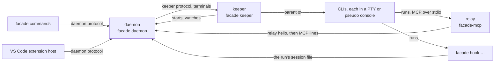

# Architecture

Facade core implements the Orchestrator, the Shell entry point and the MCP entry point in the
[product description](../facade-code.md). [Islands](islands/) describes the parts of the Rust workspace, and the
[glossary](GLOSSARY.md) defines their terms.

## Processes



One Facade home has at most one keeper and one daemon. Each service holds a lock file in the home's `core/` folder.
Shell, the VS Code extension host and the MCP relay connect to the Orchestrator for their home. Its daemon forwards
requests over SSH when the target agent runs on another machine.

| Process | Program | Lives | Threads |
| --- | --- | --- | --- |
| Command | `facade <command>` | One command. It connects to the daemon and, when nothing responds, starts the keeper | One; `attach` adds a few for the person's keys, signals and writes |
| Hook | `facade hook …`, run by a CLI | One hook call. It reads its input for at most a second, uses only its run's files, never connects to a daemon, and always exits 0 | One |
| Keeper | `facade keeper` | While it holds a CLI or a daemon runs | One, around one `poll`, or on Windows one I/O completion port: no tokio, no locks |
| Daemon | `facade daemon` | Until 5 seconds pass with no running agent, local client or unfinished work | A tokio runtime (below) |
| Relay | `facade-mcp`, run by a CLI or an MCP client | As long as its MCP client runs | One, around one `poll`; on Windows the loop around an I/O completion port, and one thread that reads standard input |
| CLI | `claude`, `codex`, … | Until it ends or is stopped | The CLI's own |

**Starting.** A command connects to the daemon's socket. When nothing responds, no daemon holds the daemon lock and no
keeper runs, it installs its own build into `core/bin/` and starts the keeper through the launcher. The keeper starts
the daemon, and the command says `hello` until the daemon responds, for up to 10 seconds. A service reports `started`,
`contention` or `failed` to whoever started it, on a startup channel. The daemon accepts clients only after it has
recovered every agent it can read. Nothing runs at login.

**Programs.** `core/bin/<build>/` holds each build's `facade` and `facade-mcp`; on Windows, `facade.exe`,
`facade-mcp.exe` and `conpty\`, the ConPTY package every Windows build ships. Two launchers, `core/bin/facade` and
`core/bin/facade-mcp` (with `.exe` on Windows), name the current build: symbolic links into it on macOS and Linux; on
Windows, copies of its programs, pointed at another build by renaming the one in use aside and copying the new one in,
with `core/bin/current-build` naming the build. Runs are given launcher paths only, so a run's next hook or MCP server
is always the current build's.

**The keeper keeps the CLIs.** Every CLI is the keeper's child. On macOS and Linux it leads a session and process group
of its own, in a PTY. On Windows it runs in a pseudo console that the keeper makes through the ConPTY package, in a job
of its own. The keeper and the daemon each hold the CLI's terminal: its PTY master, or on Windows copies of its input
and output pipes, of the signal pipe that keeps the pseudo console open, and of its job. So a terminal outlives either
service:

- When the daemon ends, the keeper starts another, after 0.5 seconds, doubling after repeated failures up to 30
  seconds. The new daemon takes the terminals back and recovers each screen from its log.
- When the keeper ends, the daemon keeps every terminal and starts another keeper, which takes the CLIs over.
- The daemon pings the keeper every second. A daemon silent for 15 seconds is killed and started again.

**A newer build takes over.** The newer program uses a compatible handshake to request takeover from the older
daemon. The old daemon checks keeper compatibility before it installs the new build, points the launchers at it,
drains, sends every client `closing` and exits. The keeper starts the new daemon. The CLIs keep running and the new
daemon recovers their terminals, records and screens. Ordinary requests use the new protocol. The newer program
reports a refusal if it cannot complete the takeover.

**A machine wakes on request.** A running daemon connects over SSH only to machines whose daemon is awake. A request
that names a sleeping machine wakes it through its saved SSH route. Forwarded work counts toward the daemon's activity
while it is in progress. Saved connections, and connections with no work in progress, do not keep the daemon running.

### The daemon's threads

- **Runtime**: tokio's multi-thread runtime, with as many workers as the machine's parallelism, at least 2 and at most
  16.
- **Tasks** include one actor for each managed agent with its terminal, screen, state and typist, and one task for each
  connection, call and watch. The layer also follows runs, Guests, results and long waits, sweeps expired data and
  handles idle exit.
- **Blocking work**: store writes, screen logs and checkpoints, state files and file preparation run on tokio's
  blocking workers, or in place on a worker that first moves its other tasks away.
- **Dedicated threads** read and write the keeper link. On Windows, the terminal I/O thread uses a completion port to
  read and write the managed agents' terminals.

## Interfaces between processes

| Between | Interface | Defined in |
| --- | --- | --- |
| A client and the daemon | JSON-RPC 2.0 with one object per line on `/tmp/facade-core-<uid>/daemon-<key>.sock`, or on Windows `\\.\pipe\facade-core-daemon-<key>`. After `hello`, clients use `call`, `watch`, `unwatch` and `cancel`. The daemon sends `changed` and `closing`. | [PROTOCOL](../../core/protocol/PROTOCOL.md) |
| The daemon and the keeper | The keeper protocol, on the keeper's socket beside the daemon's: `hello`, `agent.start`, `agent.stop`, `agent.sync`, `daemon.ping`. A terminal rides along with its line: a PTY master, or on Windows its handles, duplicated into the receiving process and named in the line | [KEEPER](../../core/protocol/KEEPER.md) |
| A relay and the daemon | The daemon protocol's relay contract: a `hello` that names the relay contract, then MCP lines both ways. `closing` hands the calls without a response over to the next daemon | [PROTOCOL: The relay](../../core/protocol/PROTOCOL.md#the-relay) |
| A CLI and its relay | MCP over standard input and output: Facade's eight tools | [MCP](../extension/engineering/MCP.md) |
| A CLI and its hooks | The CLI runs `facade hook <event> …` with its hook input. The hook saves the session the input reports in the run's session file, which the daemon follows, and prints, in the CLI's own format, the instructions the run's start wrote | [facade](islands/facade.md), [rules](islands/rules.md) |
| Two daemons | The daemon protocol with a `machine` hello, then calls, watches and changes in both directions. A machine session runs over SSH to `facade machine serve` and can forward traffic along a route. | [PROTOCOL: Machine sessions](../../core/protocol/PROTOCOL.md#machine-sessions) |
| A CLI and the daemon | What the CLI draws in its terminal, and its own reports of what it does, the Program Status Protocol (OSC 7501) | [PROTOCOL: States](../../core/protocol/PROTOCOL.md#states) |

The protocols' types, framing and client live in [base](islands/base.md); `core/protocol/` is generated from them. The
relay depends on no other Facade crate, so it reckons the daemon's socket path itself, by the same rule as base;
scenario tests that go through the relay keep the two the same.

From `core/` in an isolated checkout, build the programs and run the [relay scenario](../../core/tests/tests/mcp.rs)
with a fresh `TMPDIR`. The scenario creates its Facade home there and starts the fake CLI.

```sh
cargo build &&
  relay_test_tmp=$(mktemp -d) &&
  TMPDIR="$relay_test_tmp" cargo test -p facade-scenarios --test mcp \
    a_line_of_a_mebibyte_goes_through_the_relay_each_way -- --exact
```

The scenario sends a request with a method name 1 MiB long through the relay. The daemon replies with JSON-RPC error
`-32601` and an error message longer than 1 MiB. The next `ping` on the same connection returns an empty object.

The daemon owns the store, `core/facade.db`. The daemon process writes and migrates it. The offline machine-name
helper reads the committed local name from the existing store when the service sleeps. The home's files each have
one owner island. See [daemon](islands/daemon.md).

## Islands

The code is split into islands. An island owns its data and offers a few clear interfaces. Islands nest: each crate is
an island, and inside a crate, modules are child islands, down to one file. The level of an island that is not any of
its children's is called its layer.

```text
core
├── base       shared conventions: identity, paths, time, log
│   ├── protocol    both protocols' types and framing, the daemon client
│   ├── platform    what Facade asks of the operating system
│   ├── settings    facade.json
│   └── texts       what a model reads: instructions, skill, tool definitions
├── screen     a headless terminal for one agent
├── rules      what Facade knows of each CLI: rule files
│   ├── command_line  program, arguments, model, effort, YOLO
│   ├── compose       the launch command of a start or resume, in order
│   ├── input         the input box and pastes
│   ├── state         what the screen says of the agent's state
│   ├── sessions      session files and the CLIs' session variables
│   └── wiring        tools, hooks and plugins installed for a run
├── keeper     the parent of every CLI
├── relay      facade-mcp
├── daemon     the agent list, the store, and the orders that join its parts
│   ├── agent       one actor per agent
│   │   ├── terminal    the PTY master and waiting input
│   │   ├── screen      the agent's screen and its log
│   │   ├── state       the managed agent's state
│   │   ├── typist      typing, and delivering messages into the input box
│   │   ├── viewers     the clients watching the screen
│   │   └── readiness   trust, tools and the first prompt
│   ├── messages    messages and their delivery
│   ├── runs        the CLI runs
│   │   ├── keeper_link   the keeper connection and the runs it holds
│   │   └── preparation   run folders, environment, plugins, session following
│   ├── records     agent numbers, names and reach
│   ├── windows     the old windows a workspace import reads
│   │   └── locations   folder discovery, start checks and Git worktrees
│   ├── network     SSH connections, machine sessions, routes and forwarding
│   ├── guests      external MCP connections and Guest records
│   ├── lifecycle   the daemon's own life: idle exit, a newer build's takeover, its log
│   ├── server      client connections
│   └── mcp         Facade's MCP tools behind each relay
└── facade     the facade program
    ├── cli         command syntax and argument validation
    ├── help        public help pages
    ├── commands    agent commands and status
    ├── attach      showing an agent's terminal
    ├── hooks       what a CLI's hooks run
    ├── machine     SSH commands and the remote endpoint
    └── upgrade     stable installer and takeover results
```

The crates depend in one direction: base and screen, then rules, then keeper and daemon, then facade. The relay depends
on no other Facade crate. Inside base, texts may use protocol, and protocol and platform use only base's layer.

## Rules between islands

- **Siblings never call each other.** Their parent joins them, and is the one place their orders are written.
- **A child never calls its parent.** What it needs, it gets when it is made: a narrow handle, the sender of a channel,
  or a closure. Nothing finds its parent through a global value, and no child holds the whole daemon.
- **A child reports up** with return values, with events on a channel its parent gave it (`RunEvent`,
  `GuestEvent`), through a trait its parent implements (the server's `Service`), or through closures its parent gave
  it (the MCP server's `ActorServices`).
- **Every piece of data has one owner.** Fields are private. The daemon's layer creates every table; each part gets a
  handle to its own table and no transaction of its own. Every file and folder in the home has one owner.
- **Rust's visibility holds the lines.** A parent declares its children privately; an island's interface is
  `pub(crate)` inside a crate and `pub` between crates; everything else is private.
- **Locks.** Only the daemon nests locks, in the order [daemon](islands/daemon.md) gives: its layer's first, a part's
  after. The keeper and the relay take no locks: the keeper has one thread, and the relay one on macOS and Linux and
  two on Windows, its loop and the thread that reads its standard input.
- **One place for each kind of knowledge.** Only base's platform, the keeper and the relay branch by operating system,
  and they keep the code for every system core supports. Only rules names a CLI or branches by one, but for the texts a
  model reads. Only records gives agent numbers, and only messages gives message numbers.
- **Errors.** An island's interface returns the protocol's error, `ErrorBody` with a `Reason`, where a client will see
  it.
- **Machine boundaries.** Agents and messages are known by their machine ID and number, never by a process ID or a local
  path. A relay's process ID and start time only show that its connection is still the same live relay. A machine
  session uses the same operations as a local caller, with its origin and target carried by the protocol. Socket paths
  follow [PROTOCOL](../../core/protocol/PROTOCOL.md). Connected clients, including VS Code, get machine and agent
  data through the daemon protocol. Offline Shell help and service status use the daemon's read-only local name
  helper.

## Operations that span islands

The daemon's layer calls its islands in a fixed order so state can be recovered or explained after an interruption.

1. **Start.** Records assigns an agent number and runs starts the CLI. The daemon commits the record and its first
   prompt together before it lists the agent, starts its actor and delivers the prompt.
2. **Delivery.** Messages commits the start of a paste before the typist changes the terminal. It records the outcome
   before the send's response. A Guest read settles only the messages returned with their content.
3. **Session.** The daemon commits a session report before it sends the session to the agent's actor.
4. **Screen.** The actor records output and resize in its screen log before it applies them to the terminal engine.
5. **Removal.** The daemon confirms the running CLI exited before it deletes the record and inbox in one transaction.
   It then publishes the removal and disposes of the actor, run, screen and run folders.
6. **Guest connection.** The daemon assigns a number and saves a Guest's identity and YOLO setting before listing it.
   Ending the connection removes the record and inbox together and settles the messages it has not taken.
7. **Starting a helper across machines.** The starter's machine reserves a message number for the first prompt's result.
   The running machine commits the agent, prompt and reserved number in one transaction so a retry finds the same
   result. A start from Shell or VS Code creates no result message.
