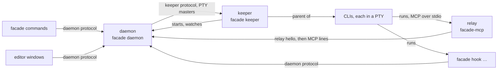

# Architecture

How Facade core is built: its processes and threads, how they talk, how the code is split into islands, and the rules
and orders that hold across islands. Each island's own design is in [islands/](islands/); the words are in the
[glossary](GLOSSARY.md).

## Processes



One home, `FACADE_HOME`, has at most one keeper and one daemon; each holds a lock file in the home's `core/`. Everything
else comes and goes.

| Process | Program | Lives | Threads |
| --- | --- | --- | --- |
| Command | `facade <command>` | One command. It connects to the daemon and, when nothing responds, starts the keeper | One; `attach` adds a few for the person's keys, signals and writes |
| Hook | `facade hook …`, run by a CLI | One hook call. It reaches a running daemon only, never starts one, reads its input for at most a second, and always exits 0 | One |
| Keeper | `facade keeper` | While it holds a CLI or a daemon runs | One, around one `poll`: no tokio, no locks |
| Daemon | `facade daemon` | Until 5 seconds pass with no running agent, client or unfinished work | A tokio runtime (below) |
| Relay | `facade-mcp`, run by a CLI or an MCP client | As long as its MCP client runs | One, around one `poll` |
| CLI | `claude`, `codex`, … | Until it ends or is stopped | The CLI's own |

**Starting.** A command connects to the daemon's socket. When nothing responds, no daemon holds the daemon lock and no
keeper runs, it installs its own build into `core/bin/` and starts the keeper through the launcher. The keeper starts
the daemon, and the command says `hello` until the daemon responds, for up to 10 seconds. A service reports `started`,
`contention` or `failed` to whoever started it, on a startup channel. The daemon accepts clients only after it has
recovered every agent it can read. Nothing runs at login.

**Programs.** `core/bin/<build>/` holds each build's `facade` and `facade-mcp`. Two launchers, `core/bin/facade` and
`core/bin/facade-mcp`, are symbolic links into the current build. Runs are given launcher paths only, so a run's next
hook or MCP server is always the current build's.

**The keeper keeps the CLIs.** Every CLI is the keeper's child, the leader of its own session and process group. The
keeper and the daemon each hold the CLI's PTY master, so a terminal outlives either service:

- When the daemon ends, the keeper starts another, after 0.5 seconds, doubling after repeated failures up to 30
  seconds. The new daemon takes the terminals back and recovers each screen from its log.
- When the keeper ends, the daemon keeps every terminal and starts another keeper, which takes the CLIs over.
- The daemon pings the keeper every second. A daemon silent for 15 seconds is killed and started again.

**A newer build takes over.** A command of a newer build that finds an older daemon asks it to let this build take
over. The old daemon installs the new build, points the launchers at it, drains, sends every client `closing` and
exits. The keeper starts the launcher's daemon, now the new build. Every CLI runs on throughout.

### The daemon's threads

- **Runtime**: tokio's multi-thread runtime, with as many workers as the machine's parallelism, at least 2 and at most
  16.
- **Tasks**: one actor task per agent, which owns its terminal, screen, state and typist; one task per client connection
  and per call; one task per watch; and the layer's followers of runs, windows, guests, results and long waits, the
  hourly sweep and the idle exit.
- **Blocking work**: store writes, screen logs and checkpoints, state files and file preparation run on tokio's
  blocking workers, or in place on a worker that first moves its other tasks away.
- **Dedicated threads**: two for the keeper link, one reading and one writing, and one for each integration command,
  reading its error output.

## Interfaces between processes

| Between | Interface | Defined in |
| --- | --- | --- |
| A client and the daemon | The daemon protocol: JSON-RPC 2.0, one object a line, on the daemon socket `/tmp/facade-core-<uid>/daemon-<key>.sock`. `hello`, then `call` (the operations), `watch` and `unwatch` (four topics), `cancel`; from the daemon, `changed` and `closing` | [PROTOCOL](../../core/protocol/PROTOCOL.md) |
| The daemon and the keeper | The keeper protocol, on the keeper's socket beside the daemon's: `hello`, `agent.start`, `agent.stop`, `agent.sync`, `daemon.ping`. PTY masters ride along with the lines | [KEEPER](../../core/protocol/KEEPER.md) |
| A relay and the daemon | The daemon protocol's relay contract: a `hello` that names the relay contract, then MCP lines both ways. `closing` hands the calls without a response over to the next daemon | [PROTOCOL: The relay](../../core/protocol/PROTOCOL.md#the-relay) |
| A CLI and its relay | MCP over standard input and output: Facade's eight tools | [MCP](../extension/engineering/MCP.md) |
| A CLI and its hooks | The CLI runs `facade hook <event> …` with its hook input; the hook calls the daemon's `hook.*` operations and prints its output in the CLI's own format | [facade](islands/facade.md), [rules](islands/rules.md) |
| A CLI and the daemon | What the CLI draws in its terminal, and its own reports of what it does, the Program Status Protocol (OSC 7501) | [PROTOCOL: States](../../core/protocol/PROTOCOL.md#states) |

The protocols' types, framing and client live in [base](islands/base.md); `core/protocol/` is generated from them. The
relay depends on no other Facade crate, so it reckons the daemon's socket path itself, by the same rule as base;
scenario tests that go through the relay keep the two the same.

The daemon alone opens the store, `core/facade.db`. The home's files each have one owner island: see
[daemon](islands/daemon.md).

## Islands

The code is split into islands. An island owns its data and offers a few clear interfaces. Islands nest: each crate is
an island, and inside a crate, modules are child islands, down to one file. The level of an island that is not any of
its children's is called its layer.

```text
core
├── base       shared conventions: identity, paths, time, log
│   ├── protocol    both protocols' types and framing, the daemon client
│   ├── platform    what Facade asks of the operating system
│   ├── settings    facade.json
│   └── texts       what a model reads: instructions, skill, tool definitions
├── screen     a headless terminal for one agent
├── rules      what Facade knows of each CLI: rule files
│   ├── command_line  program, arguments, model, effort, YOLO
│   ├── input         the input box and pastes
│   ├── state         what the screen says of the agent's state
│   ├── sessions      session files and the CLIs' session variables
│   └── wiring        Facade's way into each CLI: tools, hooks, plugins, integrations
├── keeper     the parent of every CLI
├── relay      facade-mcp
├── daemon     the agent list, the store, and the orders that join its parts
│   ├── agent       one actor per agent
│   │   ├── terminal    the PTY master and waiting input
│   │   ├── screen      the agent's screen and its log
│   │   ├── state       the eight states
│   │   ├── typist      typing, and delivering messages into the input box
│   │   ├── viewers     the clients watching the screen
│   │   └── readiness   trust, tools and the first prompt
│   ├── messages    messages and their delivery
│   ├── runs        the CLI runs
│   │   ├── keeper_link   the keeper connection and the runs it holds
│   │   └── preparation   run folders, environment, plugins, session following
│   ├── records     agent numbers, names and reach
│   ├── windows     editor windows and their grace
│   │   └── locations   a window's folders and worktrees
│   ├── guests      guests, MCP members and integrations
│   ├── server      client connections
│   └── mcp         Facade's MCP tools behind each relay
└── facade     the facade program
    ├── commands    the terminal commands
    ├── attach      showing an agent's terminal
    └── hooks       what a CLI's hooks run
```

The crates depend in one direction: base and screen, then rules, then keeper and daemon, then facade. The relay depends
on no other Facade crate. Inside base, texts may use protocol, and protocol and platform use only base's layer.

## Rules between islands

- **Siblings never call each other.** Their parent joins them, and is the one place their orders are written.
- **A child never calls its parent.** What it needs, it gets when it is made: a narrow handle, the sender of a channel,
  or a closure. Nothing finds its parent through a global value, and no child holds the whole daemon.
- **A child reports up** with return values, with events on a channel its parent gave it (`RunEvent`, `WindowEvent`,
  `GuestEvent`), through a trait its parent implements (the server's `Service`), or through a closure its parent gave
  it (the MCP server's `Connect` and `JoinMember`).
- **Every piece of data has one owner.** Fields are private. The daemon's layer creates every table; each part gets a
  handle to its own table and no transaction of its own. Every file and folder in the home has one owner.
- **Rust's visibility holds the lines.** A parent declares its children privately; an island's interface is
  `pub(crate)` inside a crate and `pub` between crates; everything else is private.
- **Locks.** Only the daemon nests locks, in the order [daemon](islands/daemon.md) gives: its layer's first, a part's
  after. The keeper and the relay have one thread and no locks.
- **One place for each kind of knowledge.** Only base's platform, the keeper and the relay branch by operating system.
  Only rules names a CLI or branches by one, but for the texts a model reads. Only records gives agent numbers, and only
  messages gives message numbers.
- **Errors.** An island's interface returns the protocol's error, `ErrorBody` with a `Reason`, where a client will see
  it.
- **No closed doors.** Core runs on one computer today; nothing may make it harder to run elsewhere later:
  - Nothing identifies an agent by a process ID or a local path; agents and messages are known by their numbers, and
    socket paths come from the rule in [PROTOCOL](../../core/protocol/PROTOCOL.md) alone.
  - Every client, the editor included, gets what it shows through the daemon protocol, and reads no file of core's.
  - The Linux code stays, in the three places that branch by operating system.

## The daemon's six orders

Six of the daemon's jobs cross several of its islands. Its layer calls the islands in a fixed order, so that a crash at
any step leaves nothing that the next daemon cannot recover or explain.

1. **Start**: records gives the agent its number first. Then runs starts the CLI. Then the record, with the start's
   first prompt, is kept in one transaction. Only then are the agent's actor and the prompt's delivery made, and the
   agent listed.
2. **Paste**: messages keeps the beginning of a paste on disk before the typist may type it. The terminal reports what
   it wrote, and messages keeps the outcome before the send's response.
3. **Session**: a session a run reported is kept on disk first, and then the agent gets it.
4. **Output and resize**: every change to a screen goes into its screen log first, and into the terminal engine after.
5. **Removal and a window's takeover**: one transaction first, an agent's record with its inbox, or a window's agents
   moving to the window that took them over. Then the layer changes what is live: the actor, the run and the folders,
   or the list.
6. **A guest joins and ends**: to join, records gives the number, the record is kept, the guest is listed, and only
   then does guests register its session, so a hook that comes right after finds it listed. To end, its record says it
   ended, then the record and its inbox go in one transaction, and clients watching the inbox learn of each message that
   went.
