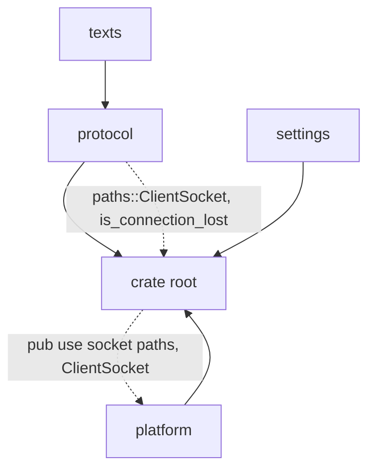

# Base

Base is what Facade's programs share: both protocols, everything that differs between operating
systems, the settings file, and the texts a model reads. It is a library with no state of its own
to speak of, so every other crate can depend on it and it depends on none of them. Crate
`facade-base`, folder `core/crates/base/`.

## Owns

- The daemon protocol and the keeper protocol: their types, operation and topic names, line
  framing and error envelope. `core/protocol/` (`PROTOCOL.md`, `protocol.schema.json`,
  `protocol.ts`, `KEEPER.md`) is generated from them.
- The Facade home's location (`FACADE_HOME`, else `~/.facade`) and the key that names its sockets.
- The services' sockets: on macOS and Linux the socket folder `/tmp/facade-core-<uid>/` and
  `keeper-<key>.sock` and `daemon-<key>.sock` in it; on Windows the named pipes
  `\\.\pipe\facade-core-keeper-<key>` and `\\.\pipe\facade-core-daemon-<key>`, which let in
  their owner alone.
- `core/keeper.lock` and `core/daemon.lock`, and the record in each; `core/logs/` as the services'
  standard error.
- `core/bin/`: each build's `facade` and `facade-mcp` in a folder named after the build, with the
  ConPTY package in its `conpty/` on Windows, and the two launchers that point at the current
  build: symbolic links on Unix, copies on Windows.
- The process-wide `FORK_LOCK`, under which children start.
- Reading `facade.json`. Nothing in core writes it.
- The instructions, skill and tool definitions a model reads.

## Keeps

- Dependencies inside the crate run one way: texts uses protocol; protocol, platform and settings
  use only the crate root; platform never uses protocol, and protocol uses of platform only
  `paths::{ClientSocket, is_connection_lost}`, which the root re-exports.
- Every branch by operating system in the crate is in `platform/`, and outside it only `rules`
  reads `system::SYSTEM`. Each public module of platform has the same items with the same
  signatures on every system, unless its documentation says an item is Unix's or Windows' alone.
- One limit for a protocol line, `MAX_LINE_BYTES` (64 MiB, newline included), for both protocols
  and for lines that carry descriptors.
- A build takes over from a running one only when both versions are three numbers and its own are
  higher (`takes_over`). The command that asks and the daemon that is asked both decide by it.
- The files in `core/protocol/` are exactly what the types generate; the `protocol_files` test
  fails on any difference.
- Each public path has one place: a module moved inside the crate is re-exported at the root, never
  reachable by a second public path.

## Never does

- Depends on another Facade crate.
- Names a CLI in non-test code, or branches by CLI, outside the texts a model reads.
- Starts a thread, opens the store, or keeps runtime state beyond `FORK_LOCK`, the build a test
  plays, on Linux whether process descriptors work, found once, and on Windows the terminal I/O
  thread with its completion port, started on first use.
- Writes `facade.json`.

## Interface

The public paths are `facade_base::<module>`. Grouped by who calls them:

**Every program**
- `build_id()`, `version()`, `VERSION`, `version_of(build)`, `takes_over(newer, running)`;
  `take_test_build()` first in `main`, and `this_program()`, for tests that make a program play
  another build: through a script, or without one through a file beside the program, its name and
  `TEST_BUILD_SUFFIX`, which `install` and `point_launchers_at` carry with it.
- `paths::{facade_home, core_dir, home_key, daemon_socket, keeper_socket, daemon_socket_for,
  keeper_socket_for}`, `socket_dir` on Unix; `paths::ClientSocket`, a blocking client's end
  (Unix's `UnixStream`; on Windows a named pipe's, which checks the server's user), and
  `paths::is_connection_lost(error)`.
- `system::{SYSTEM, System, env_var, home_folder_in}`: which system this is (rules alone reads
  it), a variable by the system's rule for names, and the home folder programs use.
- `log::write(program, level, message)`: one line on standard error.
- `time::{iso_time, iso_now, parse_iso_time}`: UTC, to the millisecond.
- `process::{ProcessIdentity, ProcessExit, ProcessState, EndReason}`.
- `random_u64()`.

**The keeper and the daemon** (services)
- `service`: `create_private_home`, `lock_home(core, Service)`, `lock_record`, `live_holder`,
  `launch(service, program, words) -> Candidate` and `Candidate::into_process() ->
  ServiceProcess`, `StartupChannel`, `RestartBackoff`, `close_inherited(keep)`,
  `authenticate_server(socket, core, service)`, `termination_requested()`, `redirect_stderr(file)`,
  and test gates (`gate_for_test`, `mark_for_test`, `pause_for_test`). Unix only: `authenticate`,
  `peer`, `close_inherited_fds`, `lock_keeper_if_unowned`; Windows only: `authenticate_client`.
- `unix_process` (named before Windows): identities and births, `presence`, `ProcessObservation`
  with `until_ended` and `wait_for_end`, `environment(identity)`, `calling_program_of(pid)`,
  `boot_time`, `signal_number(name)`, `fork_lock()`. Unix only: process groups
  (`group_members`, `signal_group`), `reap_child`, `peer_pid(socket)`; Windows only: `WaitPacket`,
  and `AsHandle` and `exit` on `ProcessObservation`.
- `terminal`: `PtyMaster`, the side of a terminal Facade holds (a PTY master on Unix; on Windows a
  pseudo console's input, output and signal pipe ends and the CLI's job); `PtyIo`, how the daemon
  reads and writes one, with `stop_reading` and `let_go_before_stop`; `PASTE_BYTES_PER_MS`;
  `key_down_records`; `test_terminal`.
- `terminal_lines::{LineSender, LineReceiver}`: keeper lines that may carry a terminal; on Unix
  over `descriptors::{send_line, DescriptorLines}` (Unix only), on Windows as the line's
  `terminal` member, with `PeerProcess`, `add_terminal` and `take_terminal` for the keeper.
- `sockets::{DaemonListener, ServerSocket, ServerReader, ServerWriter, ServerPeer, pair}`: the
  daemon's side of its socket; `server_pipe` on Windows, for the keeper.
- `limits::raise_open_files()`, which does nothing on Windows.
- `keeper`: the keeper protocol's types and operations; see
  [KEEPER.md](../../../core/protocol/KEEPER.md).
- `jsonrpc`: the framing and errors both protocols share (below).

**The daemon**
- `daemon`: the daemon protocol's types, operations and topics; see
  [PROTOCOL.md](../../../core/protocol/PROTOCOL.md). Also the shared checks and texts the protocol
  defines: `check_message_text`, `display_name`, `typed_text`, `start_result_text`,
  `is_session_id`, `location_id`, `agents_word`, `plain`.
  `WindowDescription` carries optional `colors: TerminalColors` and `env`: the terminal colors
  its agents reply to OSC 10, 11 and 12 with, and the environment whose `PATH` gives an `ide`
  client each window's `WindowInfo.clis` and `settings_problem`. A missing color gets no reply;
  without `env`, those window fields are omitted for an `ide` client. `CliInfo.not_installed`
  marks a built-in CLI whose program is not found, so a client may leave it out of its list.
  The environment stays in memory alone. `StartArgs.session` continues a CLI session as a new agent, with its own number;
  a resume keeps the agent's ID. `HelloParams.numbers_given: NumbersGiven` lets an `ide` client
  report the highest agent and message numbers its editor gave, so future numbers exceed them.
- `jsonrpc`: `Request`, `Response`, `Notification`, `ErrorBody` with one constructor per reason
  (`invalid_argument`, `refused`, `internal`, …), `Reason`, `read_request`, `encode_line`,
  `decode_arguments`, `MAX_LINE_BYTES`.
  `ErrorData.entry` names the settings entry behind a refused start or resume, so an editor can
  offer to open the settings file; a model or effort the start chose itself sets no entry.
- `operations::{Operation, Topic, NoArgs, EmptyResult}`.
- `programs`: `install`, `install_running`, `point_launchers_at(build, running)`, `launcher`,
  `Held` (`open`, `restore`, `facade_mcp`, `facade_launcher`), and path lookup:
  `program_of(command, env, cwd)`, `on_path(program, path, folder)`, `runnable(file)`,
  `direct_command(program, env, cwd)`, `program_name(path)`; `command(program)`, which opens no
  window on Windows;
  `CONPTY_FOLDER`; on Windows, `quoted_command` for the keeper.
- `files`: `create_private_file`, `create_private_folder(_all)`, `private_options`,
  `make_private`, `is_private` (Unix modes; nothing on Windows, where files inherit their folder's
  access), `sync_folder`, `real_path`, `folder_key`.
- `settings::{read, settings_file, shown, is_space, Settings}`.
- `instructions::{for_agent, for_guest, for_mcp_client, place_of, Place, Run}`;
  `skill::text()`; `tools::DEFINITIONS`.

**The `facade` program**
- `daemon_client::{DaemonClient, Identity, environment, takeover_timeout}`: a blocking client
  that connects, says hello, calls, watches, and reconnects to a daemon that took over.
- `programs::{install_running, current_build, point_launchers_at, launcher}`;
  `service::{create_private_home, launch, live_holder}` to start the keeper;
  `unix_process::calling_program()` for a hook's CLI.
- `console::{VtModes, ConsoleReader, ConsoleSignals}`: what attach needs of the person's console
  beside crossterm's size and raw mode.

**Rules**
- `settings::{Settings, Member, Json, is_space}`: rules reads the CLI entries of `clis`.
- `skill::text()`, which rules writes into a run's tools, and a few protocol types
  (`daemon::InputMechanism`, `InputInfo`, `InputState`, `HiddenRows`, `is_session_id`).

**The relay** uses nothing of base; see [relay.md](relay.md).

**Files and variables it reads**: `FACADE_HOME`, `HOME`, `USERPROFILE`; `FACADE_BUILD` at compile
time; in debug builds, `FACADE_TEST_BUILD` and `FACADE_TEST_PROGRAM`.

## Depends on

No Facade crate. `serde`, `serde_json` and `schemars` for the protocol types; `tokio` for the
daemon's terminals, socket and process ends; on Unix `nix`, `libc` and `signal-hook`, on Windows
`windows-sys`, for the platform; `sha2` for the home key; `base64` for terminal bytes; `unicode-segmentation` for
display text.

## Inside

The crate root holds what all four parts use: which build this is (`build.rs`), the process types
both protocols carry (`process.rs`), the home and its key (`paths.rs`), the line limit
(`line.rs`), timestamps (`time.rs`) and the log line (`log.rs`). It declares the four parts as
private modules and re-exports their modules at the root, so callers see one flat
`facade_base::<module>` namespace.

The root re-exports the socket paths, the client's socket and `is_connection_lost` from platform
under `paths`, so a caller finds the home and its sockets in one module, and protocol's daemon
client reaches the socket through the root alone. That is the only place the root uses a part.

There are no handles or events: each part is plain functions and types, and a part reaches
another only by the one-way imports above. The one thread is platform's terminal I/O thread on
Windows.

### protocol

The two protocols' types and framing, and a blocking daemon client. `core/crates/base/src/protocol/`
and the tests in `core/crates/base/tests/`.
- **Owns:** the daemon protocol (`daemon.rs`), the keeper protocol (`keeper.rs`), JSON-RPC lines
  and errors (`jsonrpc.rs`), typed operations and topics (`operations.rs`), terminal bytes as
  base64 (`base64.rs`), and `guide.md`, the prose of `PROTOCOL.md`.
- **Keeps:** each convention is defined once; one message per line, never longer than
  `MAX_LINE_BYTES`; `core/protocol/` matches the types byte for byte. A client keeps its socket
  and identity, so it can reach the daemon that takes over; a call whose request ID makes it safe
  to repeat, such as a send or a start, goes again to the daemon that responds next.
- **Never does:** touches processes, locks, the socket folder or file permissions; uses platform
  but `paths::{ClientSocket, is_connection_lost}`, settings or texts.
- **Interface:** the `daemon`, `keeper`, `jsonrpc`, `operations`, `base64` and `daemon_client`
  modules above. The tests generate `core/protocol/` (`FACADE_REGENERATE=1 cargo test -p
  facade-base --test protocol_files`) and check the guide's examples.

### platform

What Facade asks of the operating system. `core/crates/base/src/platform/`.
- **Owns:** which system this is (`system.rs`); the socket paths and the client's socket
  (`socket_paths.rs`); the daemon's listener (`sockets.rs`); the services' locks, logs and start
  (`service.rs`); `core/bin/` (`programs.rs`); process observation, groups, environments and
  `FORK_LOCK` (`unix_process.rs`); terminals (`terminal.rs`); on Windows, the terminal I/O
  thread, its completion port and wait completion packets (`io_thread.rs`); keeper lines that
  carry a terminal (`terminal_lines.rs`) and, on Unix, descriptors over sockets (`descriptors.rs`);
  the person's console (`console.rs`); private files
  and folder keys (`files.rs`); the open-file limit (`limits.rs`); random bytes (`random.rs`).
- **Keeps:** every branch by system in the crate is here: Linux, macOS and Windows. Each module's
  file is its face, the same on every system; each system's code is beside it, in
  `<module>/unix.rs` and `<module>/windows.rs`, or in the face itself for the Unix code that was
  there before Windows. On Windows the terminal I/O thread, one thread shared by every terminal, around one
  completion port, takes terminal reads and writes and `until_ended`'s wait completion packets.
  Both `terminal` and `unix_process` use the private `io_thread` module, which uses neither;
  `unix_process` re-exports its `WaitPacket` for the keeper. Received descriptors are close-on-exec
  before any child can start: atomically on Linux, under
  `FORK_LOCK` elsewhere. A process is known by its ID and birth, never its ID alone, and a group
  is signalled only while a member shows it is the same group. The socket folder is this user's
  alone (0700), and on Windows each pipe lets in its owner alone and a client checks the server's
  user. On Unix the home, `core/` and `core/logs/` must be this user's and writable by no one
  else, or a service refuses to start in them; on Windows they inherit their folders' access. A run is only ever given a
  launcher's path, never a build's program, so its next hook or MCP server is the current build's.
  Installed programs and Windows launchers are refreshed when their bytes differ, even with the
  same build ID.
  `Held` puts back what the person deleted in the `core/bin/` it opened the build from, never in
  another home's.
- **Never does:** uses protocol, settings or texts. The lock record is written with `serde_json`
  directly, not through the protocol's framing.
- **Interface:** the `system`, `service`, `unix_process`, `terminal`, `terminal_lines`,
  `sockets`, `descriptors`, `programs`, `files`, `console` and `limits` modules above, and the
  socket paths and client's socket through `paths`.

### settings

`facade.json`, read strictly. `core/crates/base/src/settings.rs`.
- **Owns:** reading `<home>/facade.json`: JSON with comments and trailing commas. It keeps `yolo`
  (true unless the file says false), `names`, and the members of `clis` in the file's order.
- **Keeps:** a file that is missing, or holds only spaces and comments, holds every default.
  Anything else Facade cannot read stops every start, each problem said with the file's path, line
  and column; nothing is guessed and no default stands in.
- **Never does:** writes the file; interprets a CLI entry (rules reads them from `clis`).
- **Interface:** `read() -> Result<Settings, String>`, `read_file`, `parse(text, shown)`,
  `settings_file()`, `shown(file)`, `is_space(char)`, `Settings`, and the parsed JSON (`Json`,
  `Node`, `Member`) that rules reads entries from.

### texts

What a model reads. `core/crates/base/src/texts/`.
- **Owns:** the instructions Facade's MCP server responds to `initialize` with (`instructions.rs`),
  Facade's skill (`skill.rs`), and the eight tools' definitions as `tools/list` lists them
  (`tools.json`, exposed as `tools::DEFINITIONS`).
- **Keeps:** three readers get instructions: an agent Facade runs (`for_agent`, with where it
  works, its creator and its YOLO), a guest in a terminal of its own (`for_guest`), and an MCP
  client that joined as a guest (`for_mcp_client`, with its ID, name and waiting messages). The
  sentences they share are written once. The skill repeats no sentence of the instructions or the
  tool descriptions, and ends with the version that wrote it.
- **Never does:** reaches the daemon: the daemon's MCP server reads an agent's run and passes it
  in as `Run`. Uses platform or settings.
- **Interface:** `instructions::{for_agent, for_guest, for_mcp_client, place_of, Place, Run}`,
  `skill::{text, DESCRIPTION, DESCRIPTION_PREFIX, REPEATED_MESSAGE}`, `tools::DEFINITIONS`.
  The tools themselves are described in [MCP.md](../../extension/engineering/MCP.md).

## Reading the code

1. `core/crates/base/src/lib.rs`: the parts and the public modules.
2. `src/protocol/daemon.rs`: `visit_operations` and `visit_topics`, then the types each names.
3. `src/protocol/jsonrpc.rs`: `ErrorBody`, `Reason`, `read_request`, `encode_line`.
4. `src/platform/service.rs`: `lock_home`, `launch`, `StartupChannel`; then `programs.rs`:
   `point_launchers_at`, `Held`.
5. `src/platform/unix_process.rs`: `ProcessObservation`, `signal_group`.
6. `src/texts/instructions.rs`: `for_agent`; `tests/protocol_files.rs` for how `core/protocol/`
   is made.
