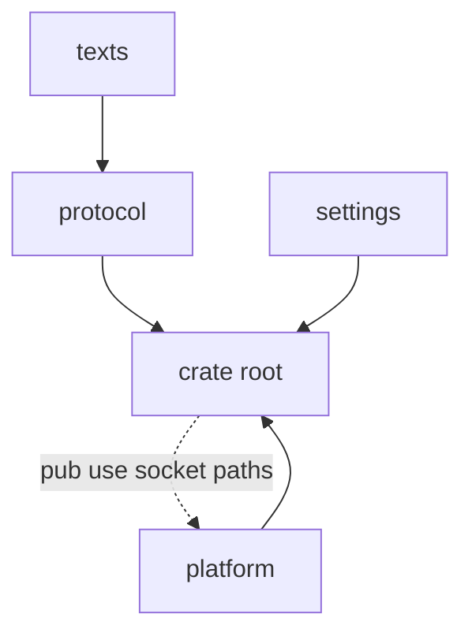

# Base

Base is what Facade's programs share: both protocols, everything that differs between operating
systems, the settings file, and the texts a model reads. It is a library with no state of its own
to speak of, so every other crate can depend on it and it depends on none of them. Crate
`facade-base`, folder `core/crates/base/`.

## Owns

- The daemon protocol and the keeper protocol: their types, operation and topic names, line
  framing and error envelope. `core/protocol/` (`PROTOCOL.md`, `protocol.schema.json`,
  `protocol.ts`, `KEEPER.md`) is generated from them.
- The Facade home's location (`FACADE_HOME`, else `~/.facade`) and the key that names its sockets.
- The socket folder `/tmp/facade-core-<uid>/` and the sockets in it,
  `keeper-<key>.sock` and `daemon-<key>.sock`.
- `core/keeper.lock` and `core/daemon.lock`, and the record in each; `core/logs/` as the services'
  standard error.
- `core/bin/`: each build's `facade` and `facade-mcp` in a folder named after the build, and the
  two launchers that point at the current build.
- The process-wide `FORK_LOCK`, under which children start.
- Reading `facade.json`. Nothing in core writes it.
- The instructions, skill and tool definitions a model reads.

## Keeps

- Dependencies inside the crate run one way: texts uses protocol; protocol, platform and settings
  use only the crate root; protocol and platform never use each other.
- Every branch by operating system in the crate is in `platform/`.
- One limit for a protocol line, `MAX_LINE_BYTES` (64 MiB, newline included), for both protocols
  and for lines that carry descriptors.
- A build takes over from a running one only when both versions are three numbers and its own are
  higher (`takes_over`). The command that asks and the daemon that is asked both decide by it.
- The files in `core/protocol/` are exactly what the types generate; the `protocol_files` test
  fails on any difference.
- Each public path has one place: a module moved inside the crate is re-exported at the root, never
  reachable by a second public path.

## Never does

- Depends on another Facade crate.
- Names a CLI in non-test code, or branches by CLI, outside the texts a model reads.
- Starts a thread, opens the store, or keeps runtime state beyond `FORK_LOCK`, the build a test
  plays, and on Linux whether process descriptors work, found once.
- Writes `facade.json`.

## Interface

The public paths are `facade_base::<module>`. Grouped by who calls them:

**Every program**
- `build_id()`, `version()`, `VERSION`, `version_of(build)`, `takes_over(newer, running)`;
  `take_test_build()` first in `main`, and `this_program()`, for tests that make a program play
  another build.
- `paths::{facade_home, core_dir, home_key, daemon_socket, keeper_socket, daemon_socket_for,
  keeper_socket_for, socket_dir}`.
- `log::write(program, level, message)`: one line on standard error.
- `time::{iso_time, iso_now, parse_iso_time}`: UTC, to the millisecond.
- `process::{ProcessIdentity, ProcessExit, ProcessState, EndReason}`.
- `random_u64()`.

**The keeper and the daemon** (services)
- `service`: `create_private_home`, `lock_home(core, Service)`, `lock_record`, `live_holder`,
  `authenticate`, `peer`, `launch(service, program, words) -> Candidate`, `StartupChannel`,
  `RestartBackoff`, `close_inherited_fds`, `redirect_stderr(file)`, and test gates
  (`gate_for_test`, `mark_for_test`, `pause_for_test`).
- `unix_process`: identities and births, `presence`, `ProcessObservation` and `wait_for_end`,
  process groups (`group_members`, `signal_group`), `reap_child`, `environment(identity)`,
  `calling_program_of(pid)`, `peer_pid(socket)`, `boot_time`, `fork_lock()`.
- `descriptors::{send_line, DescriptorLines}`: lines with PTY descriptors attached.
- `limits::raise_open_files()`.
- `keeper`: the keeper protocol's types and operations; see
  [KEEPER.md](../../../core/protocol/KEEPER.md).
- `jsonrpc`: the framing and errors both protocols share (below).

**The daemon**
- `daemon`: the daemon protocol's types, operations and topics; see
  [PROTOCOL.md](../../../core/protocol/PROTOCOL.md). Also the shared checks and texts the protocol
  defines: `check_message_text`, `display_name`, `typed_text`, `start_result_text`,
  `is_session_id`, `location_id`, `agents_word`, `plain`.
- `jsonrpc`: `Request`, `Response`, `Notification`, `ErrorBody` with one constructor per reason
  (`invalid_argument`, `refused`, `internal`, …), `Reason`, `read_request`, `encode_line`,
  `decode_arguments`, `MAX_LINE_BYTES`.
- `operations::{Operation, Topic, NoArgs, EmptyResult}`.
- `programs`: `install`, `install_running`, `point_launchers_at(build, running)`, `launcher`,
  `Held` (`open`, `restore`, `facade_mcp`, `facade_launcher`), and path lookup:
  `program_of(command, env, cwd)`, `on_path(program, path, folder)`, `runnable(file)`.
- `files::create_private_file(path)`.
- `settings::{read, settings_file, shown, is_space, Settings}`.
- `instructions::{for_agent, for_guest, for_mcp_client, place_of, Place, Run}`;
  `skill::text()`; `tools::DEFINITIONS`.

**The `facade` program**
- `daemon_client::{DaemonClient, Identity, environment, takeover_timeout}`: a blocking client
  that connects, says hello, calls, watches, and reconnects to a daemon that took over.
- `programs::{install_running, current_build, point_launchers_at, launcher}`;
  `service::{create_private_home, launch, live_holder}` to start the keeper;
  `unix_process::calling_program()` for a hook's CLI.

**Rules**
- `settings::{Settings, Member, Json, is_space}`: rules reads the CLI entries of `clis`.
- `skill::text()`, which rules writes into a run's tools, and a few protocol types
  (`daemon::InputMechanism`, `InputInfo`, `InputState`, `HiddenRows`, `is_session_id`).

**The relay** uses nothing of base; see [relay.md](relay.md).

**Files and variables it reads**: `FACADE_HOME`, `HOME`, `USERPROFILE`; `FACADE_BUILD` at compile
time; in debug builds, `FACADE_TEST_BUILD` and `FACADE_TEST_PROGRAM`.

## Depends on

No Facade crate. `serde`, `serde_json` and `schemars` for the protocol types; `nix` and `libc` for
the platform; `sha2` for the home key; `base64` for terminal bytes; `unicode-segmentation` for
display text.

## Inside

The crate root holds what all four parts use: which build this is (`build.rs`), the process types
both protocols carry (`process.rs`), the home and its key (`paths.rs`), the line limit
(`line.rs`), timestamps (`time.rs`) and the log line (`log.rs`). It declares the four parts as
private modules and re-exports their modules at the root, so callers see one flat
`facade_base::<module>` namespace.

The root re-exports the socket paths from platform under `paths`, so a caller finds the home and
its sockets in one module. That is the only place the root uses a part.

There are no handles, events or threads: each part is plain functions and types, and a part
reaches another only by the one-way imports above.

### protocol

The two protocols' types and framing, and a blocking daemon client. `core/crates/base/src/protocol/`
and the tests in `core/crates/base/tests/`.
- **Owns:** the daemon protocol (`daemon.rs`), the keeper protocol (`keeper.rs`), JSON-RPC lines
  and errors (`jsonrpc.rs`), typed operations and topics (`operations.rs`), terminal bytes as
  base64 (`base64.rs`), and `guide.md`, the prose of `PROTOCOL.md`.
- **Keeps:** each convention is defined once; one message per line, never longer than
  `MAX_LINE_BYTES`; `core/protocol/` matches the types byte for byte. A client keeps its socket
  and identity, so it can reach the daemon that takes over; a call whose request ID makes it safe
  to repeat, such as a send or a start, goes again to the daemon that responds next.
- **Never does:** touches processes, locks, the socket folder or file permissions; uses platform,
  settings or texts.
- **Interface:** the `daemon`, `keeper`, `jsonrpc`, `operations`, `base64` and `daemon_client`
  modules above. The tests generate `core/protocol/` (`FACADE_REGENERATE=1 cargo test -p
  facade-base --test protocol_files`) and check the guide's examples.

### platform

What Facade asks of the operating system. `core/crates/base/src/platform/`.
- **Owns:** the socket folder and socket paths (`sockets.rs`); the services' locks, logs and start
  (`service.rs`); `core/bin/` (`programs.rs`); process observation, groups, environments and
  `FORK_LOCK` (`unix_process.rs`); descriptors over sockets (`descriptors.rs`); private files
  (`files.rs`); the open-file limit (`limits.rs`).
- **Keeps:** every branch by system in the crate is here, Linux and macOS both. Received
  descriptors are close-on-exec before any child can start: atomically on Linux, under
  `FORK_LOCK` elsewhere. A process is known by its ID and birth, never its ID alone, and a group
  is signalled only while a member shows it is the same group. The socket folder is this user's
  alone (0700). The home, `core/` and `core/logs/` must be this user's and writable by no one
  else, or a service refuses to start in them. A run is only ever given a
  launcher's path, never a build's program, so its next hook or MCP server is the current build's.
  `Held` puts back what the person deleted in the `core/bin/` it opened the build from, never in
  another home's.
- **Never does:** uses protocol, settings or texts. The lock record is written with `serde_json`
  directly, not through the protocol's framing.
- **Interface:** the `service`, `unix_process`, `descriptors`, `programs`, `files` and `limits`
  modules above, and the socket paths through `paths`.

### settings

`facade.json`, read strictly. `core/crates/base/src/settings.rs`.
- **Owns:** reading `<home>/facade.json`: JSON with comments and trailing commas. It keeps `yolo`
  (true unless the file says false), `names`, and the members of `clis` in the file's order.
- **Keeps:** a file that is missing, or holds only spaces and comments, holds every default.
  Anything else Facade cannot read stops every start, each problem said with the file's path, line
  and column; nothing is guessed and no default stands in.
- **Never does:** writes the file; interprets a CLI entry (rules reads them from `clis`).
- **Interface:** `read() -> Result<Settings, String>`, `read_file`, `parse(text, shown)`,
  `settings_file()`, `shown(file)`, `is_space(char)`, `Settings`, and the parsed JSON (`Json`,
  `Node`, `Member`) that rules reads entries from.

### texts

What a model reads. `core/crates/base/src/texts/`.
- **Owns:** the instructions Facade's MCP server responds to `initialize` with (`instructions.rs`),
  Facade's skill (`skill.rs`), and the eight tools' definitions as `tools/list` lists them
  (`tools.json`, exposed as `tools::DEFINITIONS`).
- **Keeps:** three readers get instructions: an agent Facade runs (`for_agent`, with where it
  works, its creator and its YOLO), a guest in a terminal of its own (`for_guest`), and an MCP
  client that joined as a guest (`for_mcp_client`, with its ID, name and waiting messages). The
  sentences they share are written once. The skill repeats no sentence of the instructions or the
  tool descriptions, and ends with the version that wrote it.
- **Never does:** reaches the daemon: the daemon's MCP server reads an agent's run and passes it
  in as `Run`. Uses platform or settings.
- **Interface:** `instructions::{for_agent, for_guest, for_mcp_client, place_of, Place, Run}`,
  `skill::{text, DESCRIPTION, DESCRIPTION_PREFIX, REPEATED_MESSAGE}`, `tools::DEFINITIONS`.
  The tools themselves are described in [MCP.md](../../extension/engineering/MCP.md).

## Reading the code

1. `core/crates/base/src/lib.rs`: the parts and the public modules.
2. `src/protocol/daemon.rs`: `visit_operations` and `visit_topics`, then the types each names.
3. `src/protocol/jsonrpc.rs`: `ErrorBody`, `Reason`, `read_request`, `encode_line`.
4. `src/platform/service.rs`: `lock_home`, `launch`, `StartupChannel`; then `programs.rs`:
   `point_launchers_at`, `Held`.
5. `src/platform/unix_process.rs`: `ProcessObservation`, `signal_group`.
6. `src/texts/instructions.rs`: `for_agent`; `tests/protocol_files.rs` for how `core/protocol/`
   is made.
