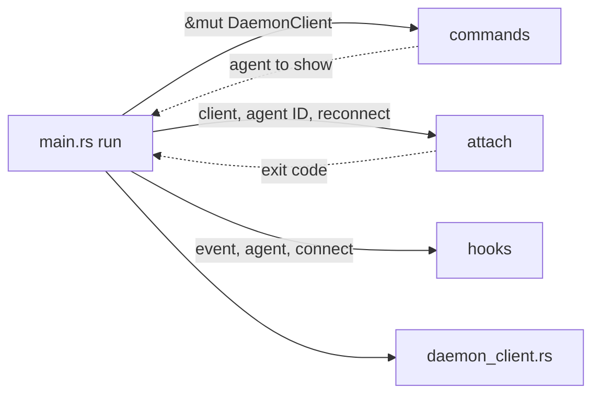

# facade

The `facade` program: the terminal commands that people and agents run, the hooks that CLIs run, and the entry points of the keeper and the daemon. It is the only program a person types. It is its own island because it is a client of the daemon, not part of it. Crate `facade`, folder `core/crates/facade/`, program `facade`.

## Owns

- The program's command line: its commands, arguments, help text and exit codes.
- How a command reaches the daemon: connecting, starting Facade when nothing responds, and taking over from an older build.
- The person's terminal while a command shows an agent (see [attach](#attach)).
- No files of its own. It never opens the database or the daemon's files. Hooks read a run's instructions and skill and write a run's session file (see [hooks](#hooks)).

## Keeps

- Help, argument errors and `--version` need no daemon. `facade start` refuses words it cannot use before it reaches the daemon.
- Every other command that needs the daemon connects first. Where nothing responds, it starts a keeper, and the keeper starts the daemon. One attempt takes at most 10 seconds.
- A command acts for the agent of its terminal: the agent that holds a CLI session its environment names, else `FACADE_AGENT`.
- A build that reaches an older running Facade asks it to let this build take over, waits for a daemon of its own build, and says on one line how it went. A Facade that refuses, or serves on, is used as it is.
- `facade hook …` only talks to a daemon that already runs, never starts Facade, and exits 0 whatever happens. That includes a hook line this build cannot parse.
- A command whose output closes early, as `facade list | head` does, ends quietly: by SIGPIPE on macOS and Linux (`service::default_broken_pipe`), and on Windows through `print_or_end!`. The keeper and the daemon keep treating a closed peer as an error.

## Never does

- Names a CLI or branches on one outside tests. Hook formats and the CLIs' session variables come from [rules](rules.md).
- Opens the database or the daemon's files.
- Branches on the operating system.

## Interface

**People and agents** use the commands: `start`, `stop`, `remove`, `list`, `attach`, `type`, `resume`, `inspect`, `send`, `messages`, `rename`, `screen`, `status` and `integration`. What each does is in [FEATURES.md](../FEATURES.md).

**CLIs** run `facade hook <event>` lines, which [rules](rules.md) writes into a run's settings and into an integration's entries. See [hooks](#hooks).

**Editors and other programs** run `facade daemon --detach` to start Facade in the background. It makes one connection attempt, as a command does. It exits 0 once a daemon responds, or when one is still starting after 10 seconds, with a note. It prints a startup failure and exits 1. The caller confirms with `hello`.

**The services** run from the launcher `core/bin/facade` that [base](base.md) installs: `facade keeper` runs `facade_keeper::serve`, and `facade daemon` runs `facade_daemon::run`. A command starts the keeper with `facade keeper` through the launcher.

**The daemon protocol** ([PROTOCOL.md](../../../core/protocol/PROTOCOL.md)): every command connects as a `terminal` client. It says `hello` with the agent it acts for and the CLI sessions its environment names. It calls `daemon.upgrade` to take over from an older build. The other operations are listed under each child island.

**Exit codes:** 0 for success. 1 for a failure, with `facade: <error>` on standard error. 2 for a usage error, as clap reports it. A command that shows an agent exits with the agent's code, or 128 plus its signal, once the agent ends (see [attach](#attach)). A hook always exits 0.

**Environment:**
- `FACADE_HOME`: the home, read through [base](base.md).
- `FACADE_AGENT`: the agent whose terminal the command runs in.
- Each CLI's session variable, from `facade_rules::SESSION_VARIABLES`: which agent or guest the terminal belongs to.
- In a debug build only, `FACADE_TEST_DAEMON_PROTOCOL` and `FACADE_TEST_KEEPER_PROTOCOL` (`low,high`): the protocol versions a takeover claims, so tests can play another build.

## Depends on

- [base](base.md): the daemon protocol's types, `DaemonClient` and the client's socket (`ClientSocket`); the person's console while attached (`console`); signal numbers (`unix_process::signal_number`); the service locks and starting services (`service`); installing the running build and pointing the launcher at it (`programs`); the home and socket paths; the log; build identity and `takes_over`.
- [rules](rules.md): `SESSION_VARIABLES` and `session_variable`; the `hook` module; the session file, run folder, instructions and skill file names.
- [keeper](keeper.md): `serve`. [daemon](daemon.md): `run`.
- Third-party: anyhow, clap, crossterm, serde, serde_json, unicode-width.

## Inside

The layer is `main.rs` and `daemon_client.rs`. `main.rs` parses the arguments and `run` hands each command to one child island. The children never call each other. They report back through return values.

What `run` does for each kind of command:

- **start, resume:** `commands::start_words` checks the words first (start only). If standard input and output are both terminals, `attach::terminal_size` gives the first frame's size. Then `run` connects and calls `commands::start` or `commands::resume`. If one returns an agent, `run` passes the same connection to `attach::attach`.
- **attach:** connect, then `attach::attach(client, agent, &attempt)`.
- **messages:** `agent_of_terminal` finds the terminal's agent, or the command fails saying this is no agent's terminal. Then `run` connects as that agent and calls `commands::messages`.
- **other commands:** connect, then the matching function in commands.
- **hook:** `hooks::run(event, FACADE_AGENT, connect)`, where `connect` reaches a running daemon only, acting for `FACADE_AGENT`, and gives `None` after 2 seconds.
- **keeper, daemon:** call the service; `daemon --detach` calls `daemon_client::detach`.
- **A hook line this build cannot parse:** `main` logs a warning and prints the first `facade_rules::hook::empty_output` its words give. Then it exits 0.

Shared with the children:

- `ConnectFailure`: why one attempt failed. `Timeout` means another attempt may succeed, `Permanent` means it will not, and `Cancelled` means the caller gave up.
- `Reconnect`: the type of the function attach reconnects with, `daemon_client::attempt`.
- `print_or_end!` and `println_or_end!`: every print to standard output. A reader that went away, as `head` once it has its lines, ends the command quietly with code 0; on macOS and Linux SIGPIPE ends it first, and Windows, without SIGPIPE, fails the write instead.
- `ExitText`: an agent's exit as a person reads it: `code 3`, the signal's name, or why neither is known. A code outside 0–255, as a Windows status, shows its 32 bits in hex: `code 0xC000013A`.

`daemon_client.rs` reaches the daemon:

- `reach` tries to connect every 25 ms until its 10-second deadline. While nothing responds, it reads what a keeper it started has reported so far. A keeper that lost the lock to another is let go, and the attempt waits for the other keeper's daemon. A keeper that exits before it reports fails the attempt, with the last line of `keeper.log`, which says why. Facade starts a keeper only when nothing holds the daemon lock and no keeper runs, because a daemon holding the lock may be recovering. Starting one installs the running build, and points the launcher at it where the launcher names no build, one this build takes over from, or one without a version. Then it starts `facade keeper`.
- `StartedKeeper` waits for the keeper's process on a thread however the attempt ends, so it never stays a zombie.
- `attempt_as` follows `reach` with a takeover check. If `takes_over(ours, theirs)`, it sends `daemon.upgrade` with this program, its build and its protocol ranges. Then it reaches the daemon again until one of this build responds, within base's `takeover_timeout`. If the old build responds instead, the takeover failed, and the command goes on with the old build.
- The identity: `attempt` and `agent_of_terminal` send `FACADE_AGENT` and the CLI sessions. `connect_or_start_for` and `connect_running` send only the agent.

A command runs on one thread. attach adds its own threads (see [attach](#attach)). A hook reads its input on a thread so that it can stop waiting after one second.

### commands

`src/commands.rs`: the terminal commands that ask the daemon something. Each one makes its protocol call on a connection the layer has already made, then prints the result for the person.

- **Owns:** no lasting state. It owns the arguments each command sends and how it prints the result: aligned columns for `facade list`, one fact per line for `facade inspect`, or the protocol's JSON with `--json`. It also collects the environment that `agent.start`, `agent.resume` and the `integration.*` operations carry. Variables that are not UTF-8 are left out, and standard error names them.
- **Keeps:**
  - It reaches the daemon only through the `DaemonClient` it is given.
  - `facade start` takes its own options, `--name` and `--prompt`, only before the CLI's name. The CLI's name and every word after it belong to the CLI.
  - `agent.start` and `agent.send` carry a request ID. If a newer Facade cuts the call off when it takes over, the call is repeated, and the result says what was done.
  - Without the person's terminal, `start` and `resume` print `#aN pid N` and return no agent. With it, they print on standard error how to detach and reconnect, and return the agent to show. The first frame uses the terminal's size, or `DEFAULT_TERMINAL_SIZE` without one.
  - `resume` first warns when the earlier CLI may still be running, because its terminal closed while no Facade service held it.
  - `send` fails, with exit code 1, when the message did not reach the recipient. A message that waits for a guest's next turn is not a failure.
- **Never does:** connect to or start the daemon; show an agent or change terminal modes; read hook input; work out which agent a terminal belongs to.
- **Interface:** only `run` calls it. Every call blocks until the daemon responds.
  - `start_words(Vec<String>) -> Result<StartWords>`, then `start(&mut DaemonClient, StartWords, Option<(u16, u16)>) -> Result<Option<String>>`. `resume(&mut DaemonClient, agent, Option<(u16, u16)>)` returns the same.
  - `list` and `inspect` take a `Format` (`Text` or `Json`). `screen`, `type_input`, `send`, `messages`, `rename`, `stop` and `remove` take the command's words.
  - `integration(&mut DaemonClient, IntegrationAction)`, where `IntegrationAction` is `Add { cli }`, `Remove { cli }` or `List`.
  - `status(&DaemonClient)` prints the `hello` result: the build, the daemon's pid, the agent count and the keeper.
  - Operations it calls: `agent.start`, `agent.resume`, `agent.inspect`, `agent.screen`, `agent.type`, `agent.send`, `agent.rename`, `agent.stop`, `agent.remove`, `integration.add`, `integration.remove` and `integration.list`. Topics it reads one snapshot of: `agents` and `messages`.

### attach

`src/attach.rs`: shows one agent's terminal in the person's terminal and sends the person's keys and size changes to it. It reconnects by agent ID until the person detaches or the agent ends.

- **Owns:**
  - The person's console while attached: raw mode and the console's VT modes (`facade_base::console::VtModes`), whether the agent's output switched to the alternate screen, and a lock that every write and the restoration take. These are statics that no other code touches.
  - The key queue, `AgentInput`: keys and resizes in the order they happened, the current connection, a connection being opened, and whether the attachment has ended.
  - The screen watch it opens on each connection.
  - Its threads. The caller's thread draws the screen and reconnects. One thread reads the person's keys and, on Windows, the console's size changes, through `facade_base::console::ConsoleReader`. One thread writes the queue as `agent.type` and `agent.resize` notifications, and never holds the queue's lock while it writes. One thread follows `facade_base::console::ConsoleSignals`: a size change (SIGWINCH) queues a resize; SIGTERM, SIGHUP, SIGINT and SIGQUIT restore the terminal and exit with 128 plus the signal's number. On Windows it has nothing to follow and ends at once.
- **Keeps:**
  - Every end restores the person's terminal exactly once, with the note after the restoration. The ends are a detach, the agent ending, its removal, a termination signal and an error. Once the terminal is restored, no more of the agent's output is written.
  - Ctrl-] detaches, in plain input, in the kitty encoding, and as a win32-input-mode key-down record of the character 0x1D (`CSI <vk>;<sc>;29;1;<cs>;<rc>_`). Keys before it in the same read are still sent, and it waits up to 1 second for them. Signals do not wait.
  - The agent's output goes to the person's console unchanged. On Windows the agent's console host turns win32-input-mode on and off; the person's console follows it, so keys arrive in either form, and go to the agent as they come. The restoration turns win32-input-mode off.
  - While disconnected, at most 1 MiB of keys waits. Keys that do not fit are dropped, and the final note counts them with the keys still waiting.
  - Keys handed to a connection are never sent again, even when the write fails.
  - On a takeover, the keys handed to the old connection are written before its response to `closing`.
  - It reconnects by the agent ID of the first snapshot, never by the name the person typed. Only the first watch includes scrollback.
  - A connect timeout, or a failed resize or watch, is retried every 500 ms for as long as the attachment lasts. A permanent failure ends it ("could not reconnect to Facade; see <logs>"), and so does `not_found`, as a removed agent. Detaching cancels a reconnect in progress, `hello` included.
  - The exit code is 0 after a detach, the agent's own code or 128 plus its signal after it ends, and 1 otherwise.
- **Never does:** connect to the daemon on its own (it only uses the `reconnect` it is given); interpret the CLI's output beyond following the alternate screen.
- **Interface:** only `run` calls it.
  - `terminal_size() -> Option<(u16, u16)>`: the person's terminal size, when both sides are nonzero.
  - `attach(DaemonClient, agent: &str, reconnect: &Reconnect) -> Result<i32>`: blocks until the attachment ends and returns the command's exit code.
  - Operations it calls: `agent.resize` before each watch of the `screen` topic; while attached, `agent.type` and `agent.resize` as notifications.

### hooks

`src/hooks.rs`: runs `facade hook …`, what a CLI's hooks run, both in a run Facade started and in a guest's session, one the person started.

- **Owns:** the hook's input, read from standard input: at most 1 MiB, for at most one second. The writes to a run's session file, through `facade_rules::write_session_file`. The person's own title command, which `title` runs with the same input, through the program and arguments `facade_rules::hook::title_command` gives for it. The run hooks (`session-start <file>`, `title`, `instructions`, `approve`) each have a function of their own. The five guest hooks share `report_guest`, keyed by `GuestEvent`, which makes the one protocol call that event needs.
- **Keeps:**
  - Every hook exits 0 and fails silently. A hook with nothing to say prints nothing, or `hook::empty_output(cli)` for a CLI that reads every hook's output as JSON.
  - It reaches the daemon only through `connect`, so a hook never starts Facade.
  - In a background job of its session (`hook::BACKGROUND_JOB_VARIABLE` set and not empty), `session-start` and the guest hooks do nothing.
  - A session file is written only at an absolute path named `facade_rules::SESSION_FILE`, and `session-start <file>` writes only the run's own session (`hook::is_run_own_session`).
- **Never does:** name a CLI or branch on one: each CLI's input keys, output format and session variable come from `facade_rules::hook` (see [rules](rules.md)). It writes no file but a run's session file, and never stands in the CLI's way.
- **Interface:**
  - For `run`: `HookEvent`, the subcommands `session-start`, `prompt`, `turn-end`, `idle`, `session-end`, `title`, `instructions` and `approve`, and `run(event, agent: Option<&str>, connect: &dyn Fn() -> Option<DaemonClient>)`.
  - Operations it calls: `hook.session-start`, `hook.prompt`, `hook.turn-end`, `hook.idle` and `hook.session-end`. `turn-end` sends `hook.idle` instead for a turn the person cut short. `prompt` adds the CLI's own session status file where the CLI keeps one.
  - Files it reads: for `instructions`, the instructions and skill (`INSTRUCTIONS_FILE`, `SKILL_FILE`) in the run folder of `FACADE_AGENT` under the core folder's `runs`; for `session-start --skill`, the skill beside the session file.
  - Environment it reads: the CLI's session variable (`facade_rules::session_variable`), and the whole environment, which it sends with each guest session for the agents the guest starts.

## Reading the code

1. `main.rs`, `run`: every command and the island it goes to.
2. `daemon_client.rs`, `attempt_as` and `reach`: connecting, starting Facade, taking over.
3. `commands.rs`, `start`: one command from words to output.
4. `attach.rs`, `attach`, then `follow_agent`: showing an agent and reconnecting.
5. `hooks.rs`, `run`, then `report_guest`: the run hooks and the guest hooks.
