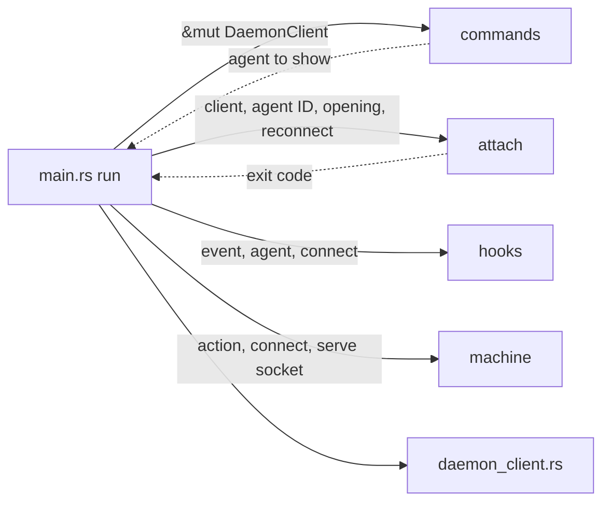

# facade

The `facade` program: the terminal commands that people and agents run, the hooks that CLIs run, and the entry points of the keeper and the daemon. It is the only program a person types. It is its own island because it is a client of the daemon, not part of it. Crate `facade`, folder `core/crates/facade/`, program `facade`.

## Owns

- The program's command line: its commands, arguments, help text and exit codes.
- How a command reaches the daemon: connecting, starting Facade when nothing responds, and taking over from an older build.
- The foreground SSH sessions used to connect a machine and to authenticate a saved connection.
- The person's terminal while a command shows an agent (see [attach](#attach)).
- No files of its own. It never opens the database or the daemon's files. Hooks read a run's instructions and skill and write a run's session file (see [hooks](#hooks)).

## Keeps

- Help, argument errors, `--version`, `version` and `completion` need no daemon. `facade start` refuses an option it does not know before PROGRAM before it reaches the daemon, with exit code 2. `facade` alone prints the root help and exits 0.
- `facade status` makes one connection attempt and never starts Facade or upgrades it.
- Every other command that needs the daemon connects first. Where nothing responds, it starts a keeper, and the keeper starts the daemon. The initial connection can wait up to 10 seconds.
- A command acts for the agent of its terminal: the agent that holds a CLI session its environment names, else `FACADE_AGENT`.
- A build that reaches an older running Facade asks it to let this build take over, waits for a daemon of its own build, and says on one line how it went: a `note:` where it upgraded, a `warning:` where it goes on with the older build. A command can continue on an older daemon that speaks the command's protocol.
- `facade hook …` only talks to a daemon that already runs, never starts Facade, and exits 0 whatever happens. That includes a hook line this build cannot parse.
- A command whose output closes early, as `facade list | head` does, ends quietly: by SIGPIPE on macOS and Linux (`service::default_broken_pipe`), and on Windows through `print_or_end!`. The keeper and the daemon keep treating a closed peer as an error.
- Data goes to standard output; everything for the reader alone goes to standard error. A failure the command knows the cause of prints the catalog's `error:` line and a `tip:` line with the next step; any other failure of the services prints the service's own words without the reason code. No command makes a call only to word an error.
- Every word a person reads has one source: help in `cli.rs` and `help.rs`, errors and the lines on taking over an older Facade in `errors.rs`, output in `commands` and `machine`, the lines around an attachment in `attach`.

## Never does

- Names a CLI or branches on one outside tests. Hook formats and the CLIs' session variables come from [rules](rules.md).
- Opens the database or the daemon's files.
- Branches on the operating system.

## Interface

**People and agents** use the commands, grouped in the root help as Agents (`start`, `list`, alias `ls`, `attach`, `stop`, `resume`, `remove`, alias `rm`, `rename`), Inspect and control (`inspect`, `screen`, `type`), Messages (`send`, `messages`) and Setup and info (`machine`, `integration`, `status`, `version`, `completion`). `machine` has the subcommands `add`, `connect`, `list`, `remove` and `rename`, on its own help page; only a person may run them, except `machine list`. Each command's help prints the same text for `-h`, `--help` and `facade help <command>`. IDs the command line writes itself are bare, as `a3`, and an agent of another machine adds its machine, as `a17@gpu`. What each does is in [FEATURES.md](../FEATURES.md).

**CLIs** run `facade hook <event>` lines, which [rules](rules.md) writes into a run's settings and into an integration's entries. See [hooks](#hooks).

**Editors and other programs** run `facade daemon --detach` to start Facade in the background. It makes one connection attempt, as a command does. It exits 0 once a daemon responds, or when one is still starting after 10 seconds, with a note. It prints a startup failure and exits 1. The caller confirms with `hello`.

**The services** run from the launcher `core/bin/facade` that [base](base.md) installs: `facade keeper` runs `facade_keeper::serve`, and `facade daemon` runs `facade_daemon::run`. A command starts the keeper with `facade keeper` through the launcher.

**The daemon protocol** ([PROTOCOL.md](../../../core/protocol/PROTOCOL.md)) uses a `terminal` hello for ordinary commands, including the local authorization for machine connections. Ordinary hello includes the agent and CLI sessions named by the command's environment. The SSH receiver, `facade machine serve`, forwards the initiating daemon's `machine` hello and the frames that follow.

**Exit codes:** 0 for success, help included. 1 for a failure, with `error: …` on standard error, and for a command given several agents when any of them failed. 2 for a usage error. The hidden commands `hook`, `keeper` and `daemon` keep `facade: <error>`. A command that shows an agent exits with the agent's code, or 128 plus its signal, once the agent ends (see [attach](#attach)). A hook always exits 0.

**Environment:**
- `FACADE_HOME`: the home, read through [base](base.md).
- `FACADE_AGENT`: the agent whose terminal the command runs in.
- Each CLI's session variable, from `facade_rules::SESSION_VARIABLES`: which agent or guest the terminal belongs to.
- In a debug build only, `FACADE_TEST_DAEMON_PROTOCOL` and `FACADE_TEST_KEEPER_PROTOCOL` (`low,high`): the protocol versions a takeover claims, so tests can play another build.

## Depends on

- [base](base.md): the daemon protocol's types, `DaemonClient` and the client's socket (`ClientSocket`); the person's console while attached (`console`); signal numbers (`unix_process::signal_number`); the service locks and starting services (`service`); installing the running build and pointing the launcher at it (`programs`); the home and socket paths; the log; build identity and `takes_over`.
- [rules](rules.md): `SESSION_VARIABLES` and `session_variable`; the `hook` module; the session file, run folder, instructions and skill file names.
- [keeper](keeper.md): `serve`. [daemon](daemon.md): `run`.
- Third-party: anyhow, clap (with `wrap_help`), clap_complete, crossterm, serde, serde_json, unicode-width.

## Inside

The layer is `main.rs`, `cli.rs`, `help.rs`, `errors.rs` and `daemon_client.rs`. `cli.rs` defines the commands and their arguments, builds the help from `help.rs` (the root page's groups, each page's description, alias and examples, with each example's words for the help tests) and writes completion scripts. `errors.rs` holds the error catalog: `Problem`, the classifiers `about_agent`, `about_send`, `about_change`, `about_machine` and `about_connection` that turn a service's refusal and the command's facts into a catalog row, and `report`, which prints any command's error. `main.rs` parses the arguments and `run` hands each command to one child island. The children never call each other. They report back through return values.

What `run` does for each kind of command:

- **start, resume:** `cli::check_start` refuses an option before PROGRAM first (start only). If standard input and output are both terminals, `attach::terminal_size` gives the first frame's size. Then `run` connects and calls `commands::start` or `commands::resume`. If one returns an agent, `run` passes the same connection and `reconnect` to `attach::attach`.
- **attach:** without an interactive terminal it fails at once; else connect, then `attach::attach(client, agent, Opening::Attached, &reconnect)`.
- **status:** `daemon_client::probe` makes one attempt that neither starts nor upgrades Facade, then `commands::status` with the home and the reply, if any.
- **stop, remove:** connect, then `commands::stop` or `remove` with every agent and `errors::report`, which they report each agent's failure through.
- **messages:** `agent_of_terminal` finds the terminal's agent, or the command fails saying this is no agent's terminal. Then `run` connects as that agent and calls `commands::messages`.
- **machine:** `machine::run` gets the ordinary connection function and the function that opens a socket for an SSH session. For `serve` the layer applies the home option before reaching the daemon.
- **other commands:** connect, then the matching function in commands.
- **hook:** `hooks::run(event, FACADE_AGENT, connect)`, where `connect` reaches a running daemon only, acting for `FACADE_AGENT`, and gives `None` after 2 seconds.
- **keeper, daemon:** call the service; `daemon --detach` calls `daemon_client::detach`.
- **A hook line this build cannot parse:** `main` logs a warning and prints the first `facade_rules::hook::empty_output` its words give. Then it exits 0.

Shared with the children:

- `ConnectFailure`: why one attempt failed. `Timeout` means another attempt may succeed, `Permanent` means it will not, and `Cancelled` means the caller gave up.
- `Reconnect`: the type of the function attach reconnects with, `daemon_client::reconnect`.
- `print_or_end!` and `println_or_end!`: every print to standard output. A reader that went away, as `head` once it has its lines, ends the command quietly with code 0; on macOS and Linux SIGPIPE ends it first, and Windows, without SIGPIPE, fails the write instead.
- `ExitText`: an agent's exit as a person reads it: `code 3`, the signal's name, or why neither is known. A code outside 0–255, as a Windows status, shows its 32 bits in hex: `code 0xC000013A`.
- `Opening` and `Shown`: how an attachment began, and the agent `start` or `resume` began, for `attach`'s first line.
- From `errors`: `Problem`, `about_agent`, `about_send` and `bare_id`.

`daemon_client.rs` reaches the daemon:

- `reach_daemon` tries to connect every 25 ms until its deadline, which is 10 seconds for an initial connection. While nothing responds, it reads what a keeper it started has reported so far. A keeper that lost the lock to another is let go, and the attempt waits for the other keeper's daemon. A keeper that exits before it reports fails the attempt, with the last line of `keeper.log`, which says why. Facade starts a keeper only when nothing holds the daemon lock and no keeper runs, because a daemon holding the lock may be recovering. Starting one installs the running build, and points the launcher at it where the launcher names no build, one this build takes over from, or one without a version. Then it starts `facade keeper`.
- `reach` uses an ordinary `DaemonClient` hello. `machine_socket` opens the socket and leaves the machine hello to the SSH session.
- `StartedKeeper` waits for the keeper's process on a thread however the attempt ends, so it never stays a zombie.
- `attempt_as` checks the build after an ordinary hello. If `takes_over(ours, theirs)`, it sends `daemon.upgrade` with this program, its build and its protocol ranges. Then it waits up to base's `takeover_timeout` for its own build. If the old build answers an ordinary hello again, the command reports the failed takeover and goes on with that build.
- `connect_or_start`, `agent_of_terminal` and `reconnect` send `FACADE_AGENT` and the CLI sessions. `connect_or_start_for` and `connect_running` send only the agent.

A command runs on one thread. attach adds its own threads (see [attach](#attach)). A hook reads its input on a thread so that it can stop waiting after one second.

### commands

`src/commands.rs`: the terminal commands that ask the daemon something. Each one makes its protocol call on a connection the layer has already made, then prints the result for the person. Every word it prints follows the command line's copy style: tables with uppercase headers and one row per agent, bare IDs such as `a3`, lowercase state words, relative times, and `-q` and `--json` where a command has them.

- **Owns:** no lasting state. It owns the arguments each command sends and how it prints the result: a table for `facade list` and `facade integration list`, IDs alone for `facade list -q`, aligned labels for `facade inspect` and `facade status`, or the protocol's JSON, pretty-printed, with `--json`. It also collects the environment that `agent.start`, `agent.resume` and the `integration.*` operations carry. Variables that are not UTF-8 are left out, and standard error names them.
- **Keeps:**
  - It reaches the daemon only through the `DaemonClient` it is given.
  - `facade start` takes `--on <machine>` and, with it, `--cwd <path>`: the machine to run on and a folder there. Without `--cwd` the agent starts in this shell's folder here, or in the login user's home on another machine.
  - `agent.start` and `agent.send` carry a request ID. If a newer Facade cuts the call off when it takes over, the call is repeated, and the result says what was done.
  - In the background (`-d`, or without the person's terminal), `start` and `resume` print the agent's bare ID, as `a3` or `a17@gpu`, and return no agent. Otherwise they return the agent to show, by its exact address where it runs on another machine, and how it began, for attach's first line. The first frame uses the terminal's size, or `DEFAULT_TERMINAL_SIZE` without one.
  - `resume` of an agent on another machine sends no environment: the run takes that machine's login environment.
  - `resume` inspects the agent first: a guest, a running agent and a plain program fail with their catalog errors before `agent.resume`, and it warns when the earlier CLI may still be running because its terminal closed.
  - `stop` and `remove` work through their agents in order, print each agent as given once it is done, report each one's failure through the reporter the layer gives them and go on; a failed connection ends the batch. They exit 1 if any failed.
  - `status` reports on the reply the layer's probe got, or says Facade did not respond. It shows this command's version, and a service's build beside its PID where it differs.
  - `send` fails, with exit code 1, when the message did not reach the recipient, or its delivery cannot be confirmed. A message that waits in a guest's inbox is not a failure.
  - `send` to the human prints one line on standard output for each window that showed the message, and a `warning:` for each that did not. Where none showed it, or the windows' outcome is unknown, it fails with a catalog row and exit code 1.
  - `list` asks every machine through `agent.list`; a machine that did not answer gets a `warning:` line, and the table lists the rest.
  - A message to an agent on another machine is numbered there and printed with its machine, as `m42@gpu`; `messages` names a sender on another machine with `on <machine>`.
  - A service's refusal goes through `errors::about_agent` or `about_send`, so it prints as a catalog row where its facts identify one.
- **Never does:** connect to or start the daemon; show an agent or change terminal modes; read hook input; work out which agent a terminal belongs to.
- **Interface:** only `run` calls it. Every call blocks until the daemon responds.
  - `start(&mut DaemonClient, name, prompt, (machine, cwd), command, Option<(u16, u16)>) -> Result<Option<Shown>>`; `resume(&mut DaemonClient, agent, Option<(u16, u16)>)` returns the same.
  - `list` takes a `Listing` (`Table`, `Quiet` or `Json`); `inspect`, `integration`, `status` and `version` take a `Format` (`Text` or `Json`). The JSON of `list` holds the agents and each machine's answer; both carry the protocol's `AgentInfo` with its running machine, window memberships and optional location source. `screen`, `type_input`, `send`, `messages` and `rename` take the command's words.
  - `stop` and `remove(&mut DaemonClient, agents, report) -> Result<i32>`.
  - `integration(&mut DaemonClient, IntegrationAction, Format)`, where `IntegrationAction` is `Add { cli }`, `Remove { cli }` or `List`.
  - `status(home, Option<&DaemonClient>, Format)` and `version(Format)`.
  - Pure renderers that the tests call with a fixed current time: the table, relative times, the state, input-box, tools and part-state words, and each command's text.
  - Operations it calls: `agent.list`, `machine.list`, `agent.start`, `agent.resume`, `agent.inspect`, `agent.screen`, `agent.type`, `agent.send`, `agent.rename`, `agent.stop`, `agent.remove`, `integration.add`, `integration.remove` and `integration.list`. Topics it reads one snapshot of: `messages`.

### machine

`src/machine.rs` presents the machine table and runs temporary connections and the foreground part of saved
connections. It gets the daemon's permission through `machine.connect` before starting SSH. Its two directions carry
machine frames over the same connection. The local daemon's handshake result supplies the machine identity, the
first-connection trust notice and Linux's SSH logout information.

- `machine connect` keeps its session open in the foreground. `machine add` holds the foreground session while a
  separate ordinary call to `machine.add` waits for the daemon to verify its saved session to the same machine ID.
  The foreground relay flushes buffered bytes between the daemon and SSH's pipes as soon as it reads them.
- `machine list` prints a table, one row per machine with this one first: name, `id:` and short ID, version, route
  and the SSH connection saved here; `--json` prints the protocol's list. A saved connection that needs an SSH login
  adds a `warning:` with the command that repairs it, quoted for the shell, or its words one per line where a word
  needs escaping quoting cannot give. `machine remove` removes a saved connection and adds a `note:` where the
  machine still has a route through another machine. `machine rename` prints the machine's ID and new name.
- `add` and `connect` print the trust `note:` on a first connection. `add` prints the saved connection on standard
  output; `connect` says on standard error that it is connected and fails with exit 1 when the connection ends.
  SSH's standard error passes through, and a failure before the machines connect prints a catalog row: SSH's last
  line, `facade` missing there, startup files that print, versions that do not match, or a copied home.
- `machine serve` validates the initiating daemon's machine hello before opening the local socket in the selected
  home. It forwards the hello and reply byte for byte. After the daemon accepts the hello, it copies the remaining
  session traffic through the same buffered readers, flushing each block as it arrives. A transfer error reports
  its direction and kind on standard error.
- When Linux logind is configured to clean up this user's SSH session processes, a `warning:` points to
  `KillExcludeUsers`.

### attach

`src/attach.rs`: shows one agent's terminal in the person's terminal and sends the person's keys and size changes to it. It reconnects by exact agent address until the person detaches or the agent ends.

- **Owns:**
  - The person's console while attached: raw mode and the console's VT modes (`facade_base::console::VtModes`), whether the agent's output switched to the alternate screen, and a lock that every write and the restoration take. These are statics that no other code touches.
  - The key queue, `AgentInput`: keys and resizes in the order they happened, the current connection, a connection being opened, and whether the attachment has ended.
  - The screen watch it opens on each connection.
  - Its threads. The caller's thread draws the screen and reconnects. One thread reads the person's keys and, on Windows, the console's size changes, through `facade_base::console::ConsoleReader`. One thread writes the queue as `agent.type` and `agent.resize` notifications, and never holds the queue's lock while it writes. One thread follows `facade_base::console::ConsoleSignals`: a size change (SIGWINCH) queues a resize; SIGTERM, SIGHUP, SIGINT and SIGQUIT restore the terminal and exit with 128 plus the signal's number. On Windows it has nothing to follow and ends at once.
- **Keeps:**
  - Before the first redraw it writes one line to standard error: `Started a3 (Pixel).`, `Resumed a3 (Pixel).` or `Attached to a3.`, then `Press Ctrl-] to detach.` An agent of another machine is named with its machine, as `a17@gpu`, which a lookup of the machines names.
  - Every end restores the person's terminal exactly once, then writes the result to standard error: `Detached from a3. …`, `a3 exited with code 0.`, `a3 was ended by SIGKILL.`, `a3's terminal closed. …`, `error: a3 was removed`, `error: could not reconnect to Facade` with a tip, or `Attachment ended by SIGTERM.` The ends are a detach, the agent ending, its removal, a termination signal and an error. Once the terminal is restored, no more of the agent's output is written.
  - Ctrl-] detaches, in plain input, in the kitty encoding, and as a win32-input-mode key-down record of the character 0x1D (`CSI <vk>;<sc>;29;1;<cs>;<rc>_`). Keys before it in the same read are still sent, and it waits up to 1 second for them. Signals do not wait.
  - The agent's output goes to the person's console unchanged. On Windows the agent's console host turns win32-input-mode on and off; the person's console follows it, so keys arrive in either form, and go to the agent as they come. The restoration turns win32-input-mode off.
  - While disconnected from an agent of this machine, at most 1 MiB of keys waits. Keys that do not fit are dropped. For an agent of another machine, input pauses: keys typed while disconnected, and keys still waiting when a remote watch ends, are dropped, and attach closes that connection before it reconnects. Either way, a last line, `warning: N bytes you typed were not sent`, counts them.
  - Keys handed to a connection are never sent again, even when the write fails.
  - On a takeover, the keys handed to the old connection are written before its response to `closing`.
  - It reconnects by the exact address of the first snapshot, machine and agent ID, never by the name the person typed. Only the first watch includes scrollback.
  - A connect timeout, or a failed resize or watch, is retried every 500 ms for as long as the attachment lasts; an unreachable machine is retried the same way. While it reconnects, the bottom row reads `Reconnecting to Facade. Recent keys may be lost.`, or for an agent of another machine `Reconnecting to gpu. Keys you type now are not sent.`, with its machine A permanent failure ends it, and so does `not_found`, as a removed agent. Detaching cancels a reconnect in progress, `hello` included.
  - For an agent of another machine, the resize waits until the new snapshot is drawn.
  - The exit code is 0 after a detach, the agent's own code or 128 plus its signal after it ends, and 1 otherwise.
- **Never does:** connect to the daemon on its own (it only uses the `reconnect` it is given); interpret the CLI's output beyond following the alternate screen.
- **Interface:** only `run` calls it.
  - `terminal_size() -> Option<(u16, u16)>`: the person's terminal size, when both sides are nonzero.
  - `attach(DaemonClient, agent: &str, opening: Opening, reconnect: &Reconnect) -> Result<i32>`: blocks until the attachment ends and returns the command's exit code. A failure before the screen shows, such as a missing agent, goes through `errors::about_agent`.
  - Pure renderers for the tests: `opening_line`, `result_line` and `unsent_line`.
  - Operations it calls: `agent.resize` before each watch of the `screen` topic; while attached, `agent.type` and `agent.resize` as notifications.

### hooks

`src/hooks.rs`: runs `facade hook …`, what a CLI's hooks run, both in a run Facade started and in a guest's session, one the person started.

- **Owns:** the hook's input, read from standard input: at most 1 MiB, for at most one second. The writes to a run's session file, through `facade_rules::write_session_file`. The person's own title command, which `title` runs with the same input, through the program and arguments `facade_rules::hook::title_command` gives for it. The run hooks (`session-start <file>`, `title`, `instructions`, `approve`) each have a function of their own. The five guest hooks share `report_guest`, keyed by `GuestEvent`, which makes the one protocol call that event needs.
- **Keeps:**
  - Every hook exits 0 and fails silently. A hook with nothing to say prints nothing, or `hook::empty_output(cli)` for a CLI that reads every hook's output as JSON.
  - It reaches the daemon only through `connect`, so a hook never starts Facade.
  - In a background job of its session (`hook::BACKGROUND_JOB_VARIABLE` set and not empty), `session-start` and the guest hooks do nothing.
  - A session file is written only at an absolute path named `facade_rules::SESSION_FILE`, and `session-start <file>` writes only the run's own session (`hook::is_run_own_session`).
- **Never does:** name a CLI or branch on one: each CLI's input keys, output format and session variable come from `facade_rules::hook` (see [rules](rules.md)). It writes no file but a run's session file, and never stands in the CLI's way.
- **Interface:**
  - For `run`: `HookEvent`, the subcommands `session-start`, `prompt`, `turn-end`, `idle`, `session-end`, `title`, `instructions` and `approve`, and `run(event, agent: Option<&str>, connect: &dyn Fn() -> Option<DaemonClient>)`.
  - Operations it calls: `hook.session-start`, `hook.prompt`, `hook.turn-end`, `hook.idle` and `hook.session-end`. `turn-end` sends `hook.idle` instead for a turn the person cut short. `prompt` adds the CLI's own session status file where the CLI keeps one.
  - Files it reads: for `instructions`, the instructions and skill (`INSTRUCTIONS_FILE`, `SKILL_FILE`) in the run folder of `FACADE_AGENT` under the core folder's `runs`; for `session-start --skill`, the skill beside the session file.
  - Environment it reads: the CLI's session variable (`facade_rules::session_variable`), and the whole environment, which it sends with each guest session for the agents the guest starts.

## Reading the code

1. `main.rs`, `run`: every command and the island it goes to.
2. `daemon_client.rs`, `attempt_as`, `reach` and `follow_takeover`: connecting, starting Facade, taking over.
3. `commands.rs`, `start`: one command from words to output.
4. `attach.rs`, `attach`, then `follow_agent`: showing an agent and reconnecting.
5. `machine.rs`, `run`, then `foreground`: machine commands and SSH.
6. `hooks.rs`, `run`, then `report_guest`: the run hooks and the guest hooks.
