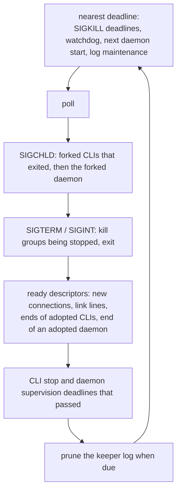

# Keeper

The keeper is the long-lived parent of every CLI in a Facade home, one per home. It holds a copy of
each CLI's terminal, so a terminal outlives a daemon crash, and it keeps one daemon running. It is
its own island because it must stay small and stable: CLIs and terminals survive anything that
happens to the daemon. Crate `facade-keeper` in `core/crates/keeper`, run as `facade keeper`.

## Owns

- **The CLI processes.** Each CLI it starts is its child and leads a session and process group of its
  own; on Windows it runs in a pseudo console of its own and in a job of its own, which does not kill
  it when the keeper ends. CLIs the daemon syncs to it after a keeper ended are held too, without
  being children.
- **One terminal per CLI.** The keeper's own copy; it never reads, writes or binds it. On Windows: the
  input pipe's write end, the output pipe's read end, the signal pipe's write end until a stop lets go
  of it, and the job (`facade_base::terminal::PtyMaster`).
- **The daemon process** it starts, and the watch on a daemon it found already running.
- **The daemon's link**: the one proved connection on the keeper's socket.
- **Files:**
  - `<home>/core/keeper.lock`;
  - the socket `keeper-<key>.sock` in the socket folder, at the path
    `facade_base::paths::keeper_socket` gives, removed when the keeper exits; on Windows the named
    pipe at that path, `\\.\pipe\facade-core-keeper-<key>`, which goes with the process.
- **Its log**, `<home>/core/logs/keeper.log`: its standard error, which whoever started it opened.
  The keeper keeps the last 30 days of this log through `facade_base::log::prune`.

## Keeps

- One thread, one wait: `poll` on Unix, an I/O completion port on Windows. No tokio, no locks, no
  other threads, and no thread per CLI.
- Only the process holding `keeper.lock` serves; a second keeper reports `contention` and exits.
- A connection is accepted only from this user's process whose pid and birth match
  `core/daemon.lock`; a newly proved connection replaces the one before.
- `hello` comes first and only once per connection; anything else before it is
  `invalid_argument`.
- A CLI starts with every signal at its default, no signal blocked, exactly the environment
  `agent.start` gave, in its own session with the PTY as its controlling terminal.
- A group signal is sent only after the leader's pid, birth and group prove the group is still
  the CLI's. A forked CLI stays unreaped until its group is dealt with, so its IDs cannot be reused.
- `changed` for a CLI always follows the response to its `agent.start`, and goes only to a link that
  said hello.
- The daemon always starts from the launcher, `core/bin/facade daemon`, so it runs whichever build
  the launcher points at.
- The keeper exits when no daemon runs and it holds no CLI, and never otherwise except on
  SIGTERM or SIGINT. On Windows it has no console, so nothing asks it to end; it is ended only by
  `TerminateProcess`.
- On Windows a daemon is started only once the one before it has ended, including one the
  watchdog ended: only then may the next daemon take the terminals' pipe ends from it.

## Never does

- Interpret a CLI, read a screen or terminal, touch the database, or know about messages,
  rules or settings.
- Add, remove or change environment variables for a CLI.
- Replace itself with another build in place. A new keeper build runs only after the old keeper exited.
- Stop a CLI the daemon did not ask it to stop. It does kill a CLI whose start failed after the
  spawn. On SIGTERM or SIGINT, only groups already being stopped get SIGKILL.
- Wait separately for service events or deadlines. `poll` or the completion port handles both.
  A write to the daemon can wait up to `SEND_TIMEOUT` (1 second). Windows then cancels the write.
- On Windows: resize a terminal, load `conpty.dll` from anywhere but its build's ConPTY folder, or
  open a console window.
- Queue messages for a daemon that is not connected. A CLI end with nobody to tell is not reported;
  the next `hello` shows the CLI has ended.

## Interface

**The `facade` program** (`crates/facade`):

- `facade keeper` calls `facade_keeper::serve() -> anyhow::Result<()>`. This is the crate's only
  public item.

**Whoever starts it**, through `facade_base::service::launch(Service::Keeper, <launcher>)`:

- A command that cannot reach the daemon and finds no daemon or keeper running
  (`crates/facade/src/daemon_client.rs`).
- The daemon, when its keeper ended (`crates/daemon/src/runs/keeper_link`).
- Both read the startup report on `FACADE_STARTUP_CHANNEL`: `started`, `contention` or
  `failed <reason>`.

**The daemon**, over the keeper protocol ([KEEPER.md](../../../core/protocol/KEEPER.md);
types in `facade_base::keeper`):

- Requests the keeper serves: `hello`, then `call` with `agent.start`, `agent.stop`,
  `agent.sync` and `daemon.ping`.
- The one notification it sends: `changed`, when a CLI ended.
- Terminals travel with `SCM_RIGHTS` on Unix, at most one per message. On Windows a terminal is the
  line's `terminal` member: handles the sender duplicated into the receiver's process
  (`facade_base::terminal_lines`).

**Programs it starts:** `core/bin/facade daemon`, and the CLIs `agent.start` names.

**Environment it reads:** `FACADE_STARTUP_CHANNEL`, and `FACADE_HOME` through
`facade_base::paths`.

## Depends on

- **`facade-base`:**
  - protocol: `keeper` (types, versions, timeouts), `jsonrpc` (framing, `ErrorBody`), `operations`
    (`CallParams`);
  - platform:
    - `service` (locks, peer proof, `launch`, `StartupChannel`, inherited descriptors, private
      home);
    - `descriptors` (lines with descriptors);
    - `unix_process` (birth, group signals, process observation, child exits);
    - `limits`, `paths`, `programs::launcher`;
  - `log` (writes a line and prunes the service's own log), `time`.
- **On Windows:** `sockets::server_pipe`, `service::authenticate_client`,
  `terminal_lines::{PeerProcess, add_terminal, take_terminal}`, `terminal::PtyMaster`,
  `unix_process::WaitPacket`, `programs::{quoted_command, bin_dir, CONPTY_FOLDER}`.
- **Third party:** `serde`, `serde_json`, `anyhow`; on Unix `nix`, `libc`, `signal-hook`; on Windows
  `windows-sys`.
- **The ConPTY package** (`core/vendor/conpty/`): `build.rs` selects `win-x64` for Windows
  `x86_64` targets and `win-arm64` for Windows `aarch64` targets, and rejects other Windows architectures.
  It copies `conpty.dll` and `OpenConsole.exe` into `<target dir>[/<triple>]/<profile>/conpty/`, and installation
  copies them into `core/bin/<build>/conpty/`. Both architectures use the package folder's `LICENSE`.

## Inside

### Startup

`serve` takes the startup channel, closes every other inherited descriptor, creates the private
home and takes `keeper.lock`. It then calls `Keeper::bind`, which:

1. raises the open-files limit (each CLI holds a terminal, and the CLIs inherit the limit);
2. ignores SIGHUP and SIGPIPE;
3. installs the SIGCHLD and SIGTERM/SIGINT pipes;
4. replaces any stale socket file and binds;
5. finds the daemon.

Then `serve` reports `started`. Any failure before that is reported as `failed`. `Keeper::run`
starts a daemon unless one already holds `daemon.lock`. That happens when a daemon started this
keeper after the previous one ended.

### The loop

SIGCHLD and SIGTERM/SIGINT reach `poll` as bytes their handlers write to two pipes (`wake.rs`). Exits
are collected before a shutdown is handled, so the daemon still hears of them.

The keeper prunes its log on its first turn after startup, then once an hour. The same deadline
mechanism schedules it on Unix and Windows. Each turn handles its events and service deadlines
before pruning. A prune failure is logged and the keeper continues.

### What it holds

`Keeper` (`keeper.rs`) holds the listener, the link, the supervisor, and the CLIs by agent ID.

A `Cli` (`cli.rs`) is the leader's pid and birth, the master, its `Tie` and, while it is being
stopped, its SIGKILL deadline. The `Tie` says how the keeper learns of the CLI's end:

- `Parent`: the keeper forked it, and SIGCHLD tells, with the exit code or signal.
- `Observed`: synced to the keeper by `agent.sync`, and a pidfd (Linux) or kqueue (macOS) descriptor tells,
  without an exit code.
- `Blind`: synced where the system gives no such descriptor. Only a later stop or sync
  from the daemon deals with it.

### Requests

The link (`link.rs`) reads every line that has arrived and takes the descriptor each line carries.
`keeper/requests.rs` turns each line into a `Request`, carries it out, and writes the response with
the master it carries, if any.

- **`agent.start`:** opens the PTY (`terminal.rs`), spawns the CLI and reads its birth. A CLI
  whose birth cannot be read is killed and the start fails.
- **`agent.stop`:**
  1. SIGHUP to the group, then SIGKILL after `STOP_TIMEOUT` (3 seconds) or as soon as the CLI ends,
     whichever comes first.
  2. A repeated stop keeps the first deadline.
  3. A SIGKILL that fails is tried again after 100 ms.
- **`agent.sync`:** gives the master to whichever side lacks it. When the daemon syncs a CLI
  that has already ended, the keeper reports `changed` right after the response.

### Ends

When a CLI ends, the keeper kills the rest of its group if a stop was under way, while the unreaped
leader still proves the group. Then it reaps the CLI, closes its master, drops it, and sends
`changed` if a daemon said hello. A CLI that ends by itself leaves behind any processes it started,
as closing a terminal does.

### The daemon

`Supervisor` (`supervisor.rs`) is either watching a daemon or waiting to start the next one.
`due(now)` tells the loop what is owed.

- **Watchdog:** the daemon pings once a second from its hello on. After `PING_TIMEOUT` (15 seconds)
  without a ping, counted from the start of watching until the first ping, the keeper sends
  SIGKILL.
- **Restart:** once the daemon ended, a keeper holding CLIs starts the next one after a delay. The
  delay starts at 0.5 seconds and doubles up to 30 seconds; it starts over after a daemon that ran
  60 seconds. A daemon that cannot be started counts as one that ended at once. A keeper holding
  no CLI exits instead.
- **How the end is seen:** SIGCHLD for a daemon the keeper forked. For a daemon it found running,
  a process descriptor, or, where the system gives none, only its silence.

### When the daemon changes

- **The daemon crashes or is killed by the watchdog.** The CLIs keep running on the keeper's
  masters. The next daemon says hello, learns from the response which CLIs the keeper holds, and
  gets each master back with `agent.sync`.
- **A new build takes over.** The old daemon installs the new build, points the launcher at it,
  drains and exits. A keeper holding CLIs treats that as an ordinary end and starts the launcher's
  daemon, which is the new build. A keeper holding none exits, and the next command starts a new
  keeper from the launcher. A keeper keeps running its own build until it exits.
- **Another proved daemon connects.** It becomes the daemon being watched, and its connection
  replaces the old one. A daemon the keeper forked and no longer watches is still reaped when it
  exits.
- **The keeper itself ended.** The daemon still holds every master. It starts a new keeper through
  the launcher and syncs each CLI to it with `agent.sync`. Those CLIs then end without an exit code.

### On Windows

The same keeper, in `src/windows/`; the Unix modules are not built there.

- **The loop** (`windows/mod.rs`, `port.rs`): one I/O completion port, waited on with
  `GetQueuedCompletionStatusEx` and the nearest deadline as its timeout. Every overlapped operation
  and every process end completes on it under a key of its own; a key is never reused, so a
  completion for something already let go of names nothing and is ignored.
- **The listener and the link** (`link.rs`): each instance of the keeper's pipe
  (`sockets::server_pipe`, owner only) waits in an overlapped `ConnectNamedPipe`; once one connects,
  the next instance waits. The client is proved with `service::authenticate_client` before a byte is
  read. The link keeps one overlapped read under way; dropping it cancels that read and waits for
  it. A write is waited for up to `SEND_TIMEOUT`, then cancelled, and the link dropped; its
  completion never reaches the port. A terminal leaves in a line through `add_terminal`, duplicated
  into the daemon, and arrives through `take_terminal`, which also closes one a line should not
  carry.
- **A start** (`console.rs`): the package's `conpty.dll` is loaded once, from
  `core/bin/<build>/conpty/`, with its search limited to that folder and System32; without it a start
  fails with an error naming the folder. Then:
  1. two named pipes, owner only: the pseudo console's end the server, synchronous; Facade's end the
     client, overlapped;
  2. a pseudo console on them (`CreatePseudoConsole`), and a copy of the signal pipe's write end,
     the first of the three handles behind the `HPCON`;
  3. the CLI, created suspended with `PROC_THREAD_ATTRIBUTE_PSEUDOCONSOLE`, no standard handles of
     the keeper's, its command line from `programs::quoted_command`, exactly the environment and
     folder `agent.start` gave;
  4. a job without kill on close; the CLI joins it, then runs;
  5. `ReleasePseudoConsole`, so the pseudo console ends with its last program and the output reaches its
     end, then `ClosePseudoConsole`, which frees the `HPCON` and closes the package's own copies
     without waiting for the console host: the pseudo console lives on through the copies of the signal
     pipe the services hold.
     - The keeper does not keep the `HPCON`. It holds the package's own copy of the signal pipe,
       so a stop's hang-up, which closes the keeper's copy, would not end the console.
- **Ends** (`cli.rs`, `supervisor.rs`): a wait completion packet (`WaitPacket`) for each CLI and the
  daemon, on the process handle the keeper holds, so a CLI's exit always has its code, whether the
  keeper started it or took it over through `agent.sync`. A CLI that cannot be watched is refused
  with an error.
- **A stop**: hang up by closing the keeper's copy of the signal pipe, after the daemon closed its
  own; the console host then closes its programs. `TerminateJobObject` at `STOP_TIMEOUT` or once the
  CLI ends, whichever comes first, tried again after 100 ms if it fails.
- **The watchdog** ends a silent daemon with `TerminateProcess` and waits for its end to arrive
  before the backoff starts the next one.

## Reading the code

1. `src/lib.rs`: `serve`, from startup to `Keeper::run`.
2. `src/keeper.rs`: `Keeper::turn`, the loop, then `collect_children`, `cli_ended` and
   `on_deadlines`.
3. `src/keeper/requests.rs`: `serve_line` and `decode`, then `start`, `stop` and `sync`.
4. `src/cli.rs`: `Cli::spawn`, `own_terminal`, `begin_stop` and `kill_group`.
5. `src/supervisor.rs`: `Supervisor::due`, `launch`, `kill` and `ended`.
6. `src/link.rs` and `src/wake.rs`: the connection and the `poll`.
7. On Windows, `src/windows/`: `mod.rs` (`Keeper::turn`, `completed`), `requests.rs`,
   `console.rs` (`ConPty::start`), `cli.rs`, `supervisor.rs`, `link.rs` and `port.rs`.
