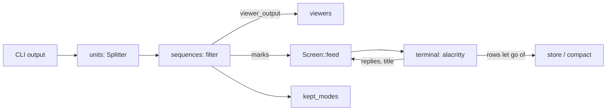

# Screen

The headless terminal behind every agent: it takes a CLI's output and keeps the cells, scrollback
and modes a real terminal would. Crate `facade-screen`, folder `core/crates/screen`. It is an
island of its own because it is pure computation that several islands share: the daemon runs one
per agent, rules reads its views, and the scenario tests use it as a viewer's terminal.

## Owns

All of it in memory, one set per `Screen`:

- **alacritty's terminal** (`alacritty_terminal`, vendored in `core/vendor/`): the main and
  alternate grids, cursor and saved cursor, pen, charsets, modes, and the parser with the frame an
  open synchronized update holds back.
- **The unit being written**: the bytes of a character, escape sequence or control string the CLI
  has started and not finished.
- **Supplied terminal colors**: optional foreground, background and cursor RGB values, used for
  replies to OSC 10, 11 and 12 queries.
- **The modes alacritty keeps private**: scrolling region, active charset (G0 or G1),
  modifyOtherKeys, the kitty keyboard flags (a stack per screen, at most 8 entries), and the tab
  stops.
- **The scrollback**: the newest `SHORT_HISTORY` (100) rows in alacritty as full cells, older rows
  in the store as compact blocks of up to 256 rows of one width. A screen made with `scrollback`
  rows keeps `scrollback + 1`, so that a read can tell whether any row was let go of.

It owns no files, processes, sockets, threads or locks shared with anyone.

## Keeps

- Reads, views, redraws and resizes give exactly what a terminal keeping every scrollback row in
  alacritty would give. Where a row lives (alacritty or the store) never shows.
- Viewers get whole characters, sequences and strings only, and never a terminal query or an
  OSC 7501 sequence.
- A viewer that takes `redraw` and then every later `viewer_output` (or a new redraw when
  `redraw_viewers` is set) ends in the screen's state: cells, cursor, modes, tab stops,
  modifyOtherKeys and keyboard flags.
- At a clean point (`at_clean_point`: main screen, no unit half-written, no open synchronized
  update), `redraw_with_all_scrollback` fed to an empty screen of the same size and scrollback
  rebuilds the rows, cursor, pen, charsets and modes.
- Query replies and status events come in the order the CLI wrote what caused them. The reply to
  `OSC 7501 ; ?` and replies to supplied terminal color queries stay among alacritty's own replies.
  Each query of a supplied color gets one reply; an omitted color gets none.
- `scrollback_bytes` stays within `SCROLLBACK_BUDGET` (2 MiB). Past it, whole blocks of the oldest
  rows go, and a read reports `trimmed`.
- A status report that breaks any limit of the protocol is dropped whole. Its words are only ever
  text: base64 decoded, at most 2,048 bytes, no control characters.

## Never does

- Depend on another Facade crate, or know about agents, CLIs, runs, the screen log or the daemon's
  states.
- Touch the disk, start processes or threads, or read the clock. The only time it handles is the
  deadline alacritty puts on a synchronized update.
- Reply with a color it was not given, reply to other color queries such as OSC 4, the kitty
  keyboard query, or ENQ.
- Show a frame that an open synchronized update is still holding back.

## Interface

`Screen` is the whole surface; the other public types supply its colors or hold its methods' results.

**Daemon, agent's screen** (`daemon/src/agent/screen/`, the screen and its screen log):

- `Screen::new(cols, rows, scrollback) -> Screen`; the daemon uses 10,000 rows.
- `feed(&mut self, &[u8]) -> ParsedOutput`, `resize(&mut self, cols, rows)`.
- `set_colors(&mut self, colors: TerminalColors)` replaces the colors used for subsequent queries.
  `TerminalColors { foreground, background, cursor }` has three `Option<[u8; 3]>` fields; its
  default leaves all three `None`. OSC 10, 11 and 12 replies use `rgb:rrrr/gggg/bbbb`, each 8-bit
  channel written twice, and the query's BEL or ST ending. No supplied colors means no color replies.
- `at_clean_point()`, then `redraw_with_all_scrollback() -> Vec<u8>` for a checkpoint;
  `on_alternate_screen()` and `has_unfinished_unit()` to say what a forced checkpoint loses.
- `synchronized_update_deadline() -> Option<Instant>`, `end_synchronized_update() -> ParsedOutput`.

**Daemon, agent actor** (`daemon/src/agent/actor.rs`):

- `ParsedOutput { query_replies, title_change, viewer_output, redraw_viewers, status }`: replies
  are written to the run's terminal, viewer output goes to viewers, status goes to the state.
- A timer on `synchronized_update_deadline()` ends an update the CLI never closed.
- `read(lines) -> Reading { text, lines, alternate, older, trimmed }` is what `ReadScreen` gets.
- `bracketed_paste()` and `application_cursor_keys()` decide how typed input is encoded.
- `leave_for_restart()` then `reset_for_restart()`: output the actor feeds through the screen, like
  CLI output, when a new run starts in the same terminal.

**Daemon, viewers** (`daemon/src/agent/viewers.rs`): `redraw(keep_scrollback, include_scrollback)`,
which replays at most `REDRAW_SCROLLBACK_ROWS` (1,000) scrollback rows. A redraw waits while
`synchronized_update_deadline()` is set.

**Daemon, state and readiness** (`daemon/src/agent/state.rs`, `readiness.rs`):

- `StatusEvent { Asked, Report(StatusReport), Reset, ShellPrompt }`,
  `StatusReport { state: Option<ReportedState>, kind: Option<BlockKind>, text: Option<String> }`.
  `BlockKind` keeps the word OSC 7501 uses; the daemon turns it into its own `WaitKind`.
- `view() -> ScreenView`.

**Rules** (`rules/src/state.rs`, `rules/src/input/`): `ScreenView { rows, cols, continues, cursor,
cursor_visible, synchronized_update }` and `VisibleCell { text, column, bold, dim, inverse,
colored }`, to find a CLI's input box and state on screen.

**Scenario tests** (`core/tests`): a `Screen` per viewer, to check what a viewer would show.

OSC 7501 itself, the Program Status Protocol, is an outside protocol; `program_status.rs` holds the
limits it sets.

## Depends on

- `alacritty_terminal` 0.26.0 from `core/vendor/`, whose changes let a grid hand the rows its
  scrollback lets go of to a `HistoryKeeper` and take rows back (`vendor/README.md`).
- `base64`, for the words in status reports.
- No Facade crate.

## Inside

The files:

- `lib.rs`: `Screen`, `ParsedOutput`, `feed` and the small queries.
- `terminal.rs`: `Terminal`, alacritty's `Term` and parser, and the queue of what alacritty asks
  to send (replies, title changes).
- `units.rs`: `Splitter`, which cuts output into `Piece`s and holds an unfinished one.
- `sequences.rs`: what each piece means: whether viewers get it, which mode it changes, and
  whether it is a `Mark` the screen must look at.
- `kept_modes.rs`: `KeptModes` (region, charset, modifyOtherKeys, keyboard flags) and `TabStops`.
- `program_status.rs`: OSC 7501 parsing and the public status types.
- `scrollback.rs`: `Scrollback`, how rows split between alacritty and the store, and what they
  cost.
- `store.rs`: `Store`, the older rows, and `reflow`. `compact.rs`: `Block`, the compact rows.
- `read.rs`, `view.rs`, `redraw.rs`, `restart.rs`, `resize.rs`: the public reads, redraws, restart
  output and resizes.

### feed

1. `sequences::filter` runs the splitter over the bytes. Each complete piece goes to viewers unless
   it is a query or a status sequence; mode changes go into `KeptModes` at once. Screen switches,
   full resets, tab-stop changes and status events become marks at the offset just after them. A
   C0 control inside a sequence goes to viewers at once, because held back it would act again
   after a redraw that already shows it.
2. alacritty parses up to each mark, then the screen looks at its state there: whether the CLI
   left the alternate screen (viewers then need a redraw), and the cursor's column for a tab stop.
   For a tab stop inside an open synchronized update, the held frame is drawn first and the update
   opened again after, so the cursor is right and a redraw still waits for the whole frame.
3. `OSC 7501 ; ?` queues its reply among alacritty's. Then the screen takes alacritty's replies,
   color queries and title changes in order. Supplied colors go through alacritty's formatter into
   the same replies; other color queries get no reply. The screen returns the replies and title
   changes with the viewer output and status events.

### resize

Without a store, alacritty resizes alone. With one, alacritty's result near the bottom depends on
the rows around the cursor and on how many scrollback rows it holds, so `resize_across_store`:

1. lets go of the rows the resize loses, then hands alacritty back the store's newest rows that
   decide the result: the start of a line alacritty holds the end of, the rows a taller screen pulls
   down, and on widening, whole lines enough to fill the screen twice once joined;
2. lets alacritty resize, while the store ignores the rows alacritty drops meanwhile;
3. reflows the store's other rows apart, through a scratch grid that runs alacritty's own reflow
   (`store::reflow`), and puts back alacritty's rows beyond its 100;
4. hands alacritty its 100 newest rows again, and sets the store's limits for the new width.

Tab stops stay, new columns get the default ones, and the scrolling region becomes the whole
screen.

### view and read

`view` lists the visible cells of the grid in use, wide characters' spacers left out, with whether
each row continues the one above. `read` and `text` walk `AllRows`: the store's rows, alacritty's
scrollback, then the visible screen (the alternate screen has no scrollback). A store row is built
back a block at a time and cached while the walk stays in that block. Rows that wrap join into one
line; blank cells at a line's end and empty lines at the end are left out.

### redraw

`Redraw` writes, in order: a known start for any terminal (it erases from the top left down, which
no terminal moves into its scrollback, and clears tab stops), the tab stops, the rows with their
styles and links (a wrapped row is written to the margin so the viewer wraps too), the saved
cursor, the scrolling region and cursor (writing the margin cell again to restore a pending wrap),
then modes, keyboard flags, modifyOtherKeys, charsets and pen.

### The store

A block keeps its rows' characters in one string, the cells as runs that share a style from the
block's palette, combining characters apart, and per row its marks: wrapped, shows something,
carries into the next row on reflow. Reads use the marks without building rows. A full block is
sealed: its style map goes and its vectors shrink. `scrollback_bytes` counts alacritty's rows and
the 32 it reserves ahead as full cells, plus the store's blocks by capacity.

## Reading the code

1. `lib.rs`: `Screen::new` and `Screen::feed`.
2. `sequences.rs`: `filter` and `read_piece`, then `units.rs`: `Splitter::take`.
3. `redraw.rs`: `Redraw::build`.
4. `read.rs`: `AllRows` and `Screen::last_lines`.
5. `resize.rs`: `resize_across_store`, with `store.rs` and `compact.rs` beside it.
