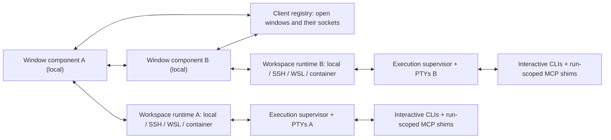

# Architecture and engineering

Layer 4. The product and shared rules decide behavior; this document chooses the implementation structure and
engineering safeguards. A platform behavior that only native evidence can prove, such as how the editor's windows
reload, restart and close, is a proof obligation here (2.2); [Verification](VERIFICATION.md) owns the gates and their
evidence.

| Group | Decides |
| --- | --- |
| 1 Components | Workspace runtime, window components, PTY supervisor and public APIs |
| 2 Ownership and recovery | Lifetimes, bounded records and actual effects |
| 3 Data and safety | Storage, paths, rendering, secrets and logs |
| 4 Repository and delivery | Source layout, builds, compatibility, packaging and translations |
| 5 Working safely | Tests, isolated editor/CLI runs and Git boundaries |

## 1 Components

### 1.1 Separate client routing from workspace execution

**Local window components connect this computer's windows while a workspace component runs agents in each window's execution environment.**

Components are extension infrastructure, not a hosted service or separate user-facing application. The workspace runtime
owns local-to-that-environment program discovery, folders, native Git integration, process/terminal adapters and its
window's Facade tools. A supervisor in each execution environment, ptyd, holds PTYs and rendered screens across
extension-host reload. A per-run stdio shim supplies the launch run ID for routing and normal tree scope; it does not
authenticate the caller.

Deployment targets: `facade.facadecode` is the workspace extension. Its companion `facade.facadecode-window` runs in
the local UI extension host, keeps the current window's handover identity and registered native terminal objects, and
is the window's client component. It exports no API (`api: none`). The two components exchange validated requests
through extension commands that appear in no menu or palette: `facade.window.identity`, `facade.window.terminals`,
`facade.window.directory`, `facade.window.route`, `facade.window.publish` and `facade.window.allocate`, registered by the
window component, and `facade.workspace.republish` and `facade.agents.route`, registered by the workspace component.
Cross-host requests contain only plain data; a same-host request may validate an actual public Terminal object. The
local component owns no workspace files, agent process or PTY data transport.

The client network has no central process. Each window component listens on its own local socket - a Unix domain
socket, or a named pipe on Windows - and records its window in the client registry under the client Facade directory
(3.1): its routing ID, label, environment, socket, network protocol, process ID and process start, the component start
that wrote the entry, and the window's agents as its workspace component publishes them - who each is, its creation
tree, CLI, YOLO setting and lifecycle, never what it is doing. Other windows resolve references to those agents from the
registry without asking (RULES-2.3). The workspace component publishes its agents and the window's name as they change,
changes within 150 ms told once, and again whenever its window component starts; the answer says whether other windows
can reach the window, and the agents log says when they cannot. Each start of a window component listens on a socket of
its own, registers only once it listens, tries a failed listen again after one second, doubling up to a minute, and on
shutdown deletes only the entry it wrote, never a successor's. An entry whose process is gone is deleted. One whose
process start the system reads otherwise - its process ID another process's now - is deleted, if unchanged, once its
socket proves nothing listens there, as a clock step or a start read to the second proves nothing alone. One whose
socket proves absent when a request is routed to it - no such socket, or on POSIX one that refuses - is deleted too. A
socket that only fails to answer in time proves nothing: its window stays listed, and requests to it report it
unavailable. Windows whose components speak another network protocol are listed as unavailable,
`protocol_incompatible`.

A window component reaches another window by connecting to the socket the registry names; the receiving component hands
the request to its own workspace component and returns the answer. The caller's window handles every tool call: its own
agents directly, other windows' agents through these routes. The recipient's window performs message delivery and
serializes terminal input, and results return to the sender's window over the same route. A send to another window
keeps half a second of RULES-1.2's two seconds for its answer's way back.

Agent `#aN` and message `#mN` numbers come from client-wide counters in the client Facade directory, taken under their
file locks, because each execution environment's own counter would repeat them. A window takes them in blocks ahead of
need - 16 at a time in a local window, 32 in a remote one - so numbers can skip, but none is given twice. Every window,
local or remote, takes its numbers only from these counters: a window that cannot take one - its counter unreadable, or
its window component too old to carry requests - refuses the start or send before any effect, so no number is ever given
twice. The client counters continue past the numbers the environment counters of the same Facade root gave - 0.0.1
numbered its agents there - for agents and messages alike. Gate G1 verifies this design, its installation and its
replacement on update.

### 1.2 Public editor APIs and explicit dependencies

**Use public extension APIs for editor interaction and an owned, versioned PTY backend for process/terminal behavior.**

No proposed APIs, internal workbench commands, guessed terminal `$mid`, patched editor files or dependence on private
vendor editor commands for core functionality. Where no extension API exists, documented user-bindable workbench
commands are used, such as pinning or unpinning the active editor for a terminal tab's Pin (LIFECYCLE-3.4); the editor's
internal or underscore-prefixed commands and guessed `$mid` contexts are prohibited. Terminal logos are the extension's
contributed icons shown as theme icons, because image-backed terminal icons are lost when the color theme changes
(LIFECYCLE-2.2). A workspace extension runs where its workspace is; extensionKind is placement preference, not two
simultaneous instances.
[Official remote extension guidance](https://code.visualstudio.com/api/advanced-topics/remote-extensions).

The execution component packages its own `node-pty` backend (4.3) with third-party notices and never locates
undocumented editor-bundled native modules by guessed appRoot paths. ptyd and each run's shim run on the extension
host's own executable as Node (`ELECTRON_RUN_AS_NODE=1`), ptyd detached so that it outlives the window. Execution
packages are platform-specific, so that remote hosts and compatible editors are supported honestly. Nothing is
downloaded or compiled during ordinary activation. A backend that cannot load on its host fails that capability clearly
and keeps usable existing records.

### 1.3 Boundaries and code structure

**Business rules depend on ports, not on VS Code, sockets or vendor screen parsers.**

`core`, `record`, `clis` and `base` remain independently testable. `ui` contains panel models, commands and pickers;
`host` implements editor/environment ports, with terminal adaptation and the PTY client together under `host/execution`;
`webview` has no extension or Node imports; `ptyd` owns terminal/process/effect state, including screen reading, key
encoding and input-box readers. `schema` owns the one source of MCP tool definitions, wire types, validators, the result
envelope and the bundled skill; `contract` implements the eight tools on core ports; `transport` owns the run's shim, its
MCP stdio server and its link to the supervisor. The client network has no layer of its own: the window component's
entry is `host/window.ts`, its sockets and routing are `host/windowNetwork.ts`, which imports no `vscode`, the workspace
component's side is `host/client.ts`, the registry and client counters are `record/windowRegistry.ts` and the plain
messages between them are `base/windowNetwork.ts`. Only extension entrypoints, `host` and `ui` import `vscode`.

Cross-layer source imports follow this table; imports within one layer remain allowed. Layer checks enforce the table,
and production modules have no import cycles, type-only imports included. The only `webview` module another layer
imports is `webview/protocol`, the plain host/page contract.

| Source layer | May import these other source layers |
| --- | --- |
| `extension.ts` | `host` |
| `host` | `ui`, `contract`, `core`, `record`, `clis`, `ptyd`, `transport`, `schema`, `base` |
| `ui` | `core`, `webview/protocol`, `base` |
| `contract` | `core`, `schema`, `base` |
| `core` | `base` |
| `transport` | `ptyd`, `schema`, `base` |
| `record`, `clis`, `ptyd`, `schema` | `base` |
| `base`, `webview` | None |

Modules group one cohesive responsibility rather than one helper per file. The panel's manual-order algorithms and
persisted order share `ui/order.ts`. Small shared contracts and independently tested failure boundaries remain separate:
JSON shape checks, disposal, notification sanitization, owner identity, record paths and socket ownership are examples.
UI does not import PTY transport or durable-record implementations; `contract` reaches durable stores through core
ports. There are no forwarding modules: source and test imports name each module where it lives.

Within `host/execution`, terminal management owns native terminals, tab correlation, focus, names and disposal; the
execution session owns the PTY connection, ownership claim, connection loss and recovery scheduling; the execution
coordinator owns each run's launch, attach, reports and cleanup. Their boundaries follow state ownership, resource
lifetime and failure handling. Shared CLI presentation and theme-logo mappings belong to a presentation module used by
pickers and terminal management, not to the New Agent picker. Execution does not import a picker or a command page.
`ui/presentation.ts` owns native CLI icons and shared launch-failure wording; name normalization is in `core/names.ts`.
Worktree input and planning are shared under WORKTREES-4.3 rather than copied into each entry flow.

## 2 Ownership and recovery

### 2.1 Routes without shared-remote-home assumptions

**The client registry is an address book; window components route requests directly; run IDs are addresses, not credentials.**

Window components register current windows and their execution environments. Route requests to the actual destination
window's runtime, preserving caller/target IDs, content, protocol and deadline. Remote paths remain in their remote
environment; equal SSH labels or folder text do not establish the same execution owner. Open windows without agents
still register. Use ordinary local IPC and the editor's cross-host command channel; Facade adds no cloud relay or public
product. Validate schemas and distinguish absent, disconnected and incompatible destinations. Allocate unique IDs
without reuse from the client-wide counters (1.1); cryptographic identity and unforgeability are not requirements. The
normal shim supplies its launch run ID. Apply YOLO/tree policy from that record. Do not add authentication, tokens,
enrollment credentials, origin-binding proofs, scoped delegation, human credentials or anti-impersonation checks.
Deliberately spoofing another ID is outside this operating policy. Keep accurate effects and routing regardless. Each
request and answer between Facade's processes travels as one line of newline-delimited JSON of at most 64 MiB: a call
larger than that is RULES-5.3's capacity failure, refused as `capacity_exceeded` before any effect and never cut - a
limit of the runtime buffer, not of the text (MCP-5.2) - and a generated result too long to return inline goes to a file
(COLLABORATION-4.2). Registry location, socket naming and stale-entry cleanup are engineering choices verified under G1,
not a product workflow.

### 2.2 Window lifetime is a proof obligation

**Keep a window's runs across reload, extension-host restart and temporary disconnect by demonstrated editor behavior,
and end them only by RULES-4.1's five-minute policy.**

RULES-4.1 owns the contract: closure ends that window's runs, reload reconnects them and temporary remote loss does
not itself terminate them. ptyd applies RULES-4.1's five minutes from the moment the owning extension host's connection
closes; a successor activation's claim cancels it, and a remote network outage that leaves the remote extension host
connected starts no timer. A stable workspace key is not enough to identify a particular live window; two windows can
share it. Route-staleness timers can detect loss, not prove closure. A window ID is the routing address the window
component derives from the window's handover identity when it registers the window; it may change after reload. The
runtime reattaches the original runs, with the same run IDs, to the reloaded window. RULES-2.2's Window row is the
conceptual identity, not this address. Record enough current window/run association to reconnect the actual process.
No durable message handover is required solely for a closing sender; RULES-1.9 permits natural termination of work
still owned by that side. The workspace key that runs are claimed under is derived from the workspace's URI once and
then kept in the editor's workspace storage for reloads. Folder-to-multi-root conversion and Save Workspace As can
replace extension workspace state; remote conversion also reloads the window and changes `env.sessionId`. Session ID
alone cannot carry this state.

The local window component keeps a random handover identity in its own directory supplied by public
`ExtensionContext.logUri`. It neither parses the URI nor reads editor storage internals. On the verified desktop editor,
that directory remains the same for this native window across these transitions and differs for a separate window,
including one opening a copied workspace. This lifecycle is a platform evidence requirement, not a guarantee inferred
from the API's name. Deletion or replacement of that directory cannot justify a folder-based search for another
window's identity. A record gone is replaced by a new identity unnoticed. A damaged one is not replaced: Facade does not
start in that window and says to close it and open its folder or workspace again, or restart the editor - not to
reload, which reads the same record. One that cannot be read now but is not damaged - a file the system holds - is
answered as unreadable, and the workspace component says to reload rather than to install the component.

The workspace component requests the identity through a public command, including its current `env.sessionId`; the UI
component rejects a request from a different session. Its answer also names the component's own version, which a remote
extension host cannot see otherwise, for the diagnostics report (3.3), and in a remote window the window's remote
authority, which only the local component sees and by which the environment is named (LIFECYCLE-1.1). Each activation
records its key, folders and workspace URI under that identity in the execution Facade directory, where such a record
is kept 30 days. The same window that retains its original first folder takes that key and the current window's saved
state - order, locations and choices - even if the destination workspace has stale state. Another window does not
inherit it merely by opening the same folders or copying a workspace file. The execution environment keeps one atomic
exact-workspace-URI ledger, including each owner's current URI. Resolution prefers a valid current-window handover, then
the canonical URI binding, then an old saved key only if it has no ledger entry or still owns that exact URI, then an
independent URI-derived key. Owner claims fence all ledger and window-record writes. Same-URI reload cannot use an
obsolete window record to override a newer canonical binding; a changing URI can carry an owner only while that owner
still owns the window record's previous URI. No same-folder search guesses identity. A window with no folder or
workspace keeps no ledger entry: its key stays in its own storage for its reloads. Save Workspace As A to B atomically
moves that owner's binding to B and drops its A binding. Reopening A, including with its old saved key, selects an
independent owner; copying B to another URI also does not acquire B's runs. An owner that has moved cannot be recovered
through its old default URI hash. This makes a fresh profile opening the exact B URI claim B's existing runs without
merging all historical workspace URIs.

When the local component survives, native terminal replacement uses its live run-to-Terminal object registrations,
never a title, PID, private ID or an activation snapshot guess. Current session and monotonically increasing owner
claims fence operations: a late request from an older workspace host cannot replace or dispose a newer binding, and an
activation whose workspace a newer activation claimed detaches its cards and terminals without ending a process
(RULES-4.1). Normal close drops the exact object's binding. The workspace runtime serializes terminal creation: begin a
capture bounded to ten seconds, create its terminal, wait for that object's public open event, then finish. The local
component accepts only one still-live object opened during that capture; every extra open makes it ambiguous even if
that extra object closes before finish. Older objects' late close events do not contaminate the capture. Same-host
completion additionally validates the actual Terminal reference. Only successful registration replaces and disposes the
prior registered object for that run. A registration a restarted local component refuses, as it knows no owner yet,
sends the activation's current claim again and retries once. Names, empty names and CLI titles may repeat freely.
Cancellation, expiration, an old claim or ambiguous events do not guess an association. An editor can replace its
public Tab objects when rebuilding the tab-group model. Discard bindings to Tab objects the current model does not hold,
then correlate the active terminal and tab through public activation/group events again; never recover them by title or
index. Pending native Pin changes wait for that exact active association and do not reveal another editor.

Queued creation retains only the latest explicit reveal request and cancels it on closure, so an agent queued first
cannot steal focus after a later selection. Restoration after a reload waits up to ten seconds for each terminal to
open before it restores the next, so a terminal the editor never opens does not hold up the others; its card and
process are kept.

A remote workspace-host restart can retain these registrations while its local companion lives. A graceful local
component shutdown synchronously records only its registered owner/run IDs and the actual final complete terminal
names, without a busy tab's spinner frame (LIFECYCLE-2.2), in its own log directory. A new registry incarnation consumes
that record once; an incarnation fence prevents a late old shutdown from replacing a newer record. There is no
per-output persistence or polling.

Only a proven same-window handover into that recreated registry may dispose of an old UI resource set after
restoration. This is a bounded heuristic cleanup, not terminal identity: it never binds an old object to any run. It
examines only the activation snapshot, excluding current PTYs and every shell/cwd/environment field, and requires known
nonpositive PIDs. The creation-time name may differ from the final displayed title, including an empty original name
followed by a CLI title. It is not compared with the final title; the shutdown record's complete title defines the old
resource group. For each complete-title group in the shutdown record, every recorded run must have been successfully
registered again in this restoration batch, and the old eligible group count must exactly agree. Then the entire old
group is disposed of once. Empty and duplicate names are valid groups; new CLI titles do not stand in for the recorded
old titles. An extra matching third-party object, missing run or uncertain PID leaves that group untouched.
Canonical-only new-window takeover does not enable this path. If a missing owned object is replaced by an
indistinguishable third-party object with the exact same title and shape, public APIs cannot tell the sets apart; this
residual heuristic risk is explicit.

A strong UI-host termination without a shutdown record, or an update from an implementation that registered no
terminals, cannot identify unknown old terminals. This mechanism does not close gate G2. The integration suite drives
workspace conversion outside test mode, which refuses to enter a workspace.

Gate G2 needs isolated traces for reload, extension-host restart, remote loss, close-one, close-last and immediate
reopen. Deactivation, terminal closure, `sessionId`, a missing-heartbeat timer, a hidden terminal's death or the
Shutdown exit reason does not alone prove a close, so Facade reports no closure from them and RULES-4.1's five minutes
are the cleanup. A mechanism proven on the editor can take the place of a derived design; it cannot silently redefine
RULES-4.1's behavior. This rule is a proof obligation, not a claim that every supported editor supplies a complete
mechanism.

### 2.3 Execution ownership and input deadlines

**The execution owner keeps process/screen facts and serializes input independently of the visible card.**

Keep process/run identity, screen snapshot/output sequence and actual input effects across extension-host reload.
Attach without duplicating output; retain a dated final screen after exit where available. A snapshot or a read waits
until everything written to the headless terminal is drawn, on the last write's own callback, as the terminal may drop
an empty write's. A screen snapshot carries the terminal modes its program set, so that a terminal drawing it anew
behaves as before: besides the serializer's own, the mouse encoding, a hidden cursor, the kitty keyboard flags of the
screen it is on and win32 input mode, each followed through the program's resets. While no window shows a run, ptyd
answers its program's terminal queries, such as the cursor position, so that a CLI waiting for an answer goes on during
a reload; a window that shows the run answers them itself. Propagate RULES-1.5's remaining message budget to the input
owner; internal hops cannot restart it. Do not compare independent host wall clocks as if synchronized. Check whether
input can still start before writing; ptyd takes a text and its Enter in separate requests, never both in one
(MCP-5.2). Uncertain effects stay uncertain; ordinary-message retries follow RULES-1.6's single paste and owned-draft
Enter. No exactly-once write protocol or operation-query service is required.

A run's shim connects to its execution environment's supervisor and names the run it speaks for; a shim of another
protocol is refused and its connection closed. The supervisor forwards each call to the connection that currently owns
that run's workspace and returns the answer to the shim that asked. A call waits at most RULES-1.2's two seconds from
the shim's ingress for a window to hold its run, and a query at most its ten-second route deadline (MCP-1.3); otherwise
it is refused as window unavailable with no effects. Once forwarded, a query keeps its route deadline for the answer,
and any other call waits for the window's answer under MCP-1.3. A call that reached a window which then went away
reports unknown effects. At most 256 calls of one run are under way at once; another is refused as `capacity_exceeded`
with no effect. For each call the shim waits at most two seconds for its connection to the supervisor, failing with no
effect, while the connection itself has 30 seconds to be taken and answered and is kept for the calls after, so that a
busy supervisor does not make a run's tools look gone. A window learns from the supervisor when its run's shim
connects, which is the run's tool connection fact (RULES-3.1), and when no shim of the run is connected any more, or none
is as the window claims the run: its tools are then unavailable until one connects again. A starting supervisor takes
over its socket only from one proven gone - no such socket, or on POSIX one that refuses - as a timeout or another error
proves nothing, and never deletes a socket another supervisor made at its path.

Explicit close immediately removes card/terminal and invalidates further input. Process cleanup uses the owning handle
or process group in the background - a hang-up, then a kill where the process has not ended within three seconds - and
the UI never waits for it. On Windows a console is ended once, as a second end reaches a console already freed, and a
console node-pty never made ready is ended through its agent. A run is let go of one way, whatever ends or drops it - a
failed start, a close or an exit - so nothing of it stays held. If remote cleanup is unreachable, record the pending
outcome and reconcile the original run on reconnect; do not claim a proven remote exit or kill an unrelated process. The
pending close is recorded beside the window's runs, in `workspaces/<key>/closing.json` under its ownership claim, so
that a reload ends that run rather than showing it again. A window starts its ptyd only where none is there - no socket,
or on POSIX one nothing listens on; a ptyd slow to take a connection, as a busy Windows pipe can be, is waited for up to
five seconds and never replaced, as a second ptyd would leave every run of the first unclaimed. A ptyd exits five
minutes after its last live run and its last window - a connection that claimed a workspace - went; a connection that
claims nothing, listing runs or finding none of its window's there, neither keeps it nor starts its five minutes again.
A window starts one again when it needs it.

A run is there as soon as its start is asked for; the supervisor creates one run's program at a time, in the order the
starts were asked, each start's ten-second wait for its program counting from its turn: on Windows node-pty creates a
program on the supervisor's own thread, and a check of a new command line can hold that thread for most of a second.
Until its turn a run is listed, claimed and closable and keeps its details, size and the person's input; it takes no
automated input, has no process ID and counts its start from the moment it was seen, which a window reloaded meanwhile
keeps for it. One closed meanwhile ends with no program ever created. A start reads what the supervisor heard before it
gives up its wait, so that a busy supervisor never takes a program that started for one that did not. Do not add
expiring security leases or automatic process killing on temporary disconnection; RULES-4.1's five minutes after the
owning extension host disconnects is the only timed cleanup. Native preparation jobs are not owned by this cleanup.

### 2.4 Journals, pressure and upgrades

**Use simple bounded runtime storage, preserve observed effects across reload, and report real capacity failures.**

Keep current process/message records and sequence information needed for reconnect, actual results and history.
Request-bearing run metadata is persisted before startup effects and retained for MCP-1.1's one-hour period after its
pair is closed. Such request-only records are validated on reading, never restore a card or process, and expire
without deleting a failed launch that the person has not closed. There is no caller request-key ledger, durable
human-notification claim protocol or authenticated cleanup authority. Atomic updates and a single writer for each record
are ordinary implementation tools, not new API promises. Closing a run does not replay its mail on a later run.
Changing protocol does not convert old pending messages into new deliveries.

Bound output buffers at 8 MiB per run and 32 MiB per window; headless scrollback is 10,000 logical lines / 8 MiB.
The headless terminal reflows the cursor's line with the text during resize. Narrowing and restoring a window must
keep the cursor attached to its logical input position; an input reader must not compensate by guessing past a frame.
Report scrollback beyond the bound as unavailable instead of truncating a requested current result silently. Keep
current screen/UI usable during output flood using ordinary backpressure and snapshots. An output buffer bound is not a
direct-input limit. Real disk/memory/storage exhaustion fails the requesting operation; there is no product cap of 100
agents or a lifetime operation-count quota that disables an otherwise usable session.

Existing processes are not killed because the extension or its protocol is updated. Compatible reconnect preserves their
actual identity; incompatible tools report unavailable. A window starts runs only in its own build's ptyd. That ptyd's
socket is named by its protocol, the Facade directory and its build - the installation's version, the path of its ptyd
script and that file's modification time - so that the windows of one installation share one ptyd while an update, a
second installation of the same version or a script rebuilt in place has a ptyd of its own, and no run starts in a ptyd
whose installation an update removed. A ptyd records its protocol, build, socket and process ID in `ptyd/sockets/` while
it listens and removes the record as it exits; a window that finds nothing listening at a recorded socket removes that
record. A build speaks every protocol a released build used, dropping none. Every other ptyd - each earlier protocol's,
each recorded one of another build of this protocol or an earlier one, and one at the name a protocol's ptyd had before
ptyds were named by build, which is never this build's - a window joins where it holds runs of its workspace, never
starting one, claims them there, and shows and operates them through it as its own: cards, terminals, input, resizing,
closing, ends and their agents' Facade tool calls, which it answers on that ptyd's own connection, at the first join and
at every reconnect; a tool protocol it does not speak is refused as `protocol_incompatible`, with no effect (MCP-6.2). A
request a later protocol added goes to no older ptyd: 0.0.1's, protocol 8, takes no screen read, typing, keys or input
reading, and they fail before anything is sent. A run whose other ptyd is gone ended with it, how is not known. A run
whose kept details name no creation tree is a root of its own, its Facade tools not injected. Agents and messages
started after an update are numbered past the older build's numbers (1.1). Once none of the window's runs is left in
such a ptyd, or it holds none as the window finds it, the window lets it go and no longer joins it for its runs, so that
it can exit once idle. A window's listing of every workspace's runs - as it activates, releasing the project files of
agents gone everywhere (CLIS-2.2), and as Resume Agent lists what it may start - asks every other ptyd anew, so that no
conversation an agent holds is started twice (LIFECYCLE-3.2). A ptyd of a build from before ptyds were named by build
exits after five minutes with no live run and no connection, a wait every connection to it - a listing's too - starts
again. New starts use current settings/protocol, in the window's own ptyd. A change of ptyd's behavior or of its
packaged native backend still advances its protocol even where requests keep their shape, so that a window knows how
each ptyd it joins behaves. A ptyd whose installation is gone - its script, or on Windows node-pty's console worker -
starts no program and says that its installation was removed - Facade's own reason (UX-2.4) - never that a process could
not be created.

## 3 Data and safety

### 3.1 Storage owners

**Data remains in its owning environment and belongs to the user; Facade uploads nothing and adds no telemetry.**

| Store | Contents |
| --- | --- |
| Client Facade directory, `<FACADE_HOME or ~/.facade>/extension` on the client computer | Window registry in `network/` - one entry for each open window (1.1) - and the client-wide counters `client-agent-numbers.json` and `client-message-numbers.json` |
| Execution supervisor's memory | Processes, screens, output sequences and input effects, for as long as ptyd runs (2.3) |
| Execution Facade directory, `<FACADE_HOME or ~/.facade>/extension` in that execution environment | Per-run launch files, the injection record (CLIS-2.2), message records, long results in `results/` (at most 30 days), location metadata, Facade conversation names/locations, the workspace URI ledger `workspace-uris.json` and window records in `windows/` (30 days, 2.2), owner claims in `claims/`, the environment's own counters `agent-aliases.json` and `message-aliases.json` (1.1), ptyd's log `ptyd/ptyd.log` (3.3), each listening ptyd's record in `ptyd/sockets/` (2.4), and in `workspaces/<key>/` each workspace's agents log and structured history (3.3), the copy of its workspace state, its retained failed launches and request records (2.4) and its closes ptyd has not confirmed (`closing.json`, 2.3) |
| Editor workspace storage | Human CLI/location choices, filter, order, exact-conversation Pins and the workspace key (2.2); a copy is kept in the execution Facade directory beside the runs, its changes written together within 100 ms and flushed as the window deactivates, a Pin's at once; a write a successor's ownership refuses is reported, never acknowledged |
| Execution Facade directory: `conversations/` | One atomic metadata record per environment/CLI/session key, containing the original cwd and Facade name; no transcript copy |
| Vendor CLI store | Its own conversations, credentials and settings |
| Beside the main checkout | New worktrees under WORKTREES-2.2 |

An environment variable can override the Facade directory, and tests always use temporary overrides. `FACADE_HOME`
(default `~/.facade`) is a root shared with the Facade Code IDE, and the extension uses only its `extension/` subfolder.
`FACADE_HOME` names an absolute folder; a relative one is refused, never taken for unset. A counter of agent or message
numbers that cannot be read is an error, never a count that starts again at `#a1` or `#m1`. Directories are interpreted
in their own environment, never an assumed shared remote home. Sockets are outside the Facade directory: on POSIX in
`/tmp/facade-ptyd-<uid>/` and `/tmp/facade-window-<uid>/`, which must be private folders this user owns or Facade does
not use them, and named pipes on Windows. Use normal application storage; no ACL security protocol is required.
Reconcile stale process records before cleanup and avoid deleting arbitrary files. Thirty-day message/log retention
does not delete vendor history.

### 3.2 Files, Git and untrusted text

**Preserve user files and exact paths; treat outside text as data rather than executable interface content.**

Preserve URI authority and compare paths in the owning environment. No shell interpolation or blanket recursive
deletion. Native Git owns worktree creation/preparation; Facade provides no discard/initialization subsystem; its one
deletion of the person's work is WORKTREES-3.2's `git worktree remove` without `--force`. Otherwise Facade deletes only
content it injected into a folder (CLIS-2.2) and its own records.
Webview rendering uses text nodes and the editor's normal resource constraints; messages do not execute command links.
Validate protocol shape and bound each line read; a call beyond the bound is refused explicitly (2.1), never cut or
silently dropped. Native editor trust and CLI sandbox/approval controls remain native; Facade adds no separate security
product or prompts.

### 3.3 Diagnostics

**Show Agents Log presents operation and lifecycle facts without secrets or task-policy judgments.**

Use a read-only editor log with UTC time, safe name/reference, operation ID, phase, effects, route status and actual
failure. Redact CLI credentials and sensitive environment values. Full message text belongs to deliberate message
history, not routine transport logs. Correlation IDs connect UI/MCP/supervisor observations. The agents log,
`workspaces/<key>/agents.log`, keeps 30 days, pruned as the window activates, with no size cap; ptyd's own log stays
within 2 MiB, keeping its newest 512 KiB of whole lines. Each tool call is logged with its tool, its caller's alias,
its status and error code and how long it took, never complete argument objects. Explicit requested CLI, model, effort
and destination are launch facts; prompts, terminal bodies, full argv and environment values are excluded. Existing
call/request IDs and short agent/message references connect dispatch, route, answer, accepted work and final receipt.
Start/stop receipts preserve their operation and execution window across routing and persistence. Message log entries
record identity and meaningful delivery/effect transitions, not repeated unchanged attempts or message bodies. The
diagnostics report labels its window/environment scope: a local log is not a complete distributed trace. There is no
second operation ID, telemetry service or background history scan.

Structured history uses `events.jsonl` beside the workspace's agents log. Records carry UTC `at`, event name,
window/environment and existing agent/call/request IDs where applicable. Window attach/detach is distinguished from
proven closure. Location catalogs and changed CLI scans are recorded at activation and existing location/configuration
notifications, with unchanged scan results coalesced. Queries and startup still read current facts. Agent launch requests,
process starts, failed starts, exits and cleanup outcomes retain requested settings without claiming native model
acceptance. MCP results cover requests rejected before an agent exists. No prompts or complete argument objects enter
these records. History is read with ordinary file tools; it is not an MCP query or an aggregate model/effort catalog.
The private launch context and each window snapshot supply the absolute path and execution environment. A remote path
is never advertised as a local file. On activation, prune entries older than 30 days; writes stay bounded to three 4 MiB
files (current, `.1`, `.2`). An oversized event becomes an explicit omission record. Diagnostic write failure cannot
fail a business operation; lock contention does not wait.

An empty agents log opens with `No agent events yet`, with no information toast.

The diagnostics report, which only the integration suite's test-mode `facade.diagnostics` command produces (UX-3.2),
holds in English, as the log is, what a report of a problem needs, and sends nothing anywhere: the extension's, its
window component's and the editor's versions, the platform and the remote kind; whether collaboration is on; each CLI of
the window's first location, custom ones included - its version as its installation says it and its input reader, or
why it cannot start - and `facade.custom`'s configuration errors; this window's agents - CLI and version, lifecycle,
activity and since when, tools, and what their input reader reads now - with each live one's last twelve screen rows;
and the agents log's last two hundred lines. The home folder is written `~`, whatever the case or separators a path
spells it with, as VS Code lowercases a Windows drive letter.

## 4 Repository and delivery

### 4.1 Source layout and build

**Source, specifications, generated output and temporary probes have separate locations.**

`extension/` is the extension's root: README, CHANGELOG, AGENTS, licenses/notices, package manifest, lock, tsconfig and
.nvmrc; the paths below are relative to it. The repository ignores `.agents/` and tracks nothing in it outside the IDE's
`ide/` folder: the product injects `.agents/skills/facade` into project folders for Codex and Muse Code and
`.agents/plugins/facade` for Antigravity, so a committed `facade` skill or plugin would conflict under CLIS-2.2;
repository-owned skills never use the `facade` name. The extension has no shared `.vscode/` configuration. Build, test
and packaging run through repository scripts; optional developer-local editor settings are not prerequisites and never
replace the isolated test profiles in group 5. `docs/extension/` at the repository root: the complete maintained
documentation, including normative rules and audit data. `src/`: code/tests by layers; `l10n/`: all translations;
`media/`: shipped assets; `scripts/`: build/audit tooling; `window/`: the window component's manifest and README.
Generated code/package/test output goes under `build/`, never source folders. Component packaging uses
`build/extension/` (execution, including ptyd and the run shim) and `build/window/` (local window component, including
its network code); native artifacts have explicit platform ownership. The window component has no native backend and
ships as a separate universal VSIX.

Use Node 24 from `.nvmrc`. Clean checkout/CI dependency installation uses `npm ci` with the committed lockfile;
`npm install` is for deliberate dependency changes, with their lockfile changes reviewed together. Build/check commands:
`npm run compile` (type checks and the unit-test build), `npm run bundle`, `npm test`, `npm run package` (both VSIXs,
into `build/vsix/`), `npm run test:package` (package-content checks; they require `build/vsix` from `npm run package`)
and `VSCODE_EXECUTABLE=<isolated editor executable> npm run test:integration`, which on macOS uses the standard VS Code
installation when the variable is unset; `FACADE_IT_ONLY` runs one part of it (`journeys`, `cross`, `conversion`,
`reopen` or `expiry`) and `FACADE_IT_KEEP=1` keeps what a run left. On Linux the integration suite runs under a virtual
display (`xvfb-run -a`); on Windows it runs in the signed-in desktop session, as an SSH session has no desktop, and its
fake CLIs are `.cmd` launchers of a Node script, as npm and Pi's installer write them. `npm run test:remote` runs the
journeys over Remote-SSH from this computer to the hosts of a given SSH configuration (`FACADE_IT_SSH_CONFIG`;
`FACADE_IT_SSH_HOST` and `FACADE_IT_REMOTE_EXTENSION`, the extension built on each host, comma-separated): one SSH
window, two SSH windows, local to SSH, SSH to local and, given two hosts, between them, each with Remote-SSH and the
editor's server in folders of the run's own, under `/tmp` unless `FACADE_IT_REMOTE_ROOT` names another folder.
`FACADE_IT_CONTAINER`, an image with Node, Git and a user `node`, runs the same scenarios on Linux in a container of the
local Docker, its windows attached as Dev Containers attaches. `FACADE_IT_ONLY=real` runs real agents of one built-in
with YOLO off - never part of a default run, as it signs in and uses an account's usage - with `FACADE_IT_REAL` naming
the built-in, `FACADE_IT_REAL_PATH` its executable, `FACADE_IT_REAL_ENV` the variables its terminals get and
`FACADE_IT_REAL_PASS` those taken from the environment, never written to a file. It checks what the models did as well
as what Facade delivered: each message sent once, one agent started, and no agent calling read_messages, list_agents or
read_screen more than two, four and two times, as an answer comes as a paste and list_agents also says where agents can
start. Document changes to these commands before using a different build layout. Lock dependency versions, preserve
licenses/notices, and keep generated/runtime files ignored. Do not repurpose HOME/CODEX_HOME as script scratch
variables.

The integration fixture build is staged separately in `build/extension-it/`; `npm run test:integration` assembles it
from the bundled extension `npm run bundle` made, before launching the isolated test editor. Test-only adapters/commands
are absent from production bundles/manifests under UX-3.2. A fixture passing does not verify its corresponding real CLI.

The root README includes repository development instructions when useful. A single optional block marked
`<!-- repository-only:start -->` and `<!-- repository-only:end -->` is omitted from the staged README; all other content
is preserved. No markers means no omission; unmatched, nested or repeated markers fail the build. The source README is
never rewritten by staging. This keeps repository setup instructions out of the installer-facing product description.

### 4.2 No compatibility migration

**Development builds' settings, command IDs and stored state are not migrated; released runtime protocols remain supported under 2.4.**

Settings, command IDs and stored workspace state of development builds are not read into the current catalog and get
no aliases; the `facadeDots.*` and `facade.agents.*` settings and the `~/.facade-dots` directory are among them. Their
MCP tools and arguments fail explicitly; they do not widen tree reach or replay old mail. Records such builds stored,
such as filters, card order and known locations, are ignored with one line in the agents log. They are never translated
or replayed. Discoverable worktrees remain available because Git discovers them. Never delete vendor history, user work
or another Facade data directory. No migration-news popup is required. The settings and command IDs of released builds
keep their meaning; a command the product does not have (UX-3.1) gets no alias. A launch-group, trust or
settings-template field in a CLI's launch settings reports a configuration error under CLIS-3.1; there is no parallel
compatibility engine.

### 4.3 Packaging and version support

**Ship the runtime component with tested platform artifacts and an honest minimum-editor capability matrix.**

The minimum editor is VS Code 1.105 (`engines.vscode` is `^1.105.0` in both components); a newer public API is
feature-detected or raises the declared minimum, never called unguarded. Facade Code is published to the Marketplace and
Open VSX only when the owner asks. Both components carry one version, the published one - 0.0.5, published to the
Marketplace for darwin-arm64, linux-x64 and win32-x64 with its window component, how each package was built and verified
recorded in the archive catalog - which the changelog's heading names; the version moves past it only when the next
version is published, and the build refuses a window component of another version. [Official manifest
reference](https://code.visualstudio.com/api/references/extension-manifest).

GitHub Packages stores the extension's build snapshots as `@y5ez3g/facade-extension`, separately from IDE downloads in GitHub
Releases. Each snapshot contains the original platform VSIX files and window component, their SHA-256 checksums and
source/evidence metadata; it has no installer or runtime scripts. Tags use `extension/<version>`. Archiving and later
marketplace publication reuse the verified VSIX bytes without rebuilding either product. Historical backfills retain
the published files and explicitly record source or release-metadata differences. The catalog in `extension/archive/`
pins the artifacts and evidence. `node scripts/archive.mjs --through <version>` prepares and checks them under
`build/archive/`; `--input-dir <directory>` reads already tested local VSIX files instead of downloading the catalog's
published originals. `--publish` additionally uploads to GitHub Packages and verifies the downloaded package contents.
The dedicated tag workflow publishes catalog entries through the tagged version with its repository-scoped token;
existing versions are checked before reuse. It runs no IDE or extension compilation and publishes to neither marketplace.

Bundle runtime dependencies and third-party notices, test commands excluded; package both components from build output
with vsce pinned at 4.1.0. The workspace manifest installs its local window component through `extensionPack`, not
`extensionDependencies`: in a remote window the editor installs the remote extension and activates it before it installs
a local dependency, and an unmet dependency then blocks activation with no reload offered. At activation the workspace
component waits up to 60 seconds for `facade.window.identity` and continues as soon as it appears, including when the
editor reports the component installed later. If it does not appear, the window cannot read its own identity (2.2),
which the component reads, so it cannot tell which agents are its own and shows and starts none (RULES-4.1): the panel
and one notification explain in plain words that the Facade Code Window Component must be installed and enabled on this
computer, with an action that shows it in the Extensions view, Facade's commands repeat that explanation, and a reload
is offered once the component is installed. The window's running agents go on for RULES-4.1's five minutes, so that
installing the component and reloading in time shows them again. A window component without the client network, too old
to carry requests, leaves its window's agents shown and usable: they reach this window's agents alone, list_agents and
name resolution report the other windows unavailable (`complete: false`, MCP-3.1), and a new start or send is refused,
saying to update the Facade Code Window Component on this computer and reload the window (1.1). Unpublished installation
tests install that component locally as well as the platform-specific execution VSIX in its execution host.

The execution stage includes its owned backend, node-pty 1.2.0-beta.15 pinned exactly - node-pty 1.1.0's Windows exit
watchers change a shared console list without a lock, which corrupts ptyd when several consoles end together - with its
required runtime dependencies/resources and their license notices under `build/extension/node_modules/`. Each execution
package targets one VS Code platform - its OS and architecture, musl Linux as `alpine` - read from the binaries' own
headers; its addons are Node-API, never bound to one runtime's ABI, so one artifact serves the local extension host and
a remote server alike. The loader resolves this packaged backend, not an editor-internal module. A build verifies only
its own host's platform; another platform needs its own build there and the verification below. Verify actual VSIX
contents and install in clean profiles for each supported editor/OS/remote host. Compatible editor marketing follows
measured support, not a promise that arbitrary forks work. Version mismatch must leave user work intact.

### 4.4 Localization

**Every human-facing implementation string reaches all supported locales in the same change.**

UX-2.4 owns languages/terminology. Keep manifest and runtime translations under `l10n/`; build places manifest strings
beside each shipped manifest. `scripts/l10n.mjs` exports the bundle with exactly the texts the code uses and checks
every language's keys, placeholders and manifest strings with the repository's pinned TypeScript; the unit suite runs
that check. Do not depend on a developer's temporary language-pack files for release checks.

## 5 Working safely

### 5.1 Required checks

**Implementation acceptance requires type checks, relevant unit tests, build, integration and affected runtime scenarios.**

Required commands: `npx tsc -p ./`, `npx tsc -p ./src/webview` (both run by `npm run compile`), `npm test`, `node
scripts/l10n.mjs check`, `node --test scripts/archive.test.mjs` where the archive tooling changed, the specification
audit (`python3 -I -B ../docs/extension/audit/check_spec.py`), `npm run bundle`, `npm run package`, `npm run
test:package`, and integration against the editor version actually used. Record version and result. Add meaningful
regression tests for behavioral fixes and check sibling CLIs/platforms/entrypoints for the same defect. For UI-only
reversible iteration do not run every suite each small edit; run complete gates at milestones. Docs-only changes need
the specification audit, not a fake code-test pass. VERIFICATION defines additional release scenarios and distinguishes
unrun from passed.

### 5.2 Editor isolation

**Every editor launched for work/testing uses its own short temporary user-data and extensions directories.**

Never run the installed editor, even `Code --version`, against the owner's profile; read installed version metadata
instead. Prefer integration/headless checks. Never drive, reload, close or inspect the owner's existing windows/agents
as test subjects. An explicitly requested new implementation agent is a collaborator, not permission to manipulate the
owner's unrelated sessions. Temporary test windows can take focus; minimize them and record isolated paths. An isolated
editor is the official VS Code build, installed or downloaded under `build/`, never a derived product such as the Facade
Code IDE that loads its own built-in agent extension or shares a data folder with the owner's live state; the runners
read the editor's `product.json` and refuse any other. Test editors start with a sanitized environment, without
inherited editor IPC, Git askpass or CLI credential variables, and use short temporary roots that respect the platform
socket-path limit. Product code never invokes the editor CLI, for example `code --status`, against a default profile.

### 5.3 CLI isolation

**Real CLI probes use isolated temporary state and never mutate the owner's conversations, memories or configuration.**

Use CLI-supported state-directory overrides for the probe process only, never repurpose HOME/CODEX_HOME as scratch
variables. No probe when the CLI cannot be isolated; use recorded evidence and report the gap. **Never run a real Qwen
probe** under this repository's standing safety rule. Keep real model probes short. Collaborator assignments and model
choices follow current user instructions; authorization to start one does not authorize additional collaborators or
credential/global-configuration changes.
The real integration runner refuses a personal-home override and state directories outside temporary storage before
opening an editor. Its default Claude and XDG state is isolated too; opting into a real CLI never opts into global state.
Recorded screens are published with the repository: `scripts/capture-inputs.mjs` masks email addresses and the recording
user's name character for character before a screen becomes a recorded case, and a unit test refuses a fixture showing
an email address outside the domains reserved for examples.

### 5.4 Working tree and commits

**Preserve unrelated working-tree changes and never stage, commit, push, publish or release without an owner request.**

Inspect the current working-tree baseline before edits. Work in the authorized workspace or explicitly tracked
isolated worktree; uncommitted content does not follow a new Git worktree automatically. Never reset/clean to simplify a
refactor. Remove only generated artifacts owned by this task. Logs and completion reports identify what was changed,
what was tested and what remains. Task assignments, pauses and discussion authority follow current user instructions.

## Checks

| Rules | Acceptance |
| --- | --- |
| 1.1–1.3 | Local/remote installation, window components and registry, public API audit, layer rules, native backend package |
| 2.1–2.4 | G1 routes between local and remote windows; G2 actual close/reload traces; folder-to-workspace handover; shim routing and input deadlines; pressure/upgrades from each released build (0.0.1 to 0.0.4) with agents running |
| 3.1–3.3 | Storage ownership/retention, preserved user files, correct paths and safe text rendering without an authentication subsystem |
| 4.1–4.4 | Build/package checks and native platform matrix, extension-pack installation in local and remote windows, development-build state ignored without migration, locale completeness |
| 5.1–5.4 | Evidence and command logs, isolated profile/config paths, dirty-tree preservation, no unrequested Git publication |

See [Verification](VERIFICATION.md) for the gates and their status.
