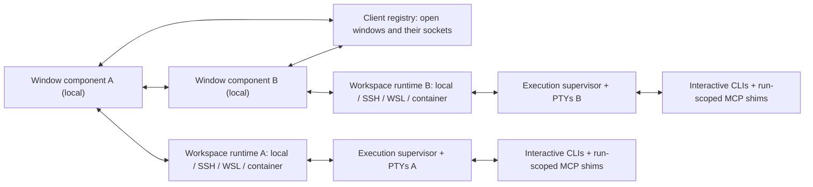

# Architecture and engineering

Layer 4. The product and shared rules decide behavior; this document chooses the implementation structure and engineering
safeguards. **This is a target design. Platform gates below are unresolved evidence requirements, not implemented claims.**

| Group | Decides | Implementation evidence |
| --- | --- | --- |
| 1 Components | Workspace runtime, window components, PTY supervisor and public APIs | Pending |
| 2 Ownership and recovery | Lifetimes, bounded records and actual effects | Critical gates open |
| 3 Data and safety | Storage, paths, rendering, secrets and logs | Pending |
| 4 Repository and delivery | Layers, builds, migration, packaging and translations | Pending |
| 5 Working safely | Tests, isolated editor/CLI runs and Git boundaries | Retained safeguards |

## 1 Components

### 1.1 Separate client routing from workspace execution

**Local window components connect this computer's windows while a workspace component runs agents in each window's execution environment.**

Components are extension infrastructure, not a hosted service or separate user-facing application. The workspace runtime
owns local-to-that-environment program discovery, folders, native Git integration, process/terminal adapters and its
window's Facade tools. A supervisor in each execution environment holds PTYs and rendered screens across extension-host
reload. A per-run stdio shim supplies the launch run ID for routing and normal tree scope; it does not authenticate the
caller.

Deployment targets: `facade.facadecode` is the workspace extension. Its companion `facade.facadecode-window` runs in
the local UI extension host, keeps the current window's handover identity and registered native terminal objects, and
is the window's client component. It exports no API (`api: none`); the two components exchange validated requests
through extension commands that appear in no menu or palette: `facade.window.*`, registered by the window component, and
`facade.workspace.*`, registered by the workspace component. Cross-host requests contain only plain data; a same-host
request may validate an actual public Terminal object. The local component owns no workspace files, agent process or
PTY data transport.

The client network has no central process. Each window component listens on its own local socket - a Unix domain
socket, or a named pipe on Windows - and records its window, with routing ID, label, environment, socket and protocol,
in the client registry under the client Facade directory (3.1). It removes its entry when its window goes; an entry
whose socket no longer answers is ignored and removed. A window component reaches another window by connecting to the
socket the registry names; the receiving component hands the request to its own workspace component and returns the
answer. The caller's window handles every tool call: its own agents directly, other windows' agents through these
routes. The recipient's window performs message delivery and serializes terminal input, and results return to the
sender's window over the same route. Agent `#aN` and message `#mN` aliases are allocated client-wide from a counter in
the client registry, under its file lock, because each execution environment's own counter would repeat them. Gate G1
verifies this design, its installation and its replacement on update.

### 1.2 Public editor APIs and explicit dependencies

**Use public extension APIs for editor interaction and an owned, versioned PTY backend for process/terminal behavior.**

No proposed APIs, internal workbench commands, guessed terminal `$mid`, patched editor files or dependence on private
vendor editor commands for core functionality. Where no extension API exists, documented user-bindable workbench
commands may be used; the editor's internal or underscore-prefixed commands and guessed `$mid` contexts remain
prohibited. A workspace extension runs where its workspace is; extensionKind is placement preference, not two
simultaneous instances.
[Official remote extension guidance](https://code.visualstudio.com/api/advanced-topics/remote-extensions).

The execution component packages a tested `node-pty` backend appropriate to its host platform/runtime, with third-party
notices. Do not locate undocumented editor-bundled native modules by guessed appRoot paths. Execution packages may be
platform-specific. This supersedes the old “one VSIX/no native dependencies” implementation choice to support remote
hosts and compatible editors honestly. No runtime downloads/compilation during ordinary activation. Unsupported ABI
fails that capability clearly and retains usable existing records.

### 1.3 Boundaries and code structure

**Business rules depend on ports, not on VS Code, sockets or vendor screen parsers.**

`core`, `record`, `clis` and `base` remain independently testable. `ui` contains panel models, commands and pickers;
`host` implements editor/environment ports, with terminal adaptation and the PTY client together under `host/execution`;
`webview` has no extension or Node imports; `ptyd` owns terminal/process/effect state, including screen reading, key
encoding and input-box readers. `schema` owns the one source of MCP tool definitions, wire types, validators, the
result envelope and the bundled skill; `contract` implements the nine tools on core ports; `transport` owns the run's
shim, its MCP stdio server and its link to the supervisor; `client` owns the window components' registry, sockets and
routing without `vscode`. Only extension entrypoints, `host` and `ui` import `vscode`.

Cross-layer source imports follow this table; imports within one layer remain allowed. Layer checks enforce the table.
The only `webview` module another layer imports is `webview/protocol`, the plain host/page contract.

| Source layer | May import these other source layers |
| --- | --- |
| `extension.ts` | `host` |
| `host` | `ui`, `contract`, `core`, `record`, `clis`, `ptyd`, `transport`, `client`, `schema`, `base` |
| `ui` | `core`, `webview/protocol`, `base` |
| `contract` | `core`, `schema`, `base` |
| `core` | `base` |
| `transport` | `ptyd`, `schema`, `base` |
| `client` | `schema`, `base` |
| `record`, `clis`, `ptyd`, `schema` | `base` |
| `base`, `webview` | None |

Modules group one cohesive responsibility rather than one helper per file. The panel's manual-order algorithms and
persisted order share `ui/order.ts`. Small shared contracts and independently tested failure boundaries remain separate:
JSON shape checks, disposal, notification sanitization, owner identity, record paths and socket ownership are examples.
UI does not import PTY transport or durable-record implementations; `contract` reaches durable stores through core
ports. No forwarding modules preserve the former `dots` paths; source and test imports move with their owning modules.

Within `host/execution`, terminal management owns native terminals, tab correlation, focus, names and disposal; the
execution session owns the PTY connection, ownership claim, connection loss and recovery scheduling; the execution
coordinator owns each run's launch, attach, reports and cleanup. Their boundaries follow state ownership, resource
lifetime and failure handling. Shared CLI presentation and theme-logo mappings belong to a presentation module used by
pickers and terminal management, not to the New Agent picker. Execution does not import a picker or a command page.
`ui/presentation.ts` owns native CLI icons and shared launch-failure wording; name normalization remains in
`core/names.ts`. Worktree input and planning are shared under WORKTREES-4.3 rather than copied into each entry flow.

## 2 Ownership and recovery

### 2.1 Routes without shared-remote-home assumptions

**The client registry is an address book; window components route requests directly; run IDs are addresses, not credentials.**

Window components register current windows and their execution environments. Route requests to the actual destination
window's runtime, preserving caller/target IDs, content, protocol and deadline. Remote paths remain in their remote
environment; equal SSH labels or folder text do not establish the same execution owner. Open windows without agents
still register. Use ordinary local IPC and the editor's cross-host command channel; no cloud relay or additional public
product is added. Validate schemas and distinguish absent, disconnected and incompatible destinations. Allocate unique
IDs without reuse from the registry's counter; cryptographic identity and unforgeability are not requirements.
The normal shim supplies its launch run ID. Apply YOLO/tree policy from that record. Do not add authentication,
tokens, enrollment credentials, origin-binding proofs, scoped delegation, human credentials or anti-impersonation checks.
Deliberately spoofing another ID is outside this operating policy. Keep accurate effects and routing regardless.
Large generated results or direct text can use bounded transport chunks without imposing a total raw-text size cap.
Registry location, socket naming and stale-entry cleanup are engineering choices verified under G1, not a product
workflow.

### 2.2 Window lifetime is a proof obligation

**Distinguish actual window closure from reload and temporary disconnect using demonstrated editor behavior.**

RULES-4.1 owns the contract: closure ends that window's runs, reload reconnects them and temporary remote loss does
not itself terminate them. ptyd applies its five-minute policy (D75) from the moment the owning extension host's connection
closes; a successor activation's claim cancels it, and a remote network outage that leaves the remote extension host
connected starts no timer. A stable workspace key is not enough to identify a particular live window; two windows can
share it. Route-staleness timers can detect loss, not prove closure. A window ID is the routing address the window
component assigns when it registers its window; it may change after reload. The runtime reattaches the original runs,
with the same run IDs, to the reloaded window. RULES-2.2's Window row is the conceptual identity, not this address.
Record enough current window/run association to reconnect the actual process. No durable message handover is required
solely for a closing sender; RULES-1.9 permits natural termination of work still owned by that side. The
workspace key that runs are claimed under is derived from the workspace's URI once and then kept in the editor's
workspace storage for reloads. Folder-to-multi-root conversion and Save Workspace As can replace extension workspace
state; remote conversion also reloads the window and changes `env.sessionId`. Session ID alone cannot carry this state.

The local window component keeps a random handover identity in its own directory supplied by public `ExtensionContext.logUri`.
It neither parses the URI nor reads editor storage internals. On the verified desktop editor, that directory remains the
same for this native window across these transitions and differs for a separate window, including one opening a copied
workspace. This lifecycle is a platform evidence requirement, not a guarantee inferred from the API's name. Removal or
replacement of that directory cannot justify a folder-based search for another window's identity.

The workspace component requests the identity through a public command, including its current `env.sessionId`; the UI
component rejects a request from a different session. Its answer names the component's own version too, which a remote
extension host cannot see otherwise, for Copy Diagnostics (3.3, D110). Each activation records its key and folders under that identity in
the execution Facade directory. The same window that retains its original first folder takes that key and the current
window's saved state - order, locations and choices - even if the destination workspace has stale state. Another window
does not inherit it merely by opening the same folders or copying a workspace file. The execution environment keeps one atomic exact-workspace-URI ledger, including each owner's current URI. Resolution
prefers a valid current-window handover, then the canonical URI binding, then an old saved key only if it has no ledger
entry or still owns that exact URI, then an independent URI-derived key. Owner claims fence all ledger and window-record
writes. Same-URI reload cannot use an obsolete window record to override a newer canonical binding; a changing URI can
carry an owner only while that owner still owns the window record's previous URI. No same-folder search guesses identity.
Save Workspace As A to B atomically moves that owner's binding to B and removes its A binding. Reopening A, including
with its old saved key, selects an independent owner; copying B to another URI also does not acquire B's runs. An owner
that has moved cannot be recovered through its old default URI hash. This makes a fresh profile opening the exact B URI
claim B's existing runs without merging all historical workspace URIs.
When the local component survives, native terminal replacement uses its live run-to-Terminal object registrations,
never a title, PID, private ID or an activation snapshot guess. Current session and monotonically increasing owner claims fence operations;
a late request from an earlier workspace host cannot replace or dispose a newer binding. Normal close removes the exact
object's binding. The workspace runtime serializes terminal creation: begin a bounded capture, create its terminal, wait
for that object's public open event, then finish. The local component accepts only one still-live object opened during
that capture; every extra open makes it ambiguous even if that extra object closes before finish. Earlier objects' late
close events do not contaminate the capture. Same-host completion additionally validates the actual Terminal reference.
Only successful registration replaces and disposes the prior registered object for that run. Names, empty names and CLI
titles may repeat freely. Cancellation, expiration, an old claim or ambiguous events do not guess an association.

Queued creation retains only the latest explicit reveal request and cancels
it on closure, so an earlier queued agent cannot steal focus after a later selection. Restoration after a reload waits up
to ten seconds for each terminal to open before it restores the next, so a terminal the editor never opens does not hold
up the others; its card and process are kept.

The cross-host open-before-finish ordering and retained local object identity require native editor evidence. A remote
workspace-host restart can retain these registrations while its local companion lives. A graceful local component shutdown synchronously records only its registered owner/run IDs and the actual final complete
terminal names in its own log directory. A new registry incarnation consumes that record once; an incarnation fence
prevents a late old shutdown from replacing a newer record. There is no per-output persistence or polling.

Only a proven same-window handover into that recreated registry may retire an old UI resource set after restoration.
This is a bounded heuristic cleanup, not terminal identity: it never binds an old object to any run. It examines only the
activation snapshot, excluding current PTYs and every shell/cwd/environment field, and requires known nonpositive PIDs.
The creation-time name may differ from the final displayed title, including an empty original name followed by a CLI
title. It is not compared with the final title; the shutdown record's complete title defines the old resource group.
For each complete-title group in the shutdown record, every recorded run must have been successfully registered again
in this restoration batch, and the old eligible group count must exactly agree. Then the entire old group is retired
once. Empty and duplicate names are valid groups; new CLI titles do not replace the recorded old titles. An extra matching
third-party object, missing run or uncertain PID leaves that group untouched. Canonical-only new-window takeover does
not enable this path. If a missing owned object is replaced by an indistinguishable third-party object with the exact
same title and shape, public APIs cannot tell the sets apart; this residual heuristic risk is explicit.

A strong UI-host termination without a shutdown record, or upgrade from an unregistered implementation, cannot identify
unknown old terminals. Whole-window reload and ordinary conversion require their own native evidence; this mechanism
does not close gate G2.
The integration suite drives workspace conversion outside test mode, which refuses to enter a workspace.

Gate G2 needs isolated traces for reload, extension-host restart, remote loss, close-one, close-last and immediate reopen.
Do not claim that deactivate, terminal closure, sessionId or a missing-heartbeat timer alone proves the distinction.
Earlier local probes rejected hidden-terminal death and Shutdown reason as reliable close detectors; full G2 remains open.
A proven alternative mechanism can replace a derived design; it cannot silently redefine owner behavior.
This rule is a proof obligation, not a claim that every supported editor already supplies a complete mechanism.

### 2.3 Execution ownership and input deadlines

**The execution owner keeps process/screen facts and serializes input independently of the visible card.**

Keep process/run identity, screen snapshot/output sequence and actual input effects across extension-host reload.
Attach without duplicating output; retain a dated final screen after exit where available.
Propagate RULES-1.5's remaining message budget to the input owner; internal hops cannot restart it.
Do not compare independent host wall clocks as if synchronized. Check whether input can still start before writing.
Uncertain effects stay uncertain; ordinary-message retries follow RULES-1.6's single paste and owned-draft Enter.
No exactly-once write protocol or operation-query service is required.

A run's shim connects to its execution environment's supervisor and names the run it speaks for. The supervisor
forwards each call to the connection that currently owns that run's workspace and returns the answer to the shim that
asked. While the owner reconnects, a call waits within RULES-1.2's two seconds, or a query within its ten-second route
deadline (MCP-1.3); otherwise it is refused as window unavailable with no effects. A call that reached a window which
then went away reports unknown effects. A window learns from the supervisor when its run's shim connects, which is the
run's tool connection fact (RULES-3.1).

Explicit close immediately removes card/terminal and invalidates further input. Process cleanup uses the owning handle
or process group in the background and can terminate it when necessary. Do not wait five seconds in the UI.
If remote cleanup is unreachable, record the pending outcome and reconcile the original run on reconnect; do not claim
a proven remote exit or kill an unrelated process. Do not add expiring security leases or automatic process killing on
temporary disconnection; RULES-4.1's five minutes after the owning extension host disconnects is the only timed cleanup. Native preparation jobs are not owned by this cleanup.

### 2.4 Journals, pressure and upgrades

**Use simple bounded runtime storage, preserve observed effects across reload, and report real capacity failures.**

Keep current process/message records and sequence information needed for reconnect, actual results and history.
Request-bearing run metadata is persisted before startup effects and retained for MCP-1.1's one-hour period after its
pair is removed. Such request-only records are validated on reading, never restore a card or process, and expire
without removing a failed launch that the person has not closed (D113).
There is no caller request-key ledger, durable human-notification claim protocol or authenticated cleanup authority.
Atomic updates and a single writer for each record are ordinary implementation tools, not new API promises.
Closing a run does not replay its mail on a later run. Changing protocol does not convert old pending messages into
new deliveries.

Bound output buffers at 8 MiB per run and 32 MiB per window; headless scrollback is 10,000 logical lines / 8 MiB.
Report unavailable earlier scrollback instead of truncating a requested current result silently. Keep current screen/UI
usable during output flood using ordinary backpressure and snapshots. A transport buffer limit is not a total direct-
input limit. Real disk/memory/storage exhaustion fails the requesting operation; there is no product cap of 100 agents
or a lifetime operation-count quota that disables an otherwise usable session.

Existing processes are not killed just because an extension/protocol is updated. Compatible reconnect preserves their
actual identity; incompatible tools report unavailable. New starts use current settings/protocol. This includes the
first update from the released 0.0.1 preview: agents its supervisor holds stay visible and usable in their window after
the update, each in an editor terminal of its own without a card and without Facade tools, until they end or their
terminal is closed with RULES-4.1's confirmation, and the update alone never starts RULES-4.1's five-minute cleanup for
them; one notification says so in plain words (D92). Upgrade/reload behavior and window-component replacement must be verified with in-flight
work under the applicable delivery rules.

## 3 Data and safety

### 3.1 Storage owners

**Data remains in its owning environment and belongs to the user; Facade uploads nothing and adds no telemetry.**

| Store | Contents |
| --- | --- |
| Client Facade directory, `<FACADE_HOME or ~/.facade>/extension/client` on the client computer | Window registry - each open window's routing ID, label, environment, socket and protocol - and the client-wide alias counter |
| Execution Facade directory, `<FACADE_HOME or ~/.facade>/extension` in that execution environment | Process/screens/effects, per-run launch files, the injection record (CLIS-2.2), message records, previously successful model/effort choices and location metadata |
| Editor workspace storage | Human CLI/location choices, order and the workspace key (2.2); a copy is kept in the execution Facade directory beside the runs (D70) |
| Vendor CLI store | Its own conversations, credentials and settings |
| Beside the main checkout | New worktrees under WORKTREES-2.2 |

An environment variable can override the Facade directory, and tests always use temporary overrides. `FACADE_HOME`
(default `~/.facade`) is a root shared with the Facade Code IDE, and the extension uses only its `extension/` subfolder.
Directories are interpreted in their own environment, never an assumed shared remote home. Use normal application
storage; no prescribed private-directory modes, ACL security protocol or randomized socket path scheme is required.
Reconcile stale process records before cleanup and avoid deleting arbitrary files. Thirty-day message/log retention
does not delete vendor history.

### 3.2 Files, Git and untrusted text

**Preserve user files and exact paths; treat outside text as data rather than executable interface content.**

Preserve URI authority and compare paths in the owning environment. No shell interpolation or blanket recursive
deletion. Native Git owns worktree creation/preparation; Facade provides no discard/initialization subsystem; its one
deletion is WORKTREES-3.2's `git worktree remove` without `--force`.
Webview rendering uses text nodes and the editor's normal resource constraints; messages do not execute command links.
Validate protocol shape and use bounded chunks/parse work without silently rejecting direct text by a total-size cap.
Native editor trust and CLI sandbox/approval controls remain native; Facade adds no separate security product or
prompts.

### 3.3 Diagnostics

**The agents log records operation and lifecycle facts without secrets or task-policy judgments.**

Use a log with UTC time, safe name/reference, operation ID, phase, effects, route status and actual failure. Redact CLI
credentials and sensitive environment values. Full message text belongs to deliberate message history, not routine
transport logs. Correlation IDs connect UI/MCP/supervisor observations. Retain 30-day diagnostics subject to the
capacity policy; no telemetry service is introduced by this refactor. Each tool call is logged with its tool, its caller's
alias, its status and error code and how long it took, never its arguments (D111).

Copy Diagnostics puts on the clipboard, in English as the log is, what a report of a problem needs, and sends nothing
anywhere: the extension's, its window component's and the editor's versions, the platform and the remote kind; each
built-in CLI for the window's first location - its version as its installation says it and its input reader, or why it
cannot start; this window's agents - CLI and version, lifecycle, activity and since when, tools, and what their input
reader reads now - with each live one's last twelve screen rows; and the agents log's last two hundred lines. The home
folder is written `~`. Its notification says that screens can show code and keys, and to look the text over before
sharing it (D110).

## 4 Repository and delivery

### 4.1 Source layout and build

**Source, specifications, generated output and temporary probes have separate locations.**

`extension/` is the extension's root: README/AGENTS/licenses/notices/package manifests/lock/tsconfig/.nvmrc; the paths
below are relative to it. `.agents/` is not version-controlled anywhere in the repository: the product injects
`.agents/skills/facade` into project folders for Codex, so a committed `facade` skill would conflict under CLIS-2.2;
repository-owned skills never use the `facade` name. The maintained layout has no shared `.vscode/` configuration. Build, test and packaging run
through repository scripts; optional developer-local editor settings are not prerequisites and never replace the
isolated test profiles in group 5. `docs/extension/` at the repository root: the complete maintained documentation,
including normative rules and audit data. `src/`: code/tests by layers; `l10n/`: all translations; `media/`: shipped
assets; `scripts/`: build/audit tooling. Generated code/package/test output goes under `build/`, never source folders.
Component packaging uses `build/extension/` (execution, including the run shim) and `build/window/` (local window
component, including its network code); native artifacts have explicit platform/ABI ownership. The window component
has no native backend and ships as a separate universal VSIX.

Use Node 24 from `.nvmrc`. Clean checkout/CI dependency installation uses `npm ci` with the committed lockfile;
`npm install` is for deliberate dependency changes, with their lockfile changes reviewed together.
Current build/check commands: `npm run compile`, `npm run bundle`, `npm test`, `npm run package`, `npm run test:package`
(package-content checks; they require `build/vsix` from `npm run package`) and
`VSCODE_EXECUTABLE=<isolated editor executable> npm run test:integration`. On Linux the integration suite runs under a
virtual display (`xvfb-run -a`); on Windows it runs in the signed-in desktop session, as an SSH session has no desktop, and
its fake CLI is a Node single executable application, as a Windows CLI is an executable. `npm run test:remote` runs the
journeys over Remote-SSH from this computer to a host of a given SSH configuration (`FACADE_IT_SSH_CONFIG`,
`FACADE_IT_SSH_HOST`, `FACADE_IT_REMOTE_EXTENSION` naming the extension built on that host): one SSH window, two SSH
windows, local to SSH and SSH to local, each with Remote-SSH and the editor's server in folders of the run's own.
`FACADE_IT_ONLY=real` runs real agents of one built-in with YOLO off - never part of a default run, as it signs in and uses
an account's usage - with `FACADE_IT_REAL` naming the built-in, `FACADE_IT_REAL_PATH` its executable, `FACADE_IT_REAL_ENV`
the variables its terminals get and `FACADE_IT_REAL_PASS` those taken from the environment, never written to a file. Document changes to these commands before using a different build layout. Lock dependency versions, preserve licenses/notices, and keep generated/runtime files ignored.
Do not repurpose HOME/CODEX_HOME as script scratch variables.

The integration fixture build is staged separately in `build/extension-it/`; `npm run test:integration` assembles it from
the current bundled extension before launching the isolated test editor. Test-only adapters/commands are absent from
production bundles/manifests under UX-3.2. A fixture passing does not verify its corresponding real CLI.

The root README includes repository development instructions when useful. A single optional block marked
`<!-- repository-only:start -->` and `<!-- repository-only:end -->` is omitted from the staged README; all other content
is preserved. No markers means no omission; unmatched, nested or repeated markers fail the build. The source README is
never rewritten by staging. This keeps repository setup instructions out of the installer-facing product description.

### 4.2 No compatibility migration

**Facade Code keeps the settings and command IDs of its 0.0.1 preview and migrates nothing from earlier development builds.**

Version 0.0.1 is the only published build. This step adds settings and commands and renames or removes none of its
ones; a record written by 0.0.1 is read where its format is unchanged and otherwise ignored with one line in the agents
log, never translated. Earlier development settings and stored workspace state are not read into the current catalog,
and earlier command IDs get no aliases; this includes the Facade Dots development builds' `facadeDots.*` and
`facade.agents.*` settings and their `~/.facade-dots` directory. Old MCP tools/arguments from those builds fail
explicitly; they are not translated into a different action, do not widen tree reach and do not replay old mail. Records stored by earlier development builds, such as card order and known
locations, are ignored with one line in the agents log. They are never translated or replayed. Discoverable worktrees
remain available because Git discovers them. Never delete vendor history, user work or an earlier Facade data
directory. No migration-news popup is required.
Retired launch-group/trust/settings-template fields report a configuration error under CLIS-3 instead of keeping a
parallel compatibility engine.

### 4.3 Packaging and version support

**Ship the runtime component with tested platform artifacts and an honest minimum-editor capability matrix.**

Base minimum remains VS Code 1.105 until evidence requires an explicit engineering update; a newer public API must be
feature-detected or raise the declared minimum, never called unguarded. Publish targets remain Marketplace and Open VSX,
only when the owner asks.
[Official manifest reference](https://code.visualstudio.com/api/references/extension-manifest).

Bundle runtime dependencies and third-party notices, test commands excluded; package both components from build output
with pinned vsce. The workspace manifest installs its local window component through `extensionPack`, not
`extensionDependencies`: in a remote window the editor installs the remote extension and activates it before it
installs a local dependency, and an unmet dependency then blocks activation with no reload offered. At activation the
workspace component waits up to 60 seconds for `facade.window.identity` and continues as soon as it appears, including
when the editor reports the component installed later. If it does not appear, existing agents keep running, New Agent
stays unavailable, and the panel and one notification explain in plain words that the Facade Code Window Component
must be installed and enabled on this computer, with an action that shows it in the Extensions view; a reload is
offered once it is installed. A window component that speaks an older network protocol leaves its window usable and
reports, to agents, that other windows are unavailable. Unpublished installation tests install that component locally
as well as the platform-specific execution VSIX in its execution host.
The execution stage includes its owned `node-pty` package, required runtime dependencies/resources and their license
notices under `build/extension/node_modules/`. Native artifacts match the explicitly selected target OS, architecture
and runtime ABI; the loader resolves this packaged backend, not an editor-internal module. A build verified on the
current host establishes that target only. Other targets require their own artifacts and the verification below.
Verify actual VSIX contents and install in clean profiles for each supported editor/OS/remote host. Native backend ABI,
architecture and remote server runtime are explicit build targets. Compatible editor marketing follows measured support,
not a promise that arbitrary forks work. Version mismatch must leave user work intact.

### 4.4 Localization

**Every human-facing implementation string reaches all supported locales in the same change.**

UX-2.4 owns languages/terminology. Keep manifest and runtime translations under `l10n/`; build places manifest strings
beside each shipped manifest. Use a pinned localization exporter/checker in scripts, verify keys/placeholders across all
languages, and remove obsolete keys. Do not depend on a developer's temporary language-pack files for release checks.

## 5 Working safely

### 5.1 Required checks

**Implementation acceptance requires type checks, relevant unit tests, build, integration and affected runtime scenarios.**

Required commands: `npx tsc -p ./`, `npx tsc -p ./src/webview`, `npm test`, `npm run bundle`, `npm run package`,
`npm run test:package`, and integration against the editor version actually used. Record version and result.
Add meaningful regression tests for behavioral fixes and check
sibling CLIs/platforms/entrypoints for the same defect. For UI-only reversible iteration do not run every suite each
small edit; run complete gates at milestones. Docs-only changes need structural/coverage checks, not a fake code-test pass.
VERIFICATION defines additional release scenarios and distinguishes unrun from passed.

### 5.2 Editor isolation

**Every editor launched for work/testing uses its own short temporary user-data and extensions directories.**

Never run the installed editor, even `Code --version`, against the owner's profile; read installed version metadata
instead. Prefer integration/headless checks. Never drive, reload, close or inspect the owner's existing windows/agents
as test subjects. An explicitly requested new implementation agent is a collaborator, not permission to manipulate the
owner's unrelated sessions. Temporary test windows can take focus; minimize them and record isolated paths. An isolated
editor is the official VS Code build, installed or downloaded under `build/`, never a derived product such as the Facade
Code IDE that loads its own built-in agent extension or shares a data folder with the owner's live state. Test editors
start with a sanitized environment, without inherited editor IPC, Git askpass or CLI credential variables, and use short
temporary roots that respect the platform socket-path limit. Product code never invokes the editor CLI, for example
`code --status`, against a default profile.

### 5.3 CLI isolation

**Real CLI probes use isolated temporary state and never mutate the owner's conversations, memories or configuration.**

Use CLI-supported state-directory overrides for the probe process only, never repurpose HOME/CODEX_HOME as scratch
variables. No probe when the CLI cannot be isolated; use recorded evidence and report the gap. **Never run a real Qwen
probe** under this repository's standing safety rule. Keep real model probes short. Collaborator assignments and model
choices follow current user instructions; authorization to start one does not authorize additional collaborators or
credential/global-configuration changes.

### 5.4 Working tree and commits

**Preserve unrelated working-tree changes and never stage, commit, push, publish or release without an owner request.**

Inspect the current working-tree baseline before edits. Work in the authorized workspace or explicitly tracked
isolated worktree; uncommitted content does not follow a new Git worktree automatically. Never reset/clean to simplify a
refactor. Remove only generated artifacts owned by this task. Logs and completion reports identify what was changed,
what was tested and what remains. Task assignments, pauses and discussion authority follow current user instructions.

## Checks

| Rules | Acceptance |
| --- | --- |
| 1.1–1.3 | Local/remote installation, window components and registry, public API audit, layer rules, native backend package |
| 2.1–2.4 | G1 routes between local and remote windows; G2 actual close/reload traces; folder-to-workspace handover; shim routing and input deadlines; pressure/upgrades including from 0.0.1 |
| 3.1–3.3 | Storage ownership/retention, preserved user files, correct paths and safe text rendering without an authentication subsystem |
| 4.1–4.4 | Build/package checks and native ABI matrix, extension-pack installation in local and remote windows, earlier-build state ignored without migration, locale completeness |
| 5.1–5.4 | Evidence and command logs, isolated profile/config paths, dirty-tree preservation, no unrequested Git publication |

See [Verification](VERIFICATION.md). G2 is not asserted solved by writing this design.

## Change log

- 2026-10-31: Copy Diagnostics includes component versions and terminal facts; tool logs omit arguments.
- 2026-10-31: 4.1's real run takes any built-in, its configuration given to its terminals.
- 2026-10-30: Step 2 of the Facade Code extension: 1.1 makes the window component the client component, using local
  sockets and a client registry without a broker process (D87); 1.3 adds the `schema`, `contract`, `transport` and
  `client` layers; 2.1 carries the Facade Dots routing rule; 2.3 adds shim call routing and input deadlines; 2.4 keeps
  agents of the 0.0.1 preview running across the first update; 3.1-3.3 add the client registry, message records and
  route logging; 4.1 ignores `.agents/` (Dots D50); 4.2 keeps the preview's settings and command IDs and refuses old
  MCP calls (Dots D37); 4.3 installs the window component through `extensionPack` with a bounded wait and a plain
  explanation (D88).

- 2026-10-30: 2.2 and 2.3 describe the owner's five-minute policy (D75) as ptyd applies it, and 2.2 bounds the wait
  for each restored terminal to open.

- 2026-10-30: Replace terminal-title recovery with current-claim-fenced local Terminal object registration. Native public
  event-order and third-party-interference probes justify implementing the bounded capture; final duplicate/empty-name
  recovery still requires Linux and Windows evidence. Loss of the local host's registry remains an explicit limitation.

- 2026-10-30: Replace the session-only D70 handover with a local window component and public command exchange after
  isolated desktop SSH Linux/Windows probes of conversion, Save Workspace As and a separate copied-workspace window.
  The new component and directory lifecycle still require the full supported-editor matrix; no automatic-reload watchdog
  or solved true-close detector is implied.

- 2026-10-29: Following the owner's duplicate-implementation review, identify the shared worktree input and native
  presentation owners; pickers and terminals reuse them, and UI name editing reuses core name normalization.

- 2026-10-29: Rule 1.3 names the presentation layer `ui`, places terminal adaptation and the PTY client under
  `host/execution`, and specifies the enforced import directions. Panel order algorithms and persistence share one
  module; small shared contracts and independent failure boundaries remain separate. This changes source ownership,
  not runtime behavior or stored data.
  The execution adapter separates terminal resources, connection ownership/recovery and run coordination; CLI
  presentation mappings are shared by their actual consumers rather than owned by a picker page.
- 2026-10-29: Added the owner-approved 4.2, no compatibility migration; 3.2 names Facade's one deletion (D73).
- 2026-10-29: Step 1 of the Facade Code extension, carried from the Facade Dots specification: the rules step 1
  needs, each with its final number. Later steps add the others.
  Extension ID `facade.facadecode`; data directory `<FACADE_HOME or ~/.facade>/extension`.
