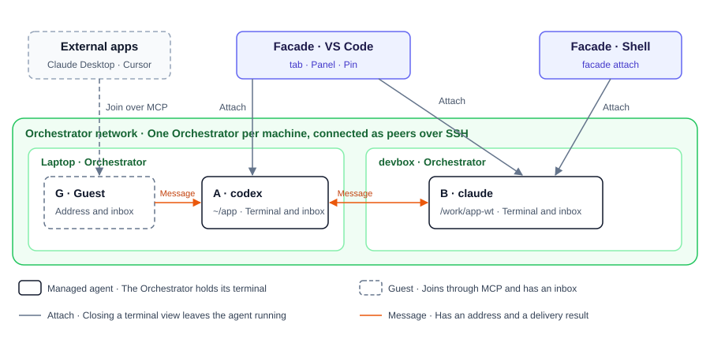

# Facade Code

Facade Code 让你在自己的几台机器上跑一群 AI 编程 CLI，比如 Claude Code 和 Codex，并让它们互相找到、互相发消息，还能看彼此的屏幕、往彼此的终端里打字。你可以从终端、VS Code 或任何支持 MCP 的应用里看着它们、指挥它们。

打个比方：Facade Code 管 CLI，就像 k8s 管 docker 容器。

> 这一版吸收了三方审查（PM、General TL、design partner）找出的硬伤、不合理和不一致，以及你对这些问题的决定。原则是同一件事只有一条规则，不开例外，也不加新功能。



---

## 两部分：Orchestrator 和 Facade

**Orchestrator** 在每台机器上跑一个，管这台机器上的 Agent。这里的「一台机器」，指一台电脑上的一个 Facade home：平常一台电脑就一个，测试时可以用 `FACADE_HOME` 另开几个，它们互不相干，要连起来也和两台电脑一样用 `machine add`。你几台机器上的 Orchestrator 用你自己的 SSH 连在一起，彼此平级，没有总控，还会互相转发：笔记本醒着、同时连着 devbox 和 gpu-box 时，devbox 也能经过笔记本找到 gpu-box。

**Facade** 是所有用 Orchestrator 的入口，现在有三个：

- **Shell**：`facade` 命令，给人和脚本用。
- **MCP**：`facade-mcp`，给 Agent 和外部应用用。
- **VS Code**：扩展，给人用。

Facade 只跟本机的 Orchestrator 打交道。要动别的机器上的 Agent，由本机的 Orchestrator 替它转过去。

```text
Facade Code
├── Orchestrator（每台机器一个），分四部分
│   ├── Agent ··· 名册、Guest
│   ├── 执行 ···· 机器、运行、设置、各个 CLI 不一样的地方
│   ├── 交互 ···· 消息、终端
│   └── 服务 ···· 安装、升级、两个进程
└── Facade
    ├── Shell ··· facade 命令（人、脚本）
    ├── MCP ····· facade-mcp（Agent、外部应用）
    └── VS Code · 扩展（人）
```

**Facade Code 不管这些事：**

| 事 | 归谁 |
|---|---|
| 模型、推理、工具调用、登录、会话内容 | CLI 自己 |
| 怎么分工、怎么汇报、谁验收、什么时候提交 | 你的 prompt 和 skill |
| 装 CLI、CLI 的账号、项目文件 | 你 |
| 外部应用的进程和界面 | 外部应用 |
| 提交、合并、代码评审、删 worktree | 你的 Git 工具。Facade Code 只在启动时帮你新建 worktree |
| 机器之间的 SSH 配置 | 你自己配好，Facade Code 只用 |
| 别人的机器和账号 | 不碰。一套 Orchestrator 网络只属于你一个人 |

---

# Orchestrator

## 1 Agent

Agent 是 Facade 里有名字的参与者。打个比方，它有名字、有嘴巴（能发消息）、有耳朵（能收消息）。Agent 分两种：

- **受管 Agent**：由 Orchestrator 启动，终端也由 Orchestrator 拿着，所以还多一个「脑机接口」：别人能读它的屏幕、往里打字。
- **Guest**：外部应用（Cursor、Claude Desktop、你自己开的 claude……）配上 `facade-mcp`，连进来就是一个 Guest。它只有名字和收件箱。

|  | 受管 Agent | Guest |
|---|---|---|
| 怎么来的 | `facade start` 启动 | 外部应用连上 `facade-mcp` |
| 发消息 | 能 | 能 |
| 收消息 | 等输入框空了，直接打进它的终端 | 进收件箱，它调 `read_messages` 取走才算收到 |
| 读屏、打字、Attach | 能 | 没有终端 |
| 启动、停止、继续、删除 | 能 | 不能。外部应用一断开，它就没了 |
| 改名 | 能 | 能 |
| 在 `facade list` 里 | 跑着的时候 | 连上、第一次调用工具以后 |

有的 CLI 自己做不到其中某几样，比如自定义程序收不了信，见「执行」里的「各个 CLI 不一样的地方」。

### 编号、名字和地址

每个 Agent 都有一个编号和一个名字，两者不是一回事：

- **编号**像流水号。每台机器自己从 `a1`、`a2` 往下发，发过的号不再发，所以在一台机器上，一个编号永远只指一个 Agent。
- **名字**像昵称，什么字都能用，也可以重复。没起名字时，从这台机器的名字池里随机挑一个，并避开 `list` 里现有的名字；池里的名字都被用上了，就允许重名。不会拿编号当名字。Guest 也这样起名，`list` 的 CLI 一列写的是它来自哪个应用，比如 cursor。

地址是「编号@机器」，比如 `a3@devbox`；机器名重了，就写机器 ID，比如 `a3@9a0d44b2`。`list` 和 MCP 给出的地址本来就带机器，照抄就行：Facade 给出的机器那一段，总是写成照下面的规则只找得到一台的样子，名字不重就写名字，重了写 ID 前 8 位，前 8 位也撞了就写完整的 ID。

找 Agent 只有一条规则：**不写机器，就在醒着、连得上的机器上，找这个操作用得上的 Agent；写了机器（地址带 `@`，或者用 `--machine`），就只去那一台找，它歇着就把它叫醒。只找到一个，就是它；找到好几个，就报错，列出它们的完整地址让你挑。**

- **用得上的。** 你有权限动的，而且这个操作对它有用：发信只找收得了信的，也就是在跑的受管 Agent 和连着的 Guest；打字只找在跑的受管 Agent；resume、删除、读屏、看详情对停了的也有用，就连停了的一起找。
- **编号还是名字。** 长得像编号的（`a` 加数字）就当编号，其余的当名字。
- **带 `@`。** `@` 后面那一段，既当机器名找，也当机器 ID 找，都对上不同的机器就报错。编号带 `@`，比如 `a3@devbox`，就是 devbox 上的 a3。名字带 `@`，比如 `Pixel@gpu`，有两种可能：gpu 上叫 Pixel 的，或者名字本来就叫 `Pixel@gpu` 的。两种各按上面的规则找：前一种写了机器，只去 gpu，它歇着就叫醒；后一种没写机器，只找醒着的机器。两种都找到就报错；其中一种查不了，比如 gpu 叫不醒，也报错，不悄悄只用另一种。
- **会话。** `resume` 还能用 CLI 自存会话的 ID，比如 `7f3e9a1c`。可从表格复制 `REF`。多个匹配时会列出候选，让你选择完整 ID。
- **找不到能用的**，也报错，并说清为什么：没有这个 Agent、它已经停了，或者它超出了你的范围。超出范围的，不列它的地址。

### 状态

```text
受管 Agent：start → starting → 运行中 ──stop / 退出 / 崩溃 / 机器重启──→ ended → 30 天后自动清掉
                                ↑                                   │
                                └──────────────resume───────────────┘
Guest：     连上 → online → 断开就没了
```

受管 Agent 运行时会显示它在干什么：`working`（在干活）、`waiting_for_you`（等人回答权限、问题或登录）、`just_done`（一轮刚结束，还没人看）、`idle`（空闲）、`error`（出错）、`unknown`（看不出来）。

### 能做的事

- **`start`**：启动一个 Agent，详见下一节「执行」。
- **`stop`** 可以一次停多个 Agent，也可以用 `--local`、`--machine <MACHINE>` 或 `--all` 按范围停止。按范围停止跳过 Guest，探测远机时让休眠的机器继续休眠。部分失败时会继续处理其他目标，再报告失败并返回 1。Agent 的记录保留 30 天，它叫来的帮手照常跑。
- **`resume`** 默认在前台接上，加 `-d` 放到后台。恢复已有 Agent 会沿用原 Ref、目录、会话和启动时的模型及 effort，并使用运行机器的当前设置。直接运行 `facade resume` 会列出可达机器上能恢复的已停止 Agent，以及本机当前目录中 CLI 自存的会话。`--local` 只查本机，发起零次 SSH。`--machine <MACHINE>` 列指定机器上的可恢复 Agent。恢复自存会话会创建一个新的 Agent。会话已被占用时，错误会给出占用它的 Agent。
- 通过 VS Code 可以删除 Agent 的记录、屏幕和收件箱。Agent 还在跑的话，先停掉它再删除。
- **`rename`** 改名字，Ref 不变。给出一个非空名字。
- **`list`** 列出可达机器上跑着的 Agent 和连着的 Guest，最近一次启动或恢复的排在最上面，`STARTED` 从那次算起。默认按需探测已保存的机器，让休眠的机器继续休眠。`--local` 发起零次 SSH。`--machine <MACHINE>` 只查指定机器，需要时会唤醒它。
- **`status <AGENT>`** 显示 Ref、名字、状态、运行机器、CLI、工作目录、启动命令、会话、启动来源、当前查看者和 YOLO。

```text
$ facade list
NAME   REF         STATE     CLI      TYPE      WORKING DIRECTORY  STARTED  TITLE
Eve    a9@devbox   Idle      claude   Managed   /work/app-wt       1m ago   Write release notes
Cora   a5@laptop   Online    cursor   Guest     -                  5m ago   -
Ada    a3@laptop   Working   codex    Managed   /work/app          2h ago   Fix the failing parser test
```

TITLE 是 CLI 给自己设的标题，最长 40 个字，超出的部分截掉。

### 权限和 YOLO

你从 Shell 或 VS Code 操作，不受任何限制。Agent 能做什么，由 YOLO 决定。YOLO 是每台机器设置里的一项，没写时是开着。和别的设置一样，Agent 在 start 或 resume 时读一次，跟着这次运行走。所以平常一台机器上的 Agent 要么全开、要么全关；改了设置以后，已经在跑的不变，resume 以后才跟上。几台机器连在一起时，各台按各台的设置。

| | YOLO 开着 | YOLO 关着 |
|---|---|---|
| CLI 自己的权限确认、信任目录 | Facade 替它关掉，或者替它回答 | 不碰，照 CLI 自己的设置来 |
| 沙箱 | 有的话就关掉 | 不碰 |
| CLI 向人提的问题 | 留给人回答 | 留给人回答 |
| 调用 Facade 工具时的确认框 | 免掉 | 也免掉 |
| 能找谁、发信给谁、操作谁 | 所有 Agent | 只限它所在的那棵创建树：叫它来的、它叫来的、同一棵树上的兄弟 |

一句话概括：YOLO 开着，什么都能做；关着，就只能在自己那棵树里活动，发信和回信也一样。树上要是有一个开着 YOLO 的 Agent，借它的手去办树外的事，这是允许的。

YOLO 关着时，CLI 自己的确认和沙箱照常起作用。Agent 想在自己的终端里运行 `facade` 命令，得先过这一关；放行了，就和你自己在命令行里运行一样，不受树的限制。

Guest 的 YOLO 在它连上时从那台机器的设置读一次，不过只有最后一行对它有用：外部应用自己的权限确认和沙箱，Facade 管不着。

### Guest 怎么加入、怎么收信

在外部应用里配一行 `facade-mcp` 就行。一条连接算谁，只有一条规则：**它来自哪个受管 Agent 自己的 CLI 会话，就算那个 Agent；其余的都是 Guest，一条连接一个 Guest，各有一个收件箱。** Orchestrator 给受管 Agent 配的那一行，带着一个只有它才有的参数，一看就知道是谁；你自己在 CLI 里配的那一行，就看它在哪个会话里。Agent 在终端里起的子程序，比如用 `claude -p` 请另一个模型看一眼，有它自己的会话，所以算 Guest，冒充不了这个 Agent。一条连接在它第一次调用工具时认定是谁，认定了就不再变；在那之前，它不出现在 `list` 里，也收不到信。

Guest 的用法是「发完再等」。Guest 用 `send_message` 发完一封信，返回的 JSON 里要写明下一步：调用 `read_messages` 等这封信的回复。要求是模型照着就能调对。下面的写法只是参照，实现时模型读不懂就改：

```json
{
  "status": "success",
  "data": {
    "id": "m42@laptop",
    "delivery": "typed_into_input",
    "next": { "tool": "read_messages", "arguments": { "wait": true, "reply_to": "m42@laptop" } }
  }
}
```

照着它调用 `read_messages`，就是在等 ada 对这封信的回复：每次最多等 30 秒，没等到就再调一次，这写在 `read_messages` 自己的说明里。只有发信的一方得自己去取回信时，才给这一步：Guest 得自己去取，所以有；受管 Agent 的回信会直接打进它的终端，所以没有。

发给 Guest 的信，它 30 秒内没取走，就算投递失败。所以别人主动找 Guest，一般都会失败，正常的流程是 Guest 先发信，对方趁它等回复时回给它。失败原因会写清楚：比如它在等对 m42 的回复，而你的信没带 `reply_to`，失败原因就提醒你带上再发。Guest 断开就没了，也不会出现在 `resume` 的列表里。

---

## 2 执行

执行管的是：在哪台机器、哪个目录、用哪个 CLI 把 Agent 跑起来。

### 机器

机器之间只用你自己配好的 SSH 来连，不另开端口，也不另建账号。`add` 后面照抄你平时 ssh 登录的写法，ssh 的参数会原样交给 ssh；Facade 自己的选项写在最前面。

```text
facade machine add devbox                        # ~/.ssh/config 里写好的 Host
facade machine add aaron@10.0.0.5                # 用户@地址
facade machine add -p 2222 aaron@devbox.lan      # 带端口
facade machine add -i ~/.ssh/work aaron@gpu      # 带密钥
facade machine add --home /data/facade devbox    # Facade 自己的选项：用远机上另一个 Facade home
facade machine add --bidirectional devbox       # 同时验证并保存回程
facade machine connect devbox                    # 只在这条命令开着时连着，Ctrl-C 就断开
facade machine remove devbox                     # 在本机删除连接并撤销 Facade 授权
facade machine remove --bidirectional devbox     # 同时尝试清理对端
facade machine list
facade machine rename devbox build-box
```

- **`add`** 会保存验证通过的连接。已有免密凭据时沿用它们。首次需要密码时，在登录后装入并验证 Facade 专用 SSH 公钥，后续用它重连。`--bidirectional` 同时在远机上保存回程，由远机直接连接它在 SSH 登录中看到的来源 IP 的 22 端口。回程验证失败时保留正向连接并报告原因。
- **`connect`** 在命令运行期间维持双向连接。命令结束时断开。
- **SSH 的提问。** `add` 和 `connect` 在你的终端里跑 SSH，要输密码或确认指纹时，你当场回答。第一次连一台机器时会提醒你开着 YOLO 的 Agent 能操作连通机器上的 Agent。哪台机器需要重新登录，`machine list` 会给出能照抄的 `add` 命令。
- **`remove`** 默认在本机删保存的出站连接，并撤销本机为对端装入的 Facade 授权，发起零次 SSH。`--bidirectional` 会先核实对端身份并尝试清理回程及授权，再完成本机删除。对端清理失败时会分别报告结果并返回 1。
- **装 Facade、升级 Facade。** 每次连上或叫醒一台机器时，都按同一条规则：没装，就在那台机器上跑一遍一行安装，装和本机同一个版本；版本比本机旧，就升级，上面的 Agent 照常跑。协议变了没法接管时，报错并列出要先停哪些 Agent。远机比本机新，就报错，让你先升级本机。装不了的时候，比如要输密码、远机上不了网，就报错，并给出手动安装的命令。
- **远机用哪个 home。** 默认用 `~/.facade`，要用别的就加 `--home`。
- **WSL 和 Dev Container** 各算一台机器。要从外面连上它们，也得在里面开好 SSH，再 `machine add`；在它们里面直接用 Facade，就用不着 SSH。
- **机器名**默认取主机名第一个点之前的部分，转成小写，只用小写字母、数字和 `-`；可以改，改的时候也是这个写法。机器 ID 是第一次运行时生成的，写的时候用前 8 位就够，比如 `9a0d44b2`。
- **按需连接和休眠。** Orchestrator 连续空闲 30 秒会退出，按需打开的 SSH 会话也在各自空闲 30 秒后关闭。前台连接、正在看的 Attach 和办到一半的调用都会保持会话活跃。点名执行 `start --machine devbox` 或 `resume a3@devbox` 可以唤醒目标和所需跳点。默认 `list` 与远机范围的 `stop` 做无唤醒探测。
- `facade machine list` 仅读本机机器表，发起零次 SSH，区分当前未连接、已确认休眠、连接失败和需要 SSH 登录。多机 Agent 查询在 stderr 报告查询失败。

### 运行：启动一个 Agent

```text
facade start [--machine M] [--workdir D] [--worktree B] [--name N] [-d] <CLI> [CLI_ARGS]...

facade start claude                                                        # 本机，当前目录
facade start --machine devbox --workdir /work/app claude                    # 在 devbox 上启动
facade start --machine devbox --workdir /work/app --worktree feat-x codex   # 新建一个 worktree，在里面启动
facade start -d -n Nova codex --model gpt-6.2-sol                           # 用 CLI 自己的选项后台启动
```

- `start` 的回执确认 Agent 已经启动。需要确认任务送达时，用 `facade send` 并检查送达回执。MCP `start_agent` 的首条任务仍由 Orchestrator 安排投递，结果用 🔔 告诉启动它的 Agent。
- **默认值。** 默认用发起的人或 Agent 所在的地方：Shell 用本机和当前目录，VS Code 用窗口所在的机器和工作区里的文件夹，MCP 用发起调用的那个 Agent 所在的机器和目录，Guest 用它连进来的那台机器。没有现成的目录可用时，比如在别的机器上启动，或者发起的是没有目录的 Guest，不写目录就用那台机器登录后的 home。
- **目录。** 普通文件夹、Git 仓库、已有的 worktree 都行，没有 Git 也照样能用。`--worktree` 会从那个仓库当前的 HEAD 新建一个分支和 worktree，放在仓库旁边的 `<仓库>.worktrees/<分支>`；分支已经存在就报错。删 worktree 不归 Facade 管，用 `git worktree remove`。
- **CLI。** 能跑的是 6 个内置的 CLI（claude、codex、agy、muse、opencode、pi），以及那台机器的设置里另外加的，包括「自定义程序」。其他程序一律拒绝。没写用哪个 CLI 会报错，并列出能用的那几个。那台机器上没装这个 CLI，就直接失败，不会拿别的机器上的顶替。
- **环境变量。** 也跟着发起的一方：在本机启动，用发起的那个 Shell、VS Code 或 Agent 的环境（Guest 用它那条 `facade-mcp` 带来的环境）；在别的机器上启动，用那台机器的登录环境，就像你 ssh 上去新开一个终端。
- 模型、推理和提示词可用 CLI 自己的参数，在 CLI 名称之后传入。也可以在目标机器的设置里配置默认值。已记录的启动选择在 `resume` 时继续使用。
- **信任目录。** 很多 CLI 第一次进一个目录会问「信任这个目录吗」。YOLO 开着时，由 Orchestrator 替你回答；YOLO 关着时，留给你自己答。
- **接入。** Orchestrator 给受管 Agent 配好 `facade-mcp` 和钩子，只在这一次运行里有效，不会写你的全局配置。你自己在 CLI 里配的那一行 `facade-mcp` 也不碍事：连接算谁，按会话认。
- **不自动拉起。** Agent 退出、崩溃或者机器重启以后，Orchestrator 不会自己去拉它，要接着干就 `resume`。VS Code 重开窗口时拉起 Pin 住的 Agent，是 VS Code 替你做了 `resume`，见后面 VS Code 一节。
- **失败时说清是哪一步。** 机器连不上、目录不存在、建 worktree 失败、CLI 没装、设置文件写错，会分开报。

### 设置

每台机器有自己的 `facade.json`，里面是 YOLO、名字池和 CLI 配置。Agent 使用运行机器的设置。`facade status` 会显示本机设置文件的位置。要编辑别的机器的设置，可先 SSH 登录那台机器，再运行 `facade status`。改完后，下一次 `start` 或 `resume` 会使用新设置。配置有错时，启动会报出对应的问题。

### 各个 CLI 不一样的地方

规则对所有 CLI 都一样。某个 CLI 自己做不到的，就照它的样子来，细节写在它的规则文件里。现在有这几处：

| CLI | 它做不到的 | 所以 |
|---|---|---|
| claude | 没有能跳过「信任这个目录吗」的参数 | YOLO 开着时，Orchestrator 认出那一屏，按键选「信任」 |
| agy | 只认项目里的插件 | 它运行期间，项目里会多一个 `.agents/plugins/facade/`，用完就删；读到这份插件的其他 agy 进程，也可能被当成这次运行 |
| muse | 只能有一个叫 facade 的服务：你自己也配了一行时，Orchestrator 加不进自己那一行 | 就用你那一行，按会话认出它是哪个 Agent |
| pi | 不把会话号交给 MCP 服务 | Orchestrator 用这次运行的启动参数接上自己的那一行；你自己在 pi 里配的那一行，算 Guest |
| agy | 启动后，Facade 的工具要过一会儿才就绪，它自己不说 | 启动时，Orchestrator 在它的终端里打一次 `/mcp`，看到 facade 就绪再关掉，然后才送第一条任务 |
| opencode | 不收模型和 effort 参数 | 给了 `--model`、`--effort` 就报错；模型和 effort 用它自己的设置 |
| opencode | 这次运行的 MCP 配置只能通过环境变量传进去，它起的其他进程也会继承 | Orchestrator 照常给受管 Agent 接上 Facade；继承了这份配置的其他 OpenCode 进程，也可能被当成这次运行 |
| 自定义程序 | Facade 认不出它的输入框，也给不了它工具，它也没有会话 | 能启动、读屏、打字、Attach，但收不了信，也发不了信，也不能 resume 和 Pin |

对所有 CLI 都一样：你自己配了一个也叫 facade、却不是 Facade 的服务，这次运行就拿不到 Facade 的工具。

---

## 3 交互

交互有两种：用消息说话，以及直接读写终端。

### 消息

- 一条消息只发给一个 Agent，只能是文字，最多 8000 字、540 行。
- 发件人是某个 Agent，或者是命令行：从 Shell 发的信不说是谁发的，只写「命令行」，Agent 在自己终端里运行 `facade send` 也一样。命令行没有地址，所以这样的信回不了。Facade 里没有「人」这个收件人：Agent 不能给人发消息，想知道它在干什么，就去看它的屏幕和状态。Agent 要是试着回信给命令行，会拿到一个说清楚的错误。
- 每条消息都有编号，比如 `m17`。编号和 Agent 编号一样，由收件人所在的机器往下发，发过的不再发。在别的机器上用，就带上机器，写法也和 Agent 地址一样：`m17@devbox`，机器名重了才写 `m17@9a0d44b2`。
- 回信时用 `reply_to` 指明在回哪一条，收件人就是那封信的发件人，写了别人就报错。你回的那封信一定在你自己的收件箱里，所以只写 `m17` 就够了。等别人回信时（`read_messages` 的 `reply_to`），照抄发信结果里那个带机器的完整编号。

**真的收到才算收到：**

| 收件人 | 怎么送 | 什么时候算收到 |
|---|---|---|
| 受管 Agent | 等它的输入框空了，把消息贴进去再按回车，不会盖掉没打完的草稿 | 打进去并按了回车。30 秒内没做到，就撤回，把已经打进去的字删掉，算失败并说明原因 |
| Guest | 放进它的收件箱 | 它用 `read_messages` 取走。30 秒内没取走，就撤回，算失败 |
| 已经停了的 Agent | 不送 | 直接失败，告诉你对方已停止 |
| YOLO 关着、对方不在你的树里 | 不送 | 直接失败，告诉你超出了范围 |

收件人看到的样子：

```text
📨 Message from ada (a3@laptop) · m42
📨 Message from the command line · m43
📨 Message from eve (a9@devbox) · m44 · Reply to m17@devbox
```

Facade 自己也会发提醒，标着 🔔，和普通消息一样送，跨机器也一样：

- 带着的第一条任务送到了或送不到，告诉启动它的那个 Agent。
- 某个 Agent 开始卡在等权限、等回答或等登录，连续 20 秒，就告诉启动它的那个 Agent。每卡住一次，提醒一次。

启动它的是 Guest 时，也按发给 Guest 的规则送：它正在用 `read_messages` 等，而且这条提醒对得上它等的条件（比如没指定 `reply_to`），才收得到；30 秒没取走，就按投递规则算失败。启动它的是命令行或 VS Code 时，没人收，就不发。

消息记录保留 30 天。Shell 不提供翻看记录的命令；Agent 可以用 MCP 的 `read_messages` 翻自己收过的信。连接断了、Facade 自己重发时，同一条消息不会发出第二遍。

### 终端

- 你可以读屏、打字、按键，也可以 Attach 进去实时查看和打字。按 Ctrl+] 离开时 Agent 照常跑。停了的 Agent 仍可通过 `facade screen` 读到最后一屏。
- 几个地方可以同时 Attach 同一个 Agent。列数和行数分别取活跃窗口容量的最小值。大 Shell 在左上角显示共享网格。调整或关闭窗口会重新计算共享尺寸。使用旧版订阅的窗口仍在线时沿用当时的尺寸规则，最后一个旧版窗口离开后恢复共享尺寸。终端颜色由 VS Code 提供。
- `facade status <AGENT>` 的 `Attached in` 显示当前的查看者。
- 断线恢复后先重绘当前屏幕。有未送达的按键时会提示丢失的字节数，方便你核对后重新输入。
- 跨机器操作和本机一样，同样要看权限。
- 没有只能看、不能打字的 Attach。只想看的话，用读屏。

---

## 4 服务

服务管的是 Orchestrator 自己：怎么装、什么时候在跑、怎么升级。

- **两个进程。** keeper 是所有 CLI 的父进程，daemon 管 Agent、给 Facade 提供服务。两个进程你都看得到：`facade status` 分开显示，日志也是两份，各留 30 天。任何一个重启，Agent 都不会停。
- **`facade status`** 显示本机 Facade home、设置文件、版本、两个进程的进程号、Agent 个数、连着的机器和 Guest MCP 的固定路径。服务休眠时可直接查询。
- **安装。** 一行命令装好 Orchestrator、`facade` 和 `facade-mcp`，并把这两个命令放进 PATH。VS Code 扩展自己带一份；远机上装的也是同一套。Facade Code IDE 的命令行启动器现在也叫 `facade`，IDE 以后会去掉，到时 `facade` 这个名字就只归 Orchestrator；在那之前，装了 IDE 的电脑上，PATH 里排在前面的那个生效。
- **什么时候在跑。** 用到时才起来，连续空闲 30 秒后退出。正在进行的前台连接、Attach 和请求也算使用。
- **升级。** `facade upgrade` 先检查稳定版，有更新才下载安装器。`facade upgrade --version X.Y.Z` 直接运行指定版本的安装器。安装的构建通过接管检查后切换运行中的服务，Agent 继续跑。升级前已在跑的 Agent 保留运行时身份，之后的启动和 resume 使用当前构建。
- **卸载。** 先不做。
- `facade --version` 显示 CLI 版本。

---

# Facade

## Shell：`facade` 命令

Shell 是给人和脚本用的。在这里运行的 `facade` 不代表任何 Agent，发出的信署名「命令行」。Agent 一般不会去调用它；就算调用了，也同样只算命令行，前提是它过了 CLI 自己的确认和沙箱，见「权限和 YOLO」。Shell 能做全部动作，输出只用英文，和 docker、git 一样。

```text
facade start [--machine M] [--workdir D] [--worktree B] [-n N] [-d] <CLI> [CLI_ARGS]...
facade list [--local | --machine <MACHINE>]
facade attach a3@devbox
facade send ada "跑一下测试"
facade screen a3              facade type a3 "yes" --enter
facade stop <AGENT>...
facade stop --local
facade stop --machine <MACHINE>
facade stop --all
facade rename a3 reviewer     facade status a3
facade resume [--local | --machine <MACHINE>]
facade resume [-d] a3         # 沿用原目录恢复 Agent
facade resume 7f3e9a1c        # 从当前目录中的自存会话创建 Agent
facade machine add [--home <PATH>] [--bidirectional] <SSH_ARGS>...
facade machine connect [--home <PATH>] <SSH_ARGS>...
facade machine remove [--bidirectional] <MACHINE>
facade machine list
facade machine rename <MACHINE> <NAME>
facade status [AGENT]
facade --version
facade upgrade [--version X.Y.Z]
```

`facade` 打开首页，每个命令都可加 `--help` 查看用法。结果与回执写 stdout，空结果引导、诊断与进度写 stderr。执行失败返回 1，用法错误返回 2。前台的 `start`、`resume` 和 `attach` 接上以后，按 Ctrl+] 离开返回 0。Agent 自己退出时，返回 CLI 的实际退出状态。

## MCP：`facade-mcp`

MCP 给 Agent 和外部应用用。工具暂时还是现在这 8 个：`list_agents`、`start_agent`、`stop_agent`、`send_message`、`read_messages`、`read_screen`、`type_text`、`press_keys`。通过 MCP，Agent 能做的就是这 8 件事。resume、删除、改名、查详情这些先不给 Agent，等真需要了再加。

要改的有五处：

- MCP 以 `machine` 选择目标机器，通过 `folder` 指定启动目录。
- 不能再给人发消息。
- `read_messages` 加一个「等」的参数：设了才等，默认不等，所以 Agent 平时查一下信不会白白卡住。等的时候可以只等某一条信的回复，每次最多等 30 秒。不管等不等，都只拿还没开始打进终端的信。
- `send_message` 的返回里，`id` 是带机器的完整编号；发信的是 Guest 时，再写明下一步：调用 `read_messages` 等回复，要让模型照着就能调对。
- `list_agents` 和 `facade list` 一样，只列在跑的受管 Agent 和连着的 Guest。

返回的内容都直接放在结果里，不给本机文件的路径，因为外部应用不一定读得到那台机器上的文件。MCP 的说明只讲每个工具能做什么、会返回什么、失败了怎么办，不教模型怎么分工。MCP 里没有 Attach，Agent 用读屏和打字来做同样的事。

## VS Code 扩展

每个工作区记着三样东西，重载、重开以后都还在：在这里开过的 Agent（在这里启动的，或者用 Go to Agent 打开过的），这些 Agent 叫来的帮手（整棵树往下都算，自动出卡片，但不开 tab），以及 Pin 住的 Agent。同一个工作区开两个窗口时，两个窗口共用这份名单。

- **Panel。** 每个 Agent 一张卡片，显示名字、CLI、状态和 TITLE，不显示消息内容；机器要点 ⓘ 进详情里看。点卡片就在编辑区打开它的终端，也就是 Attach。关掉这个 tab，Agent 照常跑，Pin 也不变：tab 只是看它的地方。
- **卡片菜单。** 打开终端、**隐藏**（这个工作区不再显示它，Agent 照常跑，Pin 也一起取消）、**停止**（停掉 Agent，卡片留着，之后能 Resume）、删除、Pin、改名。还没有会话的 Agent 不能 Pin，因为没法接着干。
- **找 Agent。** Go to Agent… 列出 `facade list` 里能 Attach 的，也就是醒着的机器上在跑的受管 Agent，选中就打开它的终端。Panel 顶部的 Resume 按钮旁边加一个 Go to Agent 按钮。Resume Agent… 列出能接着干的，和 `facade resume` 列的是同一份，都由 Orchestrator 给。
- **新建 Agent。** 在「选工作位置」那一步，同时选机器和目录。本窗口所在的机器，列出工作区里的文件夹和 worktree；别的机器，列出登录后的 home 和最近用过的目录，也可以直接输入路径。
- **重开窗口。** Pin 住的 Agent 一律拉起来，不管它是被停掉的还是崩溃的。每次重开只拉一次；拉不起来，卡片就变红，写上原因。你想停掉一个 Agent、又不想让它下次被拉起来，就先取消 Pin。超过 30 天、记录已经被清掉的：没 Pin 的卡片跟着消失；Pin 住的，用它的会话接成一个新 Agent，会话也没了，就去掉这个 Pin，并告诉你一声。
- **远程窗口。** 用 Remote SSH 打开 devbox 时，扩展跑在 devbox 上，连的是 devbox 上的 Orchestrator，不做别的特殊处理。要看别的机器上的 Agent，就在相应的机器上 `facade machine add` 好。
- **Window Component。** 这个跟着扩展一起装的小插件先留着，只做一件事：远程窗口重连、扩展重启以后，收拾上一轮留下的终端 tab。等全面切到新的 Rust 引擎，再把它删掉。
- **旧引擎。** 设置里还能切回扩展原来的旧引擎，当作过渡。它按自己原来的规则跑，不在这份文档的范围里；等全面切到 Rust 引擎，和 Window Component 一起删。
- **用词。** 界面上的叫法跟这份文档一样，各种语言都照同一份词表；Pin、Resume、Go to Agent、Attach、YOLO、Guest 不翻译。
- **不做的事。** 管机器、发消息去 Shell 做；删 worktree 交给 git。VS Code 里没有收件箱，也没有给人的消息提醒。

---

## 几个典型用法

1. **Shell 启动，VS Code 接手。** 在笔记本上运行 `facade start -d codex`，启动 ada。在 VS Code 里用 Go to Agent… 搜到 ada，打开它的终端。关掉窗口，ada 照常跑；回到 Shell 运行 `facade attach ada`，接上的还是同一个终端。
2. **去另一台机器干活。** 运行一次 `facade machine add -p 2222 aaron@devbox.lan`（devbox 上没装的话，这时会自动装好），再运行 `facade start --machine devbox --workdir /work/app --worktree feat-x claude`。笔记本上的 VS Code 和终端都能同时看它。
3. **Agent 组队。** 你开着 ada，ada 用 MCP 叫来两个帮手。帮手在你的 Panel 里自动出卡片；它们干完活，用 `reply_to` 回信给 ada，ada 再读它们的屏确认。
4. **外部应用加入。** Cursor 配上一行 `facade-mcp`，就成了一个 Guest。YOLO 开着时，它用 `send_message` 给 ada 发信，照着返回结果的提示调 `read_messages` 等着，ada 的回复一到就拿到。YOLO 关着时，Cursor 只能找它自己叫来的 Agent。
5. **接着干。** ada 停了以后，`facade resume` 能列出它，`facade resume ada` 就用原地址、原模型接着干。重开 VS Code 时，Pin 住的 Agent 由窗口替你拉起来。
