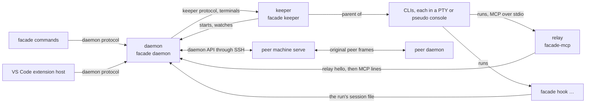

# Architecture

Facade Code Framework implements the Orchestrator, the Shell entry point and Facade API v1's MCP entry point in the
[product description](../PRODUCT.md). [Islands](islands/) describes the parts of the Rust workspace, and the
[glossary](GLOSSARY.md) defines their terms.

## Processes



Framework runs at most one keeper and one daemon per Facade home. Each service holds a lock file in the home's `framework/` folder.
Shell, the VS Code extension host and the MCP relay connect to the Orchestrator for their home. Its daemon forwards
requests over SSH when the target agent runs on another machine.

| Process | Program | Lives | Threads |
| --- | --- | --- | --- |
| Command | `facade <command>` | One command. It connects to the daemon and starts services when the command permits | Blocking client. A cold start adds a process reaper. Attach and the foreground SSH bridge add workers for terminal I/O and forwarding. [Startup](../../framework/crates/facade/src/daemon_client.rs#L395) · [Attach](../../framework/crates/facade/src/attach.rs#L112) · [SSH client bridge](../../framework/crates/facade/src/machine.rs#L792) |
| Hook | `facade hook …`, run by a CLI | One hook call. It uses the run's files and exits 0 | The command and a worker for the [bounded stdin read](../../framework/crates/facade/src/hooks.rs#L215) |
| Keeper | `facade keeper` | While it holds a CLI or a daemon runs | One, around one `poll`, or on Windows one I/O completion port: no tokio, no locks |
| Daemon | `facade daemon` | Until 30 seconds pass with no running agent, local client or unfinished work | A tokio runtime (below) |
| Relay | `facade-mcp`, run by a CLI or an MCP client | As long as its MCP client runs | One, around one `poll`; on Windows the loop around an I/O completion port, and one thread that reads standard input |
| Editor | VS Code workspace extension host | A workspace's connection and its terminal views | The host's Node event loop and asynchronous daemon connection. [Editor entry and Attach](../extension/engineering/ARCHITECTURE.md#61-one-local-orchestrator-connection-per-extension-host) |
| Remote Shell | `facade machine serve`, run by SSH | The peer stream to the remote daemon | Blocking relay with a worker for the other direction. [Remote stdio bridge](../../framework/crates/facade/src/machine.rs#L239) |
| CLI | `claude`, `codex`, … | Until it ends or is stopped | The CLI's own |

**Starting.** A command connects to the daemon's socket. When nothing responds, no daemon holds the daemon lock and no
keeper runs, it installs its own build into `framework/bin/` and starts the keeper through the launcher. The keeper starts
the daemon, and the command says `hello` until the daemon responds, for up to 10 seconds. A service reports `started`,
`contention` or `failed` to whoever started it, on a startup channel. The daemon accepts clients only after it has
recovered every agent it can read. Nothing runs at login.

**Programs.** `framework/bin/<build>/` holds each build's `facade` and `facade-mcp`; on Windows, `facade.exe`,
`facade-mcp.exe` and `conpty\`, the ConPTY package every Windows build ships. Two launchers, `framework/bin/facade` and
`framework/bin/facade-mcp` (with `.exe` on Windows), name the current build: symbolic links into it on macOS and Linux; on
Windows, copies of its programs, pointed at another build by renaming the one in use aside and copying the new one in,
with `framework/bin/current-build` naming the build. Runs are given launcher paths only, so a run's next hook or MCP server
is always the current build's.

**The keeper keeps the CLIs.** The keeper starts and supervises managed CLIs. On macOS and Linux each leads a session
and process group of its own in a PTY. On Windows each runs in a pseudo console made through ConPTY, in a job of its
own. The keeper and daemon retain native terminal copies, and the agent actor uses a copy for I/O. A replacement keeper
can adopt a live CLI and watch it exit. The [Keeper API](../../framework/protocol/KEEPER.md#clis-and-terminal-resources)
defines native custody and the platform details. A terminal outlives either service:

- When the daemon ends, the keeper starts another, after 0.5 seconds, doubling after repeated failures up to 30
  seconds. The new daemon takes the terminals back and recovers each screen from its log.
- When the keeper ends, the daemon keeps every terminal and starts another keeper, which takes the CLIs over.
- The daemon pings the keeper every second. A daemon silent for 15 seconds is killed and started again.

**A newer build takes over.** The newer program negotiates the daemon API and offers independent daemon and keeper
version sets to `daemon.upgrade`. The running daemon requires overlap with its daemon set before install and drain.
When managed CLIs are still running, the current Keeper API version must be confirmed and present in the target
Keeper set. The old daemon installs the compatible build, points the launchers at it, drains, sends clients `closing`
and exits. With live runs, the same Keeper starts the replacement daemon and retains its CLIs and terminals. The
replacement recovers records and screens. A version refusal leaves the running build, keeper and CLIs in place.

The [daemon takeover](../../framework/protocol/DAEMON.md#daemon-takeover) and
[keeper replacement](../../framework/protocol/KEEPER.md#exit-and-replacement) references define version checks and the
formal API support window for each endpoint.

**A machine connects on demand.** A reachable list, a scoped stop or a lookup by bare agent name or number can
probe saved SSH routes without waking a sleeping daemon. An explicit action such as starting an agent on a named
machine can wake it through a saved route.
In-flight calls, foreground connects and remote Attach watches keep their routes active, including on forwarding hops.
An idle saved session closes after 30 seconds. The machine table keeps the saved settings for the next request.

### The daemon's threads

- **Runtime**: tokio's multi-thread runtime, with as many workers as the machine's parallelism, at least 2 and at most
  16.
- **Tasks** include one actor for each managed agent with its terminal, screen, state and typist, and one task for each
  connection, call and watch. The layer also follows runs, Guests, results and long waits, sweeps expired data and
  handles idle exit.
- **Blocking work**: store writes, screen logs and checkpoints, state files and file preparation run on tokio's
  blocking workers, or in place on a worker that first moves its other tasks away.
- **Dedicated threads** read and write the keeper link. On Windows, the terminal I/O thread uses a completion port to
  read and write the managed agents' terminals.

## Interfaces between processes

| Between | Interface | Defined in |
| --- | --- | --- |
| A client and the daemon | Daemon API v1 uses one JSON-RPC 2.0 object per line on `/tmp/facade-framework-<uid>/daemon-<key>.sock` or Windows `\\.\pipe\facade-framework-daemon-<key>`. Clients negotiate `api_versions` in `hello`, then use `call`, `watch`, `unwatch` and `cancel`. The daemon sends `changed` and `closing`. | [Daemon API](../../framework/protocol/DAEMON.md) |
| The daemon and the keeper | Keeper API v1 negotiates its own version on the keeper socket. The daemon calls `agent.start`, `agent.stop`, `agent.sync` and `daemon.ping`, and the keeper reports exits with `changed`. The associated terminal is a PTY master or, on Windows, handles duplicated into the receiving process and carried in the same line. | [KEEPER](../../framework/protocol/KEEPER.md) |
| A relay and the daemon | The external connection starts with `hello` using `relay:1`, the relay's own handshake, then exchanges MCP lines. The daemon opens a separate authenticated API v1 session for its internal actor. `closing` lets the relay reconnect to the new daemon with its outstanding calls. | [The relay](../../framework/protocol/DAEMON.md#the-relay) |
| A CLI and its relay | MCP over standard input and output, negotiated by its date-format `protocolVersion`. Facade API v1's MCP entry point supplies the instructions and catalog of eight tools. | [MCP](../extension/engineering/MCP.md#7-mcp-through-the-orchestrator) |
| A CLI and its hooks | The CLI runs `facade hook <event> …` with its hook input. The hook saves the session the input reports in the run's session file, which the daemon follows, and prints, in the CLI's own format, the instructions the run's start wrote | [facade](islands/facade.md), [rules](islands/rules.md) |
| Two daemons | Daemon API v1 with an authenticated `machine` hello, followed by calls, watches and changes in both directions. A machine session runs over SSH to the installed `facade machine serve` and can forward traffic along a route. The API version determines compatibility. | [Machine sessions](../../framework/protocol/DAEMON.md#machine-sessions) |
| A CLI and the daemon | What the CLI draws in its terminal, and its own reports of what it does, the Program Status Protocol (OSC 7501) | [States](../../framework/protocol/DAEMON.md#states) |

The protocols' types, framing and client live in [base](islands/base.md); `framework/protocol/` is generated from them. The
relay depends on no other Facade crate, so it reckons the daemon's socket path itself, by the same rule as base;
scenario tests that go through the relay keep the two the same.

From `framework/` in an isolated checkout, build the programs and run the [relay scenario](../../framework/tests/tests/mcp.rs)
with a fresh `TMPDIR`. The scenario creates its Facade home there and starts the fake CLI.

```sh
cargo build &&
  relay_test_tmp=$(mktemp -d) &&
  TMPDIR="$relay_test_tmp" cargo test -p facade-scenarios --test mcp \
    a_line_of_a_mebibyte_goes_through_the_relay_each_way -- --exact
```

The scenario sends a request with a method name 1 MiB long through the relay. The daemon replies with JSON-RPC error
`-32601` and an error message longer than 1 MiB. The next `ping` on the same connection returns an empty object.

The daemon owns the store, `framework/facade.db`. The daemon process writes and migrates it. The offline machine-name
helper reads the committed local name from the existing store when the service sleeps. The home's files each have
one owner island. See the [storage format and migrations](islands/daemon.md#storage-format-and-migrations).

## Islands

An island owns its data and offers a few clear interfaces. Each crate is an island. Its modules are child islands,
down to one file. The code outside an island's children is its layer.

```text
framework
├── base       shared conventions: identity, paths, time, log
│   ├── model       shared agent, machine, message, terminal and error types
│   ├── protocol    API v1 framing, separate daemon and Keeper registries, the daemon client
│   ├── platform    what Facade asks of the operating system
│   ├── settings    facade.json
│   └── texts       what a model reads: instructions and tool definitions
├── screen     a headless terminal for one agent
├── rules      what Facade knows of each CLI: rule files
│   ├── command_line  program, arguments, model, effort, YOLO
│   ├── compose       the launch command of a start or resume, in order
│   ├── input         the input box and pastes
│   ├── state         what the screen says of the agent's state
│   ├── sessions      session files and the CLIs' session variables
│   └── wiring        tools, hooks and plugins installed for a run
├── keeper     starts and supervises CLIs, retains their native terminals
│   └── runtime     shared request admission, launch arguments and timing
├── relay      facade-mcp
├── daemon     the agent list, the store, and the orders that join its parts
│   ├── agent       one actor per agent
│   │   ├── terminal    daemon-side I/O on a native copy, and waiting input
│   │   ├── screen      the agent's screen and its log
│   │   ├── state       the managed agent's state
│   │   ├── typist      typing, and delivering messages into the input box
│   │   ├── viewers     the clients watching the screen
│   │   └── readiness   trust, tools and the first prompt
│   ├── messages    message delivery and inbox coordination
│   ├── store       SQLite records, transactions and migrations
│   ├── runs        the CLI runs
│   │   ├── keeper_link   the keeper connection and the runs it holds
│   │   └── preparation   run folders, environment, plugins, session following
│   ├── records     agent numbers, names and reach
│   ├── windows     working locations and start preflight
│   │   └── locations   private folder discovery, checks and Git worktree creation
│   ├── network     SSH connections, machine sessions, routes and forwarding
│   ├── guests      external MCP connections and Guest records
│   ├── lifecycle   the daemon's own life: idle exit, a newer build's takeover, its log
│   ├── server      client connections
│   └── mcp         Facade's MCP tools behind each relay
└── facade     the facade program
    ├── cli         command syntax and argument validation
    ├── daemon_client  bounded Shell startup, connect and upgrade waits
    ├── help        public help pages
    ├── commands    agent commands and status
    ├── attach      showing an agent's terminal
    ├── hooks       what a CLI's hooks run
    ├── machine     SSH commands and the remote endpoint
    └── upgrade     stable installer and takeover results
```

### Crate index

The dependency column lists direct Facade crate dependencies. Run the acceptance selectors from `framework/` with
`cargo test --locked` in an isolated checkout. See [test isolation](ENGINEERING.md#tests).

| Island | Owns | Entry interface | Direct dependencies | Existing acceptance selector |
| --- | --- | --- | --- | --- |
| [`facade-base`](islands/base.md) | Shared model, API contracts, paths, settings, text assets and native primitives | [`model`, `api_v1` and platform exports](../../framework/crates/base/src/lib.rs#L20) | None | [`-p facade-base --test protocol_files`](../../framework/crates/base/tests/protocol_files.rs) |
| [`facade-screen`](islands/screen.md) | Terminal state, scrollback, terminal replies and redraws | [`Screen` and `ScreenView`](../../framework/crates/screen/src/lib.rs#L39) | None | `-p facade-screen --lib` |
| [`facade-rules`](islands/rules.md) | CLI rule files, launch composition, input and state reading, sessions, hooks and plugins | [`entries`, `start_managed_launch_command`, `read_input`, `read_state` and `hook`](../../framework/crates/rules/src/lib.rs#L31) | `facade-base`, `facade-screen` | [`-p facade-rules --test input`](../../framework/crates/rules/tests/input.rs), `-p facade-rules --test state` |
| [`facade-keeper`](islands/keeper.md) | CLI processes, native terminal custody and daemon supervision | [`facade_keeper::serve`](../../framework/crates/keeper/src/lib.rs#L39) and the independent [Keeper API](../../framework/protocol/KEEPER.md) | `facade-base` | [`-p facade-scenarios --test keeper`](../../framework/tests/tests/keeper.rs#L40) |
| [`facade-relay`](islands/relay.md) | MCP stdio transport, reconnect and replay | [`facade-mcp`](../../framework/crates/relay/src/main.rs) and the [relay connection](../../framework/protocol/DAEMON.md#the-relay) | None | [`-p facade-scenarios --test mcp`](../../framework/tests/tests/mcp.rs#L2003) |
| [`facade-daemon`](islands/daemon.md) | Agent actors, the SQLite store, messages, working locations, guests, peer sessions and MCP tools | [`run`, `offline_machine_name` and `offline_clis`](../../framework/crates/daemon/src/lib.rs#L396), client and peer operations through the [Daemon API](../../framework/protocol/DAEMON.md) | `facade-base`, `facade-screen`, `facade-rules` | [`-p facade-scenarios --test protocol`](../../framework/tests/tests/protocol.rs) |
| [`facade`](islands/facade.md) | Public Shell syntax and output, hooks, interactive Attach, installer and machine command entry points | [`facade` command dispatch](../../framework/crates/facade/src/main.rs#L404), including `daemon`, `keeper` and `machine serve` | `facade-base`, `facade-screen`, `facade-rules`, `facade-keeper`, `facade-daemon` | [`-p facade-scenarios --test cli --test help`](../../framework/tests/tests/cli.rs) |

### Interfaces inside the crates

- **Base model and v1.** Shared runtime values live in `facade_base::model`. `api_v1` owns framing, the
  daemon client and separate daemon and Keeper registries and negotiation. [Model source](../../framework/crates/base/src/model/mod.rs) ·
  [v1 source](../../framework/crates/base/src/protocol/api_v1/mod.rs) ·
  [Generated daemon schema](../../framework/protocol/protocol.schema.json) ·
  [Generated Keeper schema](../../framework/protocol/keeper.schema.json).
- **Daemon working locations.** The `windows` module exports `preflight`, `read_locations` and
  `Windows::create_local_worktree` for folder discovery and agent starts. Its private `locations` child handles
  folder checks and Git worktree creation. [Exports](../../framework/crates/daemon/src/windows/mod.rs) ·
  [Location request](../../framework/crates/daemon/src/service.rs#L1251) ·
  [Start preflight](../../framework/crates/daemon/src/operations.rs#L448).
- **MCP catalog and relay.** The daemon binds each shipped tool definition to a typed action. The live catalog feeds
  listing, validation, dispatch and send/read cancellation. The client controls when it exposes definitions to its
  model. `initialize` supplies the managed instructions for verified runs that use server instructions. Other
  verified runs get their managed instructions from a hook or extension and receive the Guest instructions during
  `initialize`, as do unbound connections. The daemon supplies verified actor services and shares one deadline
  across a call that requests waiting. The relay carries MCP lines.
  [Catalog](../../framework/crates/daemon/src/mcp/mod.rs#L161) ·
  [Relay ingress](../../framework/crates/daemon/src/mcp/lines.rs#L52) ·
  [Instruction selection](../../framework/crates/daemon/src/relays.rs#L228) ·
  [Relay golden case](../../framework/tests/tests/mcp.rs#L2558).

### Thread model and call chains

See the [daemon thread model](#the-daemons-threads), the [Keeper loop](islands/keeper.md#the-loop) and its
[Windows completion port](islands/keeper.md#on-windows), and the [Relay loop](islands/relay.md#keeps).
The [cross-island operation order](#operations-that-span-islands) describes the daemon's commit and effect ordering.

JSON-RPC IDs match replies and cancellation to calls on the issuing connection. Start and Send use a separate
business `request_id` for a repeat after reconnect. Agent and message identities include the machine ID.
See the [wire envelope](../../framework/protocol/DAEMON.md#messages) and
[send receipt rules](../../framework/protocol/DAEMON.md#agent-messages).

To run a linked scenario by name, use `cargo test --locked -p facade-scenarios --test <target> <case> -- --exact`
from `framework/`, using the test file stem and function name. The [two-build takeover case](../../framework/tests/tests/upgrade.rs#L2398)
requires `--ignored` and a separately built higher executable in `FACADE_TEST_API_V1_NEXT`.

| Chain | Owner and effect boundary | Existing scenario |
| --- | --- | --- |
| Start | Shell, VS Code or MCP invokes `agent.start`. The daemon resolves the machine scope. Keeper starts the CLI and holds its native terminal. The daemon commits the launch and any first prompt together, creates the actor and establishes any prompt hold, publishes the run, then starts prompt delivery. A foreground Shell start attaches to the exact target in the reply. [Shell call](../../framework/crates/facade/src/commands.rs#L79) · [VS Code call](../../extension/src/host/framework/agents.ts#L126) · [Daemon dispatch](../../framework/crates/daemon/src/service.rs#L628) · [Commit](../../framework/crates/daemon/src/operations.rs#L622) · [Actor and publication](../../framework/crates/daemon/src/operations.rs#L716) | [First prompt and one result](../../framework/tests/tests/prompts.rs#L128) · [Repeat start](../../framework/tests/tests/reliability.rs#L573) |
| Typed send and receipt | Typed `agent.send` goes to daemon delivery. Store keeps send routes, request receipts and inbox rows. Messages persists paste start before terminal bytes, under the same lock as withdrawal. A same-connection cancel can withdraw an unstarted paste. Its acknowledgment is separate from the send outcome. A forwarded cancel can leave the outcome unknown. Retry with the original `request_id`, arguments and destination within the documented hour. [Delivery](../../framework/crates/daemon/src/delivery.rs#L625) · [Paste admission](../../framework/crates/daemon/src/messages/handle.rs#L27) · [Forwarded cancel](../../framework/crates/daemon/src/delivery.rs#L466) · [Message contract](../../framework/protocol/DAEMON.md#agent-messages) | [Cancel at paste start](../../framework/tests/tests/reliability.rs#L719) · [Committed paste](../../framework/tests/tests/reliability.rs#L883) · [Relay cancellation](../../framework/tests/tests/mcp.rs#L2281) |
| Attach, watch, resize and release | Shell or VS Code opens a v1 Attach watch. The agent actor uses the row and column minima of live viewer capacities. Resize checks ownership on the same connection. Forwarded resize also checks the holder's daemon boot ID. Unwatch or disconnect releases the watch and its capacity. [Shell Attach](../../framework/crates/facade/src/attach.rs#L69) · [Editor resize](../../extension/src/host/framework/connection.ts#L317) · [Watch ownership](../../framework/crates/daemon/src/server/connection.rs#L548) · [Forwarded resize](../../framework/crates/daemon/src/topics.rs#L190) · [Viewers](../../framework/crates/daemon/src/agent/viewers.rs#L205) | [Shared grid and owned resize](../../framework/tests/tests/attach.rs#L450) |
| Machine SSH and wake | Shell Add opens an authenticated session. The daemon verifies the peer and commits a saved route before publication. Daemon network owns saved-route wake and idle release. Passive probes reach awake peers. An explicit remote start may wake one. A remote Attach keeps its saved route active while its watch is open. If SSH closes during the connect handshake, the local Shell bridge half-closes the Unix socket's write side and keeps the Windows pipe reader open for the result. [Shell Add](../../framework/crates/facade/src/machine.rs#L696) · [Saved route](../../framework/crates/daemon/src/machine_service.rs#L245) · [Wake and probe](../../framework/crates/daemon/src/network/wake.rs#L47) · [Native pipes](../../framework/crates/base/src/platform/ssh.rs#L933) · [Local bridge](../../framework/crates/facade/src/machine.rs#L878) | [Passive probe](../../framework/tests/tests/machines.rs#L532) · [Saved watch lifetime](../../framework/tests/tests/machines.rs#L842) |
| Daemon takeover and Keeper replacement | A common daemon API is required before install and drain. With live managed CLIs, the newer build must also support the confirmed Keeper API. A replacement daemon obtains its own terminal copy from Keeper. A replacement Keeper adopts a copy retained by the daemon. Shared admission allows a terminal only on an `agent.sync` request. The authenticated link transfers a Unix PTY descriptor or duplicates native handles into the Windows receiver. [Takeover](../../framework/crates/daemon/src/lifecycle/takeover.rs#L117) · [Daemon recovery](../../framework/crates/daemon/src/runs/keeper_link/mod.rs#L319) · [Keeper admission](../../framework/crates/keeper/src/runtime.rs#L54) · [Native transfer](../../framework/protocol/KEEPER.md#clis-and-terminal-resources) | [Protocol refusal](../../framework/tests/tests/upgrade.rs#L2288) · [Live Attach takeover](../../framework/tests/tests/upgrade.rs#L2703) · [Keeper replacement](../../framework/tests/tests/keeper.rs#L422) · [Native custody](../../framework/tests/tests/keeper.rs#L40) |

## Rules between islands

- **The parent orders effects across siblings.** It gives a child a narrow handle, a channel sender or a closure.
  A child can use shared values and helpers from its layer or an explicit dependency in the parent's approved
  interface. For example, Store uses the daemon layer's `StartKey` and samples the cutoff supplied by its caller.
  The parent retains the Daemon. [Start receipt](../../framework/crates/daemon/src/store/mod.rs#L423)
- **A child reports up** with return values, with events on a channel its parent gave it (`RunEvent`,
  `GuestEvent`), through a trait its parent implements (the server's `Service`), or through closures its parent gave
  it (the MCP server's `ActorServices`).
- **Every piece of data has one owner.** Fields are private. Store owns SQL, migrations and transactions on one
  connection. Each daemon part uses its table handle; the daemon layer decides when to publish a committed result.
  Every file and folder in the home has one owner. [Storage](islands/daemon.md#storage-format-and-migrations)
- **Rust visibility defines the available interface.** A parent declares its children privately and exposes
  only the required items at the narrowest visibility. Review checks which modules use crate-visible items
  against the parent's approved dependencies.
- **Locks.** Only the daemon nests locks, in the order [daemon](islands/daemon.md) gives: its layer's first, a part's
  after. The keeper and the relay take no locks: the keeper has one thread, and the relay one on macOS and Linux and
  two on Windows, its loop and the thread that reads its standard input.
- **One place for each kind of knowledge.** Base's platform, Keeper and Relay own OS-specific process, terminal and
  transport behavior. Shell's [repair-command formatter](../../framework/crates/facade/src/errors.rs#L945) selects the
  quoting syntax displayed to the person. Rules owns CLI-specific behavior; Base holds the texts a model reads.
  Records gives agent numbers, and messages gives message numbers.
- **Errors.** An island's interface returns the protocol's error, `ErrorBody` with a `Reason`, where a client will see
  it.
- **Machine boundaries.** Agents and messages are known by their machine ID and number, never by a process ID or a local
  path. A relay's process ID and start time only show that its connection is still the same live relay. A machine
  session uses the same operations as a local caller, with its origin and target carried by the protocol. Socket paths
  follow [Daemon API](../../framework/protocol/DAEMON.md). Connected clients, including VS Code, get machine and agent
  data through the daemon protocol. Offline Shell help and service status use the daemon's read-only local name
  helper.

## Operations that span islands

The daemon's layer calls its islands in a fixed order so state can be recovered or explained after an interruption.

1. **Start.** Records assigns an agent number and runs asks the Keeper to start the CLI. The daemon commits the
   launch and any first prompt together, creates the actor and establishes any prompt hold, publishes the run, then
   starts prompt delivery.
2. **Delivery.** The destination commits the inbox message before acknowledging acceptance. For managed terminals,
   Messages persists paste start before the typist writes terminal bytes. A cancellation can withdraw a message
   before paste start. A started paste continues. Settlement normally writes the outcome before notification.
   An ordinary settlement write error still reports the observed outcome. A Guest read settles only the messages
   returned with their content. A command-line result wait belongs to the originating connection. The assigning
   machine checks the replying actor against the saved recipient before handing the first linked reply to that wait.
3. **Session.** The daemon commits a session report before it sends the session to the agent's actor. A Shell list
   or resume query reads the current native name or preview for that session on the machine that holds it.
4. **Screen.** The actor records output and resize in its screen log before it applies them to the terminal engine.
5. **Removal.** The daemon confirms the running CLI exited before it deletes the record and inbox in one transaction.
   It then publishes the removal and disposes of the actor, run, screen and run folders.
6. **Guest connection.** The daemon assigns a number and saves a Guest's identity and YOLO setting before listing it.
   Ending the connection removes the record and inbox together and settles the messages it has not taken.
7. **Starting a helper across machines.** The starter's machine reserves a message number for the first prompt's result.
   The running machine commits the agent, prompt and reserved number in one transaction so a retry finds the same
   receipt. A failed prompt uses the reserved number. Successful delivery clears it. Shell and VS Code starts
   have no creator inbox.
8. **Finishing a dedicated Shell Attach.** The server learns that the watched run has exited independently of the
   dedicated Shell connection's outgoing buffer. It allows a short drain for the final screen bytes and exit
   status, then closes the connection and releases its watch. Shared connections keep their independent watches.
