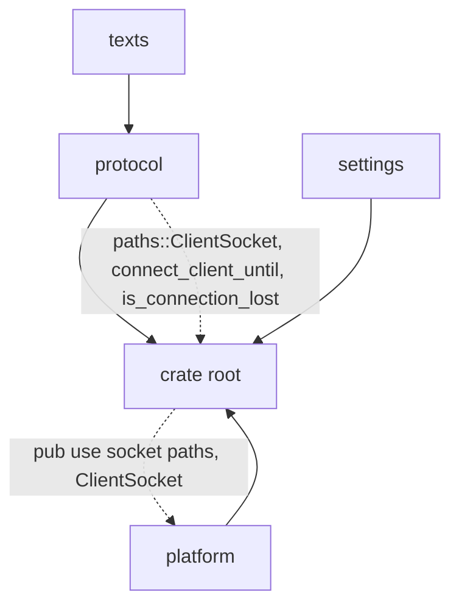

# Base

Base is what Facade's programs share: both protocols, everything that differs between operating
systems, the settings file, and the texts a model reads. It is a library with no state of its own
to speak of, so every other crate can depend on it and it depends on none of them. Crate
`facade-base`, folder `framework/crates/base/`.

## Owns

- The daemon and keeper protocol types, operations, framing and error envelope. `framework/protocol/`
  contains the two generated guides and endpoint schemas. The generator writes `protocol.ts` and
  the extension's `src/base/frameworkProtocol.ts` together from the daemon registrations.
- The Facade home's location (`FACADE_HOME`, else `~/.facade`) and the key that names its sockets.
- The services' sockets: on macOS and Linux the socket folder `/tmp/facade-framework-<uid>/` and
  `keeper-<key>.sock` and `daemon-<key>.sock` in it; on Windows the named pipes
  `\\.\pipe\facade-framework-keeper-<key>` and `\\.\pipe\facade-framework-daemon-<key>`, which let in
  their owner alone.
- `framework/keeper.lock` and `framework/daemon.lock`, and the record in each. Both services use the same
  30-day retention policy for their own log in `framework/logs/`.
- `framework/startup/` holds local startup attempts, with progress and outcomes tied to a generation and
  the PID and birth of the service. Startup order verifies the live candidates, seals the previous
  attempt and issues a claim. A separate inherited file reference keeps the claim until the Keeper
  takes its lock, even if the launcher ends first. The `programs.lock` section selects and publishes
  the program set after the claim.
- `framework/bin/`: each build's `facade` and `facade-mcp` in a folder named after the build, with the
  ConPTY package in its `conpty/` on Windows, and the two launchers that point at the current
  build: symbolic links on Unix, copies on Windows.
  Windows starts the daemon through the published launcher when it holds the selected image's
  bytes. Base pins the launcher under the programs lock and compares the open files. Its hold
  lasts through process creation. If the launcher is unavailable or cannot start, Base tries
  the pinned versioned image.
- The process-wide `FORK_LOCK`, under which children start.
- Reading `facade.json`. Nothing in framework writes it.
- The instructions and tool definitions a model reads.

## Keeps

- Dependencies inside the crate run one way: texts uses protocol; protocol, platform and settings
  use only the crate root; platform never uses protocol, and protocol uses of platform only
  `paths::{ClientSocket, connect_client_until, is_connection_lost}`, which the root re-exports.
- Every branch by operating system in the crate is in `platform/`, and outside it only `rules`
  reads `system::SYSTEM`. Each public module of platform has the same items with the same
  signatures on every system, unless its documentation says an item is Unix's or Windows' alone.
- One limit for a protocol line, `MAX_LINE_BYTES` (64 MiB, newline included), for both protocols
  and for lines that carry descriptors.
- A build takes over from a running one only when both versions are three numbers and its own are
  higher (`takes_over`). The command that asks and the daemon that is asked both decide by it.
- An authenticated connection selects the highest common version offered in hello. The daemon
  and keeper support sets each begin at `[1]`. Daemon hello lists operations and topics available
  to that caller. The external MCP relay keeps its own `relay:1` boundary. Its authenticated
  in-process actor uses daemon API v1.
- Waking callers, the startup Keeper link and the Keeper's initial supervision use the same local monotonic
  budget. Base publishes one window per generation. Verified progress survives changes of service identity.
  Only a completed stage renews the 75-second progress window, within the original 180-second limit.
  Base seals an accepted candidate and its generation when both reporting services and the creation
  reference are gone. A caller following a candidate reads that candidate's outcome. A new caller
  seeking readiness takes queued accepted failures in order, then general startup failures, before
  another claim. A busy startup-order lock leaves the waiter's deadline and cancellation checks active.
  Each outcome remains readable. Reporting it acknowledges only that dispatch.
- Each endpoint follows its own formal compatibility window. See [Daemon takeover](../../../framework/protocol/DAEMON.md#daemon-takeover).
- The files in `framework/protocol/` are exactly what the types generate; the `protocol_files` test
  fails on any difference.
- Each public path has one place: a module moved inside the crate is re-exported at the root, never
  reachable by a second public path.

## Never does

- Depends on another Facade crate.
- Names a CLI in non-test code, or branches by CLI, outside the texts a model reads.
- Starts a thread, opens the store, or keeps runtime state beyond `FORK_LOCK`, the build a test
  plays, on Linux whether process descriptors work, found once, and on Windows the terminal I/O
  thread with its completion port, started on first use.
- Writes `facade.json`.

## Interface

The public paths are `facade_base::<module>`. Grouped by who calls them:

**The Shell and Framework MCP**

- `key_input` defines the public key names and batch limit. `key_problems` checks a batch and gives the current
  spelling for a recognized alias. The shared key encoder and paste delimiters give Shell's preflight and
  the daemon's typist the same one MiB input limit. `TerminalInput::typing_bytes` counts typed input with
  the bytes for each paste and key.

**The Shell and the daemon**

- `start::LaunchColors` holds the reported foreground, background, cursor and ANSI colors 0–15 as
  optional 8-bit sRGB triples. `carry_terminal_colors` writes a nonempty sample into a private launch
  context in the existing v1 `env` field. `take_terminal_colors` removes the reserved entry before
  decoding it and returns only a valid, nonempty sample. The daemon also uses `start::LAUNCH_CONTEXT`
  to strip that entry from inherited CLI environments. The public terminal color DTO keeps its existing
  format.

**Every program**
- Build and version helpers include `build_id()`, `version()`, `VERSION`, `build_version(build)`,
  `version_of(build)`, `compare_builds(left, right)` and `takes_over(newer, running)`.
  Compare the stable version, then the source commit time. Equal ranks keep the selected set.
  Call `take_test_build()` first in `main`.
  Tests can make a program play another build through a script or a file beside the program.
  `this_program()` locates the program. `install` and `point_launchers_at` carry the file named with
  `TEST_BUILD_SUFFIX` beside it.
- `paths::{facade_home, framework_dir, home_key, daemon_socket, keeper_socket, daemon_socket_for,
  keeper_socket_for}`, `socket_dir` on Unix; `paths::ClientSocket`, a blocking client's end
  (Unix's `UnixStream`; on Windows a named pipe's, which checks the server's user), and
  `paths::is_connection_lost(error)`.
- `system::{SYSTEM, System, env_var, home_folder_in}`: which system this is (rules alone reads
  it), a variable by the system's rule for names, and the home folder programs use.
- `log::write(program, level, message)` writes one line on standard error. The keeper and daemon
  call `log::prune(path: &Path, now: SystemTime) -> io::Result<()>` on their own log. The shared
  stderr lock covers replacement and reopening, and continuation lines follow their dated entry.
- `time::{iso_time, iso_now, parse_iso_time}`: UTC, to the millisecond.
- `process::{ProcessIdentity, ProcessExit, ProcessState, EndReason}`.
- `random_u64()`.

**The keeper and the daemon** (services)
- `service`: `create_private_home`, `lock_home(framework, Service)`, `lock_record`, `live_holder`,
  `launch(service, program, words) -> Candidate` and `Candidate::into_process() ->
  ServiceProcess`, `StartupChannel`, `RestartBackoff`, `close_inherited(keep)`,
  `authenticate_server(socket, framework, service)`, `termination_requested()`, `redirect_stderr(file)`,
  and test gates (`gate_for_test`, `mark_for_test`, `pause_for_test`). Unix only: `authenticate`,
  `peer`, `close_inherited_fds`, `lock_keeper_if_unowned`; Windows only: `authenticate_client`.
- `unix_process` (named before Windows): identities and births, `presence`, `ProcessObservation`
  with `until_ended` and `wait_for_end`, `environment(identity)`, `calling_program_of(pid)`,
  `boot_time`, `signal_number(name)`, `fork_lock()`. Unix only: process groups
  (`group_members`, `signal_group`), `reap_child`, `peer_pid(socket)`; Windows only: `WaitPacket`,
  and `AsHandle` and `exit` on `ProcessObservation`.
- `terminal`: `PtyMaster`, the side of a terminal Facade holds (a PTY master on Unix; on Windows a
  pseudo console's input, output and signal pipe ends and the CLI's job); `PtyIo`, how the daemon
  reads and writes one, with `stop_reading` and `let_go_before_stop`. A caller can ask `write` for the
  readable output prefix at the start of its native write. An overlapped write records this position
  once, when it is issued. `queued_output_bytes()` counts, without waiting, the output that reached
  Facade's end and has not been read; no read holds output that this count misses. On Windows the
  `PtyIo` is the output pipe's only reader. It keeps just a zero-byte read under way, which completes
  once output waits and takes none; a sized read then takes waiting bytes and completes at once, so
  `PeekNamedPipe` gives the count. On Unix it uses a zero-timeout poll for hangup and `FIONREAD` for
  the byte count. A closed peer can still leave bytes; the end comes once none is left.
  `stop_reading` leaves no read under way, and output not read stays for the next reader.
  `PASTE_BYTES_PER_MS` estimates paste time.
  `KeyRecord` and `key_down_records` encode console keys. `KeyRecord::press_len` and
  `key_down_records_len` count the encoded bytes. `test_terminal` gives tests both sides of a terminal.
- `terminal_lines::{LineSender, LineReceiver}` carry keeper lines and their optional terminal.
  Unix uses `descriptors::{send_line, DescriptorLines}` to associate a descriptor with its frame.
  On Windows the authenticated link carries the resource in the `terminal` member.
  `take_terminal` extracts one owned resource and passes the stripped bytes to the protocol
  decoder. `InvalidTerminalEnvelope::request_id()` exposes a proved request ID if available.
  `add_terminal` prepares target-process copies. Its guard transfers ownership after delivery of
  the full line and reclaims the copies when dropped before commit.
- `sockets::{DaemonListener, ServerSocket, ServerReader, ServerWriter, ServerPeer, pair}`: the
  daemon's side of its socket; `server_pipe` on Windows, for the keeper.
- `limits::raise_open_files()`, which does nothing on Windows.
- `api_v1::keeper` supplies hello, the typed operation decoder, launch DTOs and exit notifications.
  [Keeper reference](../../../framework/protocol/KEEPER.md)

**The daemon**
- `address::selector` parses CLI selectors and formats machine-qualified references.
  `parse_command_reply_address` recognizes `#cN` with an optional machine selector for Send.
  `format_command_reply_address` uses the assigned message ID and its machine selector.
  `address::mcp` handles the MCP address spelling.
  `ssh` extracts the destination from the supplied OpenSSH login arguments and keeps the original
  arguments in their order. When the remote platform is unknown, Route and Travel identify its
  login shell over the authenticated stream. The bootstrap probes the selected remote home's
  launcher and reads the client's install or serve decision. A permitted installation of a
  missing or lower-ranked build pins the complete local BUILD and verifies the selected launcher.
  A higher remote build requires a local upgrade. The bootstrap writes `ready` before running
  machine serve on the same streams. The authenticated machine hello checks API compatibility
  and identity. A passive attempt uses `--no-start` and recognizes exit 3 as sleeping.
  On Windows, the foreground command keeps its output capture pipes private before starting the
  process that holds the saved SSH link.
  `system::hostname` and `system::login_environment` supply the host name and login environment.
- `model` groups shared runtime and stored data for agents, machines, messages, terminals and
  errors. `model::agent` provides shared agent identity and session validation.
  `model::message` validates message text and formats delivery receipts. A command-line reply
  marker follows the original message through the daemon's store and display projections.
  `DeliveredVia::ReturnedToRequest` records a confirmed handoff to the waiting command.
- `api_v1::daemon` supplies typed operation and topic markers, request and response DTOs, and
  audience-aware decoders. The registry records forwarding eligibility. Forwarded calls carry
  exact targets where required. A forwarded Attach watch carries the holder's viewer and daemon
  start ID, scoped to that watch. Saved-connection removal accepts an expected full machine ID.
  Daemon v1 carries explicit Send waits, an optional reply result, ordered input, and native
  session names alongside existing requests. `attach.shell` uses the ordinary Attach payloads
  and is advertised to Terminal clients when the daemon can serve a dedicated watch.
  [Daemon reference](../../../framework/protocol/DAEMON.md)
- `api_v1` supplies shared bounded line framing, `Size`, and the JSON-RPC error envelope.
  A stable reason and optional object details carry information for callers, such as the settings
  entry behind a refusal or an endpoint's supported API versions.
- `operations::{Operation, Topic, EmptyResult}` and `api_v1::NoArgs`.
- `programs`: `install`, `install_running`, `point_launchers_at(build, running)`, `launcher`,
  `Held` (`open`, `restore`, `facade_mcp`, `facade_launcher`), and path lookup:
  `program_of(command, env, cwd)`, `on_path(program, path, folder)`, `runnable(file)`,
  `direct_command(program, env, cwd)`, `program_name(path)`; `command(program)`, which opens no
  window on Windows;
  `CONPTY_FOLDER`; on Windows, `quoted_command` for the keeper.
- `files`: `create_private_file`, `create_private_folder(_all)`, `private_options`,
  `make_private`, `is_private` (Unix modes; nothing on Windows, where files inherit their folder's
  access), `sync_folder`, `real_path`, `folder_key`, `valid_folder_name` for one path component on
  the running machine.
- `settings::{read, settings_file, shown, is_space, Settings, SourceLocation}`. The settings path
  is available before the file exists.
- `instructions::{for_connection, for_managed, ManagedRun, Creator}` and
  `tools::DEFINITIONS` describe Facade API v1's MCP entry point and its eight tools.

**The `facade` program**
- `api_v1::daemon_client::DaemonClient` is the blocking terminal client for authenticated local
  hello, typed calls and watches, and reconnect after takeover. It preserves the reader buffer
  when handing the stream over after machine authorization. The terminal can manage its own
  reconnection through `disable_auto_reconnect`. `connect` bounds the local open and hello by
  the given deadline. `reconnect_until` uses the same path and the saved Terminal socket.
  `call_until` uses the caller's absolute deadline for request writes and response reads on the
  negotiated connection. Existing calls can use `call_with_request_id` to recover an interrupted
  start or send. Shell captures its launch environment.
- `programs::{install_running, current_build, point_launchers_at, launcher}`;
  `service::{create_private_home, launch, live_holder}` to start the keeper;
  `unix_process::calling_program()` for a hook's CLI.
- `ssh` prepares the selected-home administration bootstrap and SSH arguments for Shell. It resolves the SSH account
  and the source IP observed by the remote sshd. Dedicated keys live in the Facade home's `framework/ssh/` folder,
  with owner-only access to the private file. `SshKeyProof` checks the dedicated key used by an independent
  OpenSSH login. Authorization changes and host trust changes carry the exact entries to roll back.
  Authorization removal uses the Facade machine ID. Windows administrators use the shared OpenSSH authorization
  file with its required access list. For an unknown return host, the authenticated server key goes in a safe
  configured native user known_hosts file. The strict proof and saved reconnect apply OpenSSH's configured
  trust and revocation policy. A changed or revoked key, or no safe user file for first-time trust, fails the
  return and preserves the forward connection. Host trust appends honor HashKnownHosts. Rollback blanks
  only this attempt's confirmed records in place and preserves unrelated native appends.
- `install` reads the release BUILD marker and builds installer commands for the current home.
  The numeric version selects the download location. The full BUILD pins the exact package when
  known. Upgrade and SSH leave PATH management to the standalone installer. Shell can request a
  receipt carrying the exact failed file and HTTP status.
- `console::{VtModes, ConsoleReader, ConsoleSignals}`: what Attach needs of the person's
  console beside crossterm's size and raw mode. `ConsoleReader::read_until` also supports the
  bounded color query before a launch. On Windows, Attach can consume an exact
  queued release from its detach chord. A native wheel record gives one-based viewport
  coordinates, a signed delta and terminal modifier bits. Native pointer records carry left press,
  drag and release, and right press at those coordinates. A release can finish a drag that leaves
  the viewport. Attach enables capture when the CLI tracks the mouse or the Shell owns scrolling
  and selection. `VtModes` restores the console's input and output modes on handback. Shell enters
  it before enabling any additional raw mode, so that it saves the original Windows modes. On Unix,
  `ConsoleSignals` reports `SIGPIPE` as an end signal so Shell can restore the terminal before
  exiting. `console::owns_input()` says whether the program may read the console now, which a Unix
  shell's background job may not. `console::return_input(bytes)` gives input taken from the console
  back to the next reader. It does nothing on Windows and on a Unix system that forbids it.
- `clipboard::copy`: puts text on the clipboard of the computer the person sits at, through pbcopy or
  the Wayland and X11 clipboard programs, for terminals that ignore OSC 52. It does nothing over SSH,
  where that is another computer's, and on Windows.
- `desktop::{sees_keys, arrows}`: whether Up and Down are down on the keyboard the person types on,
  for a terminal that sends the same bytes for them and for the wheel. It uses the session's key state
  on macOS and the desktop's on Windows, without a permission, and loads their libraries only when
  asked. It sees no keys on Linux, over SSH, outside a desktop session, or in a terminal that
  another computer can show: tmux, Screen, Zellij and VS Code's remote terminals.
- `desktop::{clicks, pointer, right_click_at, press_left_at, left_button_down}`: the pointer and the
  buttons, for Attach's clicks in macOS Terminal. Posting a click needs Accessibility for the
  terminal app; `clicks` checks it and never asks. Elsewhere there are none.

**Rules**
- `settings::{Settings, Member, Json, is_space}`: rules reads the CLI entries of `clis`.
- The shared input types in `model::terminal` and `model::agent::is_session_id` for session
  identifiers.

**The relay** uses nothing of base; see [relay.md](relay.md).

**Files and variables it reads**: `FACADE_HOME`, `HOME`, `USERPROFILE`; `FACADE_BUILD` at compile
time; in debug builds, `FACADE_TEST_BUILD` and `FACADE_TEST_PROGRAM`.

## Depends on

No Facade crate. `serde`, `serde_json` and `schemars` for the protocol types; `tokio` for the
daemon's terminals, socket and process ends; on Unix `nix`, `libc` and `signal-hook`, on Windows
`windows-sys`, for the platform; `sha2` for the home key; `base64` for terminal bytes; `unicode-segmentation` for
display text.

## Inside

The crate root holds what all four parts use: which build this is (`build.rs`), the process types
both protocols carry (`process.rs`), the home and its key (`paths.rs`), the line limit
(`line.rs`), timestamps (`time.rs`) and service logs (`log.rs`). It declares the four parts as
private modules and re-exports their modules at the root, so callers see one flat
`facade_base::<module>` namespace.

The root re-exports the socket paths, the client's socket, its bounded open helper and
`is_connection_lost` from platform under `paths`. Protocol's daemon client reaches the socket
through the root.

There are no handles or events: each part is plain functions and types, and a part reaches
another only by the one-way imports above. The one thread is platform's terminal I/O thread on
Windows.

### protocol

The daemon and keeper types and framing, and a blocking daemon client.
`framework/crates/base/src/protocol/` and the tests in `framework/crates/base/tests/`.
- **Owns** the current wire DTOs, endpoint support sets, registered operations and topics, framing
  and blocking client in `api_v1/`. It also owns shared operation traits in `operations.rs`,
  terminal byte encoding in `base64.rs`, and the source for the generated guides.
- **Keeps:** each convention is defined once; one message per line, never longer than
  `MAX_LINE_BYTES`; `framework/protocol/` matches the types byte for byte. A client keeps its socket
  and identity, so it can reach the daemon that takes over; a call whose request ID makes it safe
  to repeat, such as a send or a start, goes again to the daemon that responds next.
- **Never does:** touches processes, locks, the socket folder or file permissions; uses platform
  but `paths::{ClientSocket, connect_client_until, is_connection_lost}`, settings or texts.
- **Interface** `api_v1` exports the current wire boundary. The generator verifies both endpoint
  schemas and guide examples. Run `FACADE_REGENERATE=1 cargo test -p facade-base --test protocol_files`
  to refresh the checked-in output.

### platform

What Facade asks of the operating system. `framework/crates/base/src/platform/`.
- **Owns:** which system this is (`system.rs`); the socket paths and the client's socket
  (`socket_paths.rs`); the daemon's listener (`sockets.rs`); the services' locks, logs and start
  (`service.rs`); `framework/bin/` (`programs.rs`); process observation, groups, environments and
  `FORK_LOCK` (`unix_process.rs`); terminals (`terminal.rs`); on Windows, the terminal I/O
  thread, its completion port and wait completion packets (`io_thread.rs`); keeper lines that
  carry a terminal (`terminal_lines.rs`) and, on Unix, descriptors over sockets (`descriptors.rs`);
  the person's console (`console.rs`); private files
  and folder keys (`files.rs`); SSH arguments and subprocess I/O (`ssh.rs`); the published
  installer commands (`install.rs`); the open-file limit (`limits.rs`); random bytes (`random.rs`).
- **Keeps:** every branch by system in the crate is here: Linux, macOS and Windows. Each module's
  file is its face, the same on every system; each system's code is beside it, in
  `<module>/unix.rs` and `<module>/windows.rs`, or in the face itself for the Unix code that was
  there before Windows. On Windows the terminal I/O thread, one thread shared by every terminal, around one
  completion port, takes terminal reads and writes and `until_ended`'s wait completion packets.
  Both `terminal` and `unix_process` use the private `io_thread` module, which uses neither;
  `unix_process` re-exports its `WaitPacket` for the keeper. Received descriptors are close-on-exec
  before any child can start: atomically on Linux, under
  `FORK_LOCK` elsewhere. A process is known by its ID and birth, never its ID alone, and a group
  is signalled only while a member shows it is the same group. The socket folder is this user's
  alone (0700), and on Windows each pipe lets in its owner alone and a client checks the server's
  user. On Unix the home, `framework/` and `framework/logs/` must be this user's, or a service refuses to
  start in them; `framework/` and `framework/logs/` are made this user's alone, and the home keeps the mode
  the person gave it; on Windows they inherit their folders' access. A run is only ever given a
  launcher's path, never a build's program, so its next hook or MCP server is the current build's.
  Selection publishes complete higher-ranked program sets in the resolved home. Equal or lower
  arrivals leave the selected files and launchers in place.
  `Held` puts back what the person deleted in the `framework/bin/` it opened the build from, never in
  another home's.
- **Never does:** uses protocol, settings or texts. The lock record is written with `serde_json`
  directly, not through the protocol's framing.
- **Interface:** the `system`, `service`, `unix_process`, `terminal`, `terminal_lines`,
  `sockets`, `descriptors`, `programs`, `files`, `ssh`, `install`, `console` and `limits` modules
  above, and the socket paths and client's socket through `paths`.

### settings

`facade.json`, read strictly. `framework/crates/base/src/settings.rs`.
- **Owns:** reading `<home>/facade.json`: JSON with comments and trailing commas. It keeps `yolo`
  (true unless the file says false), `names`, and the members of `clis` in the file's order.
- **Keeps:** a file that is missing, or holds only spaces and comments, holds every default.
  Anything else Facade cannot read stops every start, each problem said with the file's path, line
  and column; nothing is guessed and no default stands in.
- **Never does:** writes the file; interprets a CLI entry (rules reads them from `clis`).
- **Interface:** `read() -> Result<Settings, String>`, `read_file`, `parse(text, shown)`,
  `settings_file()`, `shown(file)`, `is_space(char)`, `Settings`, and the parsed JSON (`Json`,
  `Node`, `Member`) that rules reads entries from. `Settings::source_location(at)` gives rules
  the file and 1-based line and UTF-16 column of a CLI entry's key or value, using offsets from
  the parsed JSON.

### texts

What a model reads at Facade API v1's MCP entry point in `framework/crates/base/src/texts/`.
- **Owns** the Guest and managed instructions (`instructions.rs`) and the
  definitions of the eight tools (`tools.json`).
- **Keeps** one table for `tools/list` and `tools/call`. `for_connection` tells a Guest how to read
  its inbox and wait for delivery or one reply. `for_managed` explains how to answer a `📨 Message`
  using `send_message` with the sender's address and the message number. It also explains the
  unnumbered `🔔` notices. Its last line gives the run's reach under its saved YOLO setting, address,
  creator, folder and machine.
- **Never keeps** a text used only by tests.
- **Input:** the daemon supplies `ManagedRun` from the agent's run. MCP `initialize` and run hooks
  use the instructions according to the CLI's rule.
- **Interface:** `instructions::{for_connection, for_managed, Creator, ManagedRun}` and
  `tools::DEFINITIONS`.
  The [Framework MCP contract](../../extension/engineering/MCP.md#7-mcp-through-the-orchestrator)
  describes the tools and their results.

## Reading the code

1. `framework/crates/base/src/lib.rs`: the parts and the public modules.
2. `src/protocol/api_v1/daemon/registry.rs` and `src/protocol/api_v1/keeper.rs` show each
   endpoint's typed registration and the operations it visits.
3. A local client resolves [its Facade home](../../../framework/crates/base/src/paths.rs#L16) and
   [daemon endpoint](../../../framework/crates/base/src/platform/socket_paths.rs#L39).
   [The v1 client](../../../framework/crates/base/src/protocol/api_v1/daemon_client.rs#L106) sends the hello and
   checks the selected version before admitting the connection. The
   [out-of-offer test](../../../framework/crates/base/tests/daemon_client.rs#L253) verifies the refusal.
   `src/protocol/api_v1/frame.rs` defines the shared error envelope and bounded framing.
4. `src/platform/service.rs`: `lock_home`, `launch`, `StartupChannel`; then `programs.rs`:
   `point_launchers_at`, `Held`.
5. `src/platform/unix_process.rs`: `ProcessObservation`, `signal_group`.
6. `src/texts/instructions.rs`: `for_connection`; `tests/protocol_files.rs` for how `framework/protocol/`
   is made.
