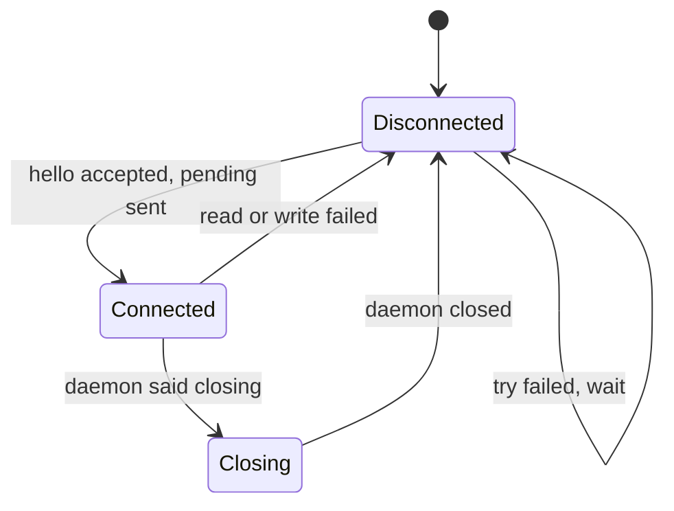

# Relay

The relay is `facade-mcp`, the program a CLI starts as its Facade Code Framework MCP server. With the daemon's MCP server it forms
Facade API v1's MCP entry point. It passes each MCP line between the CLI's
MCP client and the daemon's MCP server, and keeps the CLI's requests alive while one daemon takes over from another. It
is its own island because it must almost never change: a CLI keeps running the same `facade-mcp` across Facade Code Framework upgrades,
so it knows only a small fixed contract and nothing of MCP or Facade Code Framework's tools. Crate `facade-relay`, folder
`framework/crates/relay/`, program `facade-mcp`.

## Owns

- Its one link to the daemon, `DaemonLink`: the socket stream and what the daemon sent that is no whole line yet.
- The pending requests: each request line the CLI sent that has no response yet, with its JSON-RPC `id`.
- The held lines: lines from the CLI that wait while no daemon takes lines.
- Its standard input and output, which carry MCP, and its standard error, where it logs.

It keeps nothing on disk.

## Keeps

- One loop: on Unix, one thread waits in `poll`; on Windows, the loop waits on an I/O completion port and one other
  thread blocks reading standard input and posts each read to that port. Reads from the daemon use overlapped I/O.
  Writes and the hello block, as does running `facade daemon --detach`.
- Every byte it passes on goes through unchanged. Of a line it reads only the top-level `id`, `method` and `error`.
- A request stays pending until the daemon sends a line with its `id` and no `method`.
- When it connects again, it sends the pending requests first, in their order, then the held lines, then new lines.
- Before it sends the hello, it checks that the process at the socket's other end runs as its own user. The socket
  folder on Unix is under `/tmp`; on Windows it compares the named pipe server's token user SID with its own. The
  hello carries the CLI's environment, which may hold keys.
- Once it has responded to `closing`, it sends that daemon nothing more.
- It runs `facade daemon --detach` at most once for each time it is disconnected, and only where no one listens.
- Code that differs by operating system stays inside the relay.

## Never does

- Change or make MCP messages. Its hello and its response to `closing` are its only own lines.
- Depend on a Facade Code Framework crate. Its dependencies are `sha2`, `nix` on Unix and `windows-sys` on Windows.
- Read its arguments. They go into the hello and nowhere else.
- Start any process other than `facade daemon --detach`.
- Time out a request, limit a line's size, or queue anything beyond the pending and held lines.
- Name a CLI.

## Interface

**CLIs.** A CLI runs the launcher `framework/bin/facade-mcp` from its MCP settings. The entries Facade Code Framework writes come from
the wiring in [rules](rules.md); a person can also write one by hand with only the program's path.

- Standard input and output: MCP, one JSON-RPC message per line.
- Environment: the Facade home, from `FACADE_HOME`, `HOME` or `USERPROFILE` by the rule in DAEMON.md. A
  `FACADE_HOME` that is not an absolute path exits 1. The whole UTF-8 environment goes into the hello.
- Arguments: any. Wiring passes words such as `--guest codex`, which the daemon reads from the hello. A `--socket
  <path>` that older entries still carry is passed on like any other word.
- Exit codes: 0 once its input ended, or could not be read any more, and every request had its response, or its
  input ended while no daemon was connected; 1 where its environment names no Facade home, its standard input cannot
  be opened, or its standard output cannot be written.
- Standard error: one line per fact, `facade-mcp: <level>: <fact>`, with level `error`, `warn` or `info`.

**The daemon.** The relay contract, version 1, is part of the daemon protocol: see "The relay" in
[DAEMON.md](../../../framework/protocol/DAEMON.md), which gives the hello and the response to `closing`. The relay takes
the hello as accepted when the daemon's first line has `id` 1, no `method` and no `error`. The daemon's side is the MCP
server in [daemon](daemon.md).

**The socket.** The relay works out the daemon socket from the Facade home by the rule in "Connect to the daemon" in
[DAEMON.md](../../../framework/protocol/DAEMON.md). [base](base.md) follows the same rule in `paths::home_key` and
`daemon_socket`. The scenario tests that go through the relay keep the two the same: the relay is given no path, so a
different result would not connect. On Windows the socket is the named pipe
`\\.\pipe\facade-framework-daemon-<key>`, with the same home key: the first five SHA-256 bytes in hex, hashing the home as
written without changing case or slashes.

**The `facade` program.** Where no one listens, the relay runs `facade daemon --detach` from its own folder, with its
own environment, as DAEMON.md tells a client to. On Windows the program is `facade.exe`, started with
`CREATE_NO_WINDOW`.

## Depends on

- `nix` (Unix only): `poll`; the user ID; the peer's user, through `getpeereid`, or `SO_PEERCRED` on Linux.
- `sha2`: the hash in the socket's name.
- `windows-sys` (Windows only): the completion port, overlapped pipe I/O and the server's user SID.
- No Facade Code Framework crate. At run time it uses the daemon's socket and the `facade` program beside it.

## Inside

| File | What it does |
|---|---|
| `main.rs` | Works out the socket, builds the hello from the process, runs the loop; documents the exit codes. |
| `socket.rs` | `daemon_socket`: the daemon socket of the Facade home. |
| `relay.rs` | The loop: `Relay`, its `Daemon` state, the pending and held lines, reconnection. |
| `daemon.rs` | `DaemonLink::open` (connect, check the peer's user, hello), the response to `closing`, `RelayHelloParams`, `start_facade`. |
| `jsonrpc.rs` | `read`: sorts a line into `Request`, `Notification`, `Response` or `Other`; `string`: a JSON string for the hello. |
| `lines.rs` | `Lines`: cuts a stream into lines, newline included. |
| `windows.rs` | The completion port, standard-input thread, overlapped daemon pipe, user check and process creation flag. The only module that allows unsafe code. |

**The loop.** `relay::run` repeats four steps on one thread:

1. Stop with 0 once the CLI's input has ended and no request waits on a connected daemon. Pending requests are given
   up only when the input ended while no daemon was connected.
2. While disconnected and the wait is over, try to connect.
3. `poll` the CLI's input, unless it ended, and the daemon's link, while there is one. While disconnected, `poll`
   wakes at the next try; otherwise it has no timeout.
4. Read what is ready. A read from the CLI that ends or fails ends the input. A read from the daemon that ends or
   fails ends the link. A failed write to standard output stops the relay with 1.

On Windows, the same loop waits on a completion port instead of `poll`. The standard-input thread posts each read,
including the end of input, to the port. The loop keeps one daemon read outstanding; its buffer and `OVERLAPPED`
stay in place until completion. Dropping a link cancels its read and waits before freeing that storage. Each
connection has its own completion key, so the loop ignores any old cancelled read's packet. Writes and the hello
use an event with completion-port notification suppressed, and block until their overlapped I/O finishes.

**The daemon's state** is one enum:

- `Connected`: lines from the CLI go to the daemon.
- `Closing`: the relay responded to `closing`. Lines from the CLI are held; the daemon's responses still go to the
  CLI until it closes the connection.
- `Disconnected`: the relay tries again at `next_try`. It also notes whether it logged why and whether it ran
  `facade daemon --detach` since it was last connected.

**A line from the CLI** (`handle_cli_line`). While connected, the relay writes it to the daemon. A line that is a
request, with a `method` and an `id`, also becomes pending. If the write fails, the line is held and the link ends.
In any other state the line is held.

**A line from the daemon** (`handle_daemon_line`). A `closing` notification gets the relay's response and moves the
state to `Closing`; it is not passed on. A response, with an `id` and no `method`, removes the first pending request
whose `id` has the same bytes. Every line but `closing` goes to standard output and is flushed.

**Connecting** (`connect_when_due`). `DaemonLink::open` connects, checks the peer's user, writes the hello and waits
for the daemon's first line. The relay then writes the pending requests to the new link. Any failure leaves it
disconnected:

- It logs why once for each time it is disconnected. When it logged, it logs `connected to Facade Code Framework` once it connects.
- Where no one listens (the socket is missing, or the connection is refused) and it has not done so since it was last
  connected, it runs `start_facade`. Once that succeeds, it tries again at once; where it fails, it logs why and waits
  as below. `start_facade` waits for `facade daemon --detach` to return, which takes up to 10 seconds while Facade Code Framework
  starts. Its standard input is empty and its output goes to standard error, as standard output carries MCP.
- Otherwise it waits 0.1 seconds, doubling up to 2 seconds. The wait starts again from 0.1 seconds once a daemon took
  the hello and the pending requests.

On success the hello's `reconnect` becomes true for every later connection, and the held lines go out through
`handle_cli_line`, so requests among them become pending.

**Reading JSON** (`jsonrpc::read`). A hand-written scanner walks the top-level object, skips each value whole,
strings and nesting included, and keeps the bytes of `id` and `method` as written. A line that is not a JSON object,
such as a batch, is `Other` and only passed on.

**Lines** (`Lines`). Each read takes up to 64 KiB. A long line is searched for its newline once, not on every read. A
last line without a newline when the input ends is dropped.

## Reading the code

1. `main.rs`: `main`, and the exit codes in the crate's documentation.
2. `relay.rs`: `run`, then `Relay::connect_when_due`, `handle_cli_line` and `handle_daemon_line`.
3. `daemon.rs`: `DaemonLink::open` and `start_facade`.
4. `jsonrpc.rs`: `read`.
5. `socket.rs`: `daemon_socket`.
