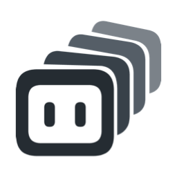

<div align="center">



# Facade Code

**내 머신에서 AI 코딩 에이전트를 실행하세요.**

Facade Code는 내 머신에서 여러 AI 코딩 CLI를 실행합니다. 에이전트는 서로를 찾고 메시지를 보내며 화면을 읽고 터미널에 입력할 수 있습니다. Shell, VS Code 또는 MCP를 지원하는 앱에서 이들을 제어할 수 있습니다. 각 머신은 자체 Orchestrator를 실행하고 SSH로 연결합니다.

[](https://facadecode.com)
[](https://marketplace.visualstudio.com/items?itemName=facade.facadecode)
[](https://open-vsx.org/extension/facade/facadecode)
[](https://github.com/y5ez3g/facadecode/releases)
[](https://github.com/y5ez3g/facadecode/issues)

[English](../../../README.md) · [简体中文](../zh-CN/README.md) · [繁體中文](../zh-TW/README.md) · [Português (Brasil)](../pt-BR/README.md) · [Español](../es/README.md) · [Русский](../ru/README.md) · [Deutsch](../de/README.md) · [日本語](../ja/README.md) · [Bahasa Indonesia](../id/README.md) · [Français](../fr/README.md) · **한국어** · [Türkçe](../tr/README.md) · [Tiếng Việt](../vi/README.md) · [Polski](../pl/README.md)

<p>
  <a href="https://upstar.dev/t/editors/week/2026-11-09">
    <picture>
      <source media="(prefers-color-scheme: dark)" srcset="https://upstar.dev/badge/y5ez3g/facadecode/award/editors-dark.svg">
      
    </picture>
  </a>
</p>

</div>

[](https://facadecode.com)

## 설치

### Shell

한 줄 설치 프로그램은 독립 실행형 패키지가 포함된 첫 릴리스부터 사용할 수 있습니다.
Shell 패키지는 macOS, Linux, Windows의 x64 및 arm64용으로 제공됩니다.

macOS 또는 Linux에서는 이 명령을 실행합니다.

```sh
sh -c 'script=$(curl -fsSL "$1") && sh -c "$script" --' facade-install https://github.com/y5ez3g/facadecode/releases/latest/download/install.sh
```

Windows에서는 PowerShell에서 이 명령을 실행합니다.

```powershell
$response = Invoke-WebRequest -UseBasicParsing 'https://github.com/y5ez3g/facadecode/releases/latest/download/install.ps1'; & ([ScriptBlock]::Create([Text.Encoding]::UTF8.GetString($response.RawContentStream.ToArray())))
```

설치 프로그램은 `facade`와 `facade-mcp`를 PATH에 추가합니다. 새 터미널을 열어 갱신된 PATH를 사용합니다. `facade upgrade`로 업데이트하세요. 각 머신에 필요한 CLI를 설치하고 로그인합니다. 기본 제공 CLI는 Claude Code, Codex, Antigravity, Muse Code, OpenCode, Pi입니다.

IDE 실행 명령도 `facade`입니다. 둘 다 설치된 경우 Shell은 PATH에서 먼저 찾은 프로그램을 실행합니다. IDE 미리 보기가 종료되면 이 이름은 Orchestrator에서 사용합니다. `facade --version`을 실행합니다. `facade <version>` 형식의 줄이 나오면 Shell 명령입니다.

### VS Code

```sh
code --install-extension facade.facadecode
```

확장 프로그램에 Orchestrator가 포함됩니다. 활동 표시줄에서 **Facade Code**를 열고 **새 에이전트**, **Go to Agent** 또는 **Resume Agent**를 선택합니다. macOS, Linux, Windows용 x64 및 arm64 패키지를 제공합니다.

[Marketplace](https://marketplace.visualstudio.com/items?itemName=facade.facadecode) · [Open VSX](https://open-vsx.org/extension/facade/facadecode) · [VS Code](../../../extension/GUIDE.md)

### MCP

`facade-mcp`를 stdio MCP 서버로 추가하세요. 이 예시는 `mcpServers` 객체를 사용합니다.

```json
{
  "mcpServers": {
    "facade": { "command": "facade-mcp" }
  }
}
```

외부 연결은 첫 도구 호출 때 Guest로 참여합니다. 메시지를 보낸 뒤에는 `send_message`가 반환한 `read_messages` 호출로 응답을 기다립니다.

## 여러 머신에서 작업

```sh
facade start --name ada -d codex
facade list
facade attach ada
```

`facade list`에 표시된 주소를 사용합니다. 다른 머신은 평소 사용하는 SSH 대상과 옵션으로 등록합니다. 외부에서 WSL이나 Dev Container에 접속하려면 해당 환경 안에서 SSH를 설정하고 같은 방식으로 등록합니다. 그 환경에서 Facade를 직접 실행할 수도 있습니다.

```sh
facade machine add -p 2222 aaron@devbox.lan
facade start --machine devbox --workdir /work/app --worktree feat-x claude
```

필요하면 Facade가 원격 머신에 해당 버전을 설치합니다. Facade는 원격 머신에서 고정된 설치 경로를 사용합니다. 수동으로 설치할 때는 로컬 Orchestrator와 같은 버전을 사용하세요. VS Code에서 **Go to Agent**를 선택하면 실행 중인 에이전트의 터미널을 열 수 있습니다. 작업 영역은 열었던 에이전트와 그 도우미, Pin을 기억합니다. 터미널 탭을 닫아도 에이전트는 계속 실행됩니다. **Resume Agent**와 `facade resume`은 저장된 작업을 표시합니다.

> **YOLO는 기본적으로 켜져 있습니다.** YOLO가 켜진 에이전트는 연결된 머신의 다른 에이전트에 접근할 수 있습니다. 해당 머신의 `facade.json`에서 `"yolo": false`를 설정하면 CLI 자체의 승인과 샌드박스가 유지되고 MCP 범위는 호출자의 생성 트리로 제한됩니다. 다음 시작 또는 resume부터 적용됩니다. `facade status`로 파일 위치를 확인하세요.

[제품 문서 (영어)](../../PRODUCT.md) · [용어집](../../core/GLOSSARY.md)

## Facade Code IDE (Preview)

**여러 프로젝트. 하나의 창.**

전용 작업 영역 표시줄에서 프로젝트, 기능 worktree 및 에이전트 팀을 정리하세요. 에이전트가 백그라운드에서 계속 작업하는 동안 관련 파일과 터미널이 포함된 프로젝트 사이를 전환할 수 있습니다.

IDE 미리 보기 다운로드: [macOS (Apple silicon, .dmg)](https://github.com/y5ez3g/facadecode/releases/download/facade/0.1.2/facade-code-0.1.2-darwin-arm64.dmg) · [Windows (x64, .exe)](https://github.com/y5ez3g/facadecode/releases/download/facade/0.1.2/facade-code-0.1.2-win32-x64-user-setup.exe) · [Linux (Ubuntu x64, .deb)](https://github.com/y5ez3g/facadecode/releases/download/facade/0.1.2/facade-code-0.1.2-linux-x64.deb) · [모든 릴리스](https://github.com/y5ez3g/facadecode/releases)

IDE 미리 보기는 기존 편집기와 함께 설치되며 자체 설정과 확장 프로그램을 사용합니다. 확장 프로그램은 [Open VSX](https://open-vsx.org)에서 제공되며, Remote Development 및 C/C++ 같은 일부 Microsoft 전용 독점 확장 프로그램은 공식 Microsoft 빌드에서만 실행됩니다. 아키텍처 및 사양은 [`docs/ide/`](../../ide/)에 있습니다.

## 소스에서 빌드

- **확장 프로그램:** 패키지를 빌드하려면 코딩 에이전트에게 [`extension/AGENTS.md`](../../../extension/AGENTS.md)를 제공하세요.
- **Orchestrator / Shell.** [빌드 안내](../../../core/README.md).
- **IDE:** 애플리케이션을 빌드하려면 코딩 에이전트에게 [`docs/ide/RELEASE.md`](../../ide/RELEASE.md)를 제공하세요.

기여 가이드라인 및 브랜치 규칙에 대한 자세한 내용은 [`CONTRIBUTING.md`](../../../CONTRIBUTING.md) 및 [`docs/ide/ENGINEERING.md`](../../ide/ENGINEERING.md)를 참조하세요.

## 피드백

- **버그 및 제안:** [GitHub Issues](https://github.com/y5ez3g/facadecode/issues) 또는 IDE의 **도움말 > 문제 보고**.
- **보안 취약점:** [`SECURITY.md`](../../../SECURITY.md)에 따라 비공개로 보고해 주세요.

## 라이선스

업스트림 VS Code와 동일한 MIT 라이선스입니다. Microsoft 저작권 고지 및 Facade Code 기여자 고지는 [`LICENSE.txt`](../../../LICENSE.txt)를 참조하세요.

<sub>Facade Code는 독립적인 제품이며 표시된 타사 도구 제공업체와 제휴, 보증 또는 후원 관계가 아닙니다. 모든 타사 상표 및 로고는 해당 소유자의 자산입니다.</sub>
