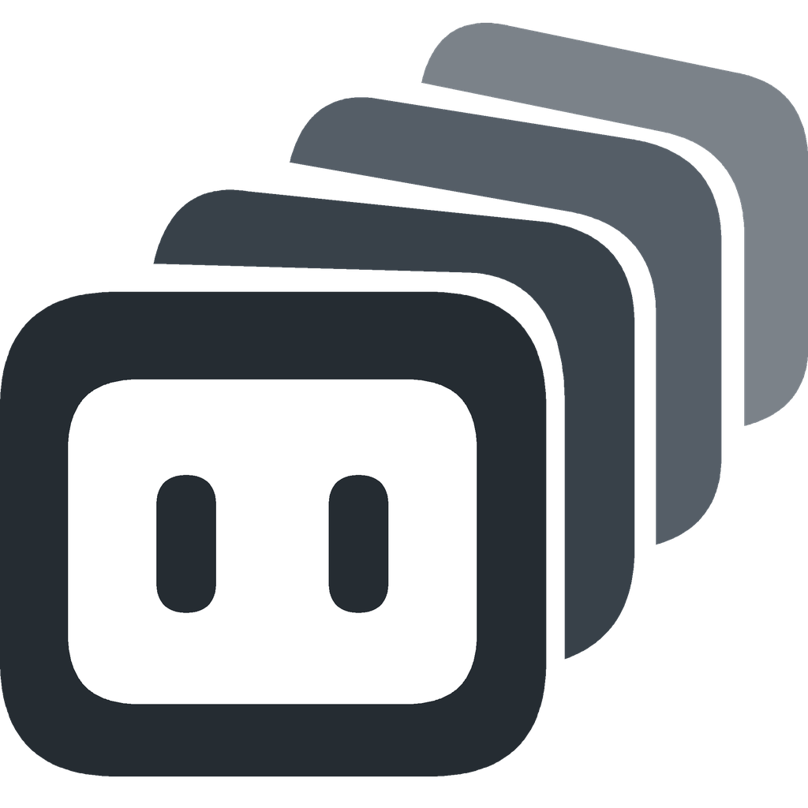

<div align="center">



# Facade Code

**Uma IDE para você e seu time de IA.**

Baseada no VS Code. Roda as CLIs nativas dos seus agentes, como Claude Code, Codex, Antigravity, Muse Code e Qwen Code.

[Download](https://github.com/y5ez3g/facadecode/releases) ·
[Especificações](../../ide/) ·
[Reportar um bug](https://github.com/y5ez3g/facadecode/issues)

[English](../../../README.md) · [简体中文](../zh-CN/README.md) · [繁體中文](../zh-TW/README.md) · **Português (Brasil)** · [Español](../es/README.md) · [Русский](../ru/README.md) · [Deutsch](../de/README.md) · [日本語](../ja/README.md) · [Bahasa Indonesia](../id/README.md) · [Français](../fr/README.md) · [한국어](../ko/README.md) · [Türkçe](../tr/README.md) · [Tiếng Việt](../vi/README.md) · [Polski](../pl/README.md)

</div>

https://github.com/user-attachments/assets/35e2c317-8040-49c6-bb56-ab81196e8ebc

O Facade Code é um fork do VS Code em que agentes nativos de todos os fornecedores colaboram nos seus projetos e funcionalidades, enquanto você revisa o código e orienta qualquer agente na mesma janela.

- 🧑‍💻 **O VS Code completo, organizado por projetos e funcionalidades.** Desenvolva vários projetos e funcionalidades em uma única janela. Cada funcionalidade é uma worktree do Git, com um time de agentes dedicado.
- 🤖 **Um time de CLIs nativas de agentes, de vários fornecedores.** Os agentes rodam nas assinaturas que você já tem. No Facade Code, os agentes iniciam uns aos outros, trocam mensagens e se ajudam a destravar.
- 👥 **Super Engineer ou Super Team.** Dirija vários agentes você mesmo, ou escolha um modelo líder para coordenar especialistas em paralelo.

## Instalação

Baixe a versão mais recente em [Releases](https://github.com/y5ez3g/facadecode/releases): um `.dmg` para macOS (Apple silicon), um instalador para Windows (x64) ou um `.deb` para Ubuntu (x64).

**Pré-requisitos**: instale e faça login nas CLIs de agentes que você quer usar (qualquer combinação de Claude Code, Codex, Antigravity, Muse Code ou Qwen Code). O Facade Code as executa diretamente, com a autenticação e as assinaturas nativas delas.

O Facade Code é instalado ao lado do VS Code e não compartilha nada com ele: configurações, extensões e a ferramenta de linha de comando `facade` são totalmente separadas.

## Início rápido

1. **Abra um projeto**:
   ```sh
   facade ~/code/space-shooter
   ```
   Ou use **File > Open Folder** (Arquivo > Abrir Pasta), ou arraste uma pasta para a barra de workspaces. A pasta precisa ser um repositório git (worktrees exigem git; rode `git init` antes se estiver começando do zero).

2. **Inicie um tech lead**:
   Clique no ícone de robô na barra de título (menu Agent), ou rode **Agents: Start Agent...** (iniciar agente) na Paleta de Comandos, e escolha Claude Code ou Codex. Um agente iniciado de dentro do Facade Code já vem com as ferramentas MCP do Facade.

3. **Passe para ele o prompt de tech lead**:
   ```text
   Você é o tech lead. Use o Facade para construir um jogo de nave neon para navegador
   (desktop) para uma demo, com um PD no GPT Sol 6 (gpt-6-sol, max) via Codex, dono do
   visual e da sensação de jogo, e três engenheiros Muse 1.3 (muse-spark-1.3, max)
   trabalhando em paralelo. Mantenha pequeno, cerca de meia hora de construção: uma fase,
   três tipos de inimigo, um chefe com duas fases, power-ups, pontuação e combos. Melhor
   um jogo pronto e bem acabado do que mais funcionalidades. Os engenheiros fazem o merge
   do próprio trabalho e você revisa depois. Me mande uma página HTML com um plano curto, um diagrama
   de raias e o mockup do PD, e espere minha aprovação antes de começar.
   ```

4. **Veja o time colaborar**:
   O PD e os engenheiros iniciados aparecem na barra de workspaces, sob o projeto e a funcionalidade deles. Assim que você aprovar o plano em HTML, eles começam a construir. Você pode entrar no terminal de qualquer agente a qualquer momento para ver a saída ou falar diretamente com ele.

*(Observação: este prompt de exemplo inicia 5 agentes no nível máximo de raciocínio. Ajuste as CLIs, os modelos, os níveis de raciocínio e o número de engenheiros às assinaturas que você tem.)*

## Funcionalidades

### Projetos e funcionalidades, não sessões

https://github.com/user-attachments/assets/bf93be03-1c75-4d35-86ca-c2a62a62ea95

A maioria das ferramentas de agentes cria uma worktree para cada sessão de agente. O Facade Code faz o contrário: cada worktree é uma funcionalidade, listada sob o seu repositório, e você atribui agentes a ela.

Uma funcionalidade costuma precisar de mais de um agente. O que escreve o código pode não explicar bem o próprio trabalho ou não ter bom olho para design, então outros agentes ajudam com documentação, design e revisão, todos na mesma worktree. Os agentes vêm e vão; a funcionalidade fica.

- **Barra de workspaces**: lista todos os repositórios e funcionalidades em uma coluna. Clique em um para trocar a janela inteira (explorador, editores, terminais e controle do código-fonte), restaurada do jeito que você deixou. Os projetos nunca se misturam. Veja [`WORKSPACE.md`](../../ide/WORKSPACE.md).
- **Ciclo de vida da worktree**: **New Worktree** (nova worktree) cria o branch, sincroniza os arquivos locais listados em `.worktreeinclude` e roda a configuração inicial. **Delete Worktree** (excluir worktree) mostra o que seria perdido antes de remover. Veja [`WORKTREE.md`](../../ide/WORKTREE.md).
- **Subtarefas em paralelo**: tarefas independentes podem ir para worktrees separadas.

### Um time de todos os fornecedores

- **CLIs nativas nas suas próprias assinaturas**: Claude Code, Codex, Muse Code, Antigravity e Qwen Code rodam nos seus próprios terminais integrados, usando as assinaturas que você já tem.
- **Agentes iniciam agentes**: um agente pode iniciar outros agentes (com qualquer CLI ou modelo de qualquer fornecedor) na funcionalidade atual ou em uma nova worktree, e atribuir tarefas a eles. Veja [`AGENT-LAUNCHER.md`](../../ide/AGENT-LAUNCHER.md) e [`AGENT-ORCHESTRATION.md`](../../ide/AGENT-ORCHESTRATION.md).
- **Mensagens**: os agentes trocam mensagens entre si, reportam resultados a quem os chamou e avisam você quando uma decisão precisa de aprovação humana. Veja [`AGENT-MESSAGES.md`](../../ide/AGENT-MESSAGES.md).
- **Um destrava o outro**: um agente pode ler o terminal de outro agente, responder prompts e enviar teclas para ajudar um engenheiro travado, sem interromper você. Veja [`AGENT-DEBUGGING.md`](../../ide/AGENT-DEBUGGING.md).
- **Você pode intervir em qualquer um**: cada agente tem a sua própria linha de terminal sob a sua funcionalidade. Você vê o que ele está fazendo e pode digitar diretamente nele a qualquer momento.
- **MCP padrão**: todas as ferramentas de orquestração são expostas por um servidor MCP padrão.

## Duas formas de trabalhar

A atenção do desenvolvedor é o gargalo. Os dois modos representam dois níveis de delegação:

| | **Super Engineer** | **Super Team** |
|---|---|---|
| **Seu papel** | Engenheiro com a mão na massa | Gerente de engenharia |
| **Com quem você interage** | Vários agentes diretamente | Um agente tech lead, 1:1 |
| **Quem coordena os agentes** | Você | O tech lead |
| **Ideal para** | Funcionalidades que pedem acompanhamento de perto: trabalho exploratório, decisões de design que você quer avaliar pessoalmente, requisitos que mudam | Funcionalidades grandes e bem definidas, que se dividem com clareza |

Você pode misturar os dois na mesma janela: acompanhar de perto funcionalidades sensíveis e delegar trabalho bem delimitado a um líder.

- **Super Engineer**: você abre worktrees, atribui tarefas a agentes em vários repositórios e revisa o código à medida que cada um termina.
- **Super Team**: você entrega uma funcionalidade a um agente como tech lead. Ele divide as tarefas, define contratos de interface, inicia os engenheiros e revisa o que eles entregam.
  - Um modelo forte lidera; modelos mais rápidos e mais baratos, nas assinaturas que você já tem, implementam em paralelo; e modelos de fornecedores diferentes revisam o trabalho uns dos outros.
  - Um prompt basta para montar isso (veja [Início rápido](#início-rápido)); fluxos de time que você reutiliza podem virar skills.

*(Este README foi escrito do mesmo jeito: um agente analisou, outro redigiu, e uma pessoa deu a palavra final.)*

## Por quê

A maioria das ferramentas de programação com IA cai em dois grupos: IDEs no estilo Copilot, em que uma pessoa precisa acompanhar linha por linha, e IDEs de agentes, em que a revisão de código e a depuração ficam para um editor externo. Nenhum dos dois reúne um time de agentes nativos de vários fornecedores dentro da sua IDE principal.

Acreditamos que o futuro é um desenvolvedor tocando vários projetos e funcionalidades com um time de agentes. Modelos diferentes se destacam em tarefas diferentes, então o time deve reunir vários fornecedores. E, como são os agentes que escrevem o código que você revisa, esse time tem que estar na sua IDE.

## Continua sendo VS Code

O Facade Code muda apenas o que o gerenciamento de vários projetos e de agentes exige:

- A **barra de workspaces** ocupa a primeira coluna; a **barra de atividades** vai para o canto superior direito da barra de título (dá para restaurar com `workbench.activityBar.location`).
- O Copilot e o chat do upstream vêm desativados por padrão (uma única configuração os reativa).
- Todo o resto é o VS Code padrão: editor, configurações, atalhos de teclado, `.vscode/` e arquivos `.code-workspace`.
- As extensões são instaladas a partir do [Open VSX](https://open-vsx.org). Algumas extensões proprietárias da Microsoft, como Remote Development e C/C++, são licenciadas apenas para as builds oficiais da Microsoft e não rodam em forks.

## Compilando a partir do código-fonte

Entregue [`docs/ide/RELEASE.md`](../../ide/RELEASE.md) ao seu agente e deixe que ele faça a build.

Para as diretrizes de contribuição e as regras de branches, veja [`CONTRIBUTING.md`](CONTRIBUTING.md) e [`docs/ide/ENGINEERING.md`](../../ide/ENGINEERING.md).

## Feedback

- **Bugs e ideias**: [GitHub Issues](https://github.com/y5ez3g/facadecode/issues) ou **Help > Report Issue** (Ajuda > Relatar Problema) no editor.
- **Vulnerabilidades de segurança**: reporte de forma privada, conforme o [`SECURITY.md`](SECURITY.md).

## Licença

MIT, igual ao VS Code upstream. Veja o [`LICENSE.txt`](../../../LICENSE.txt) para o aviso de copyright da Microsoft e os avisos dos contribuidores do Facade Code.
