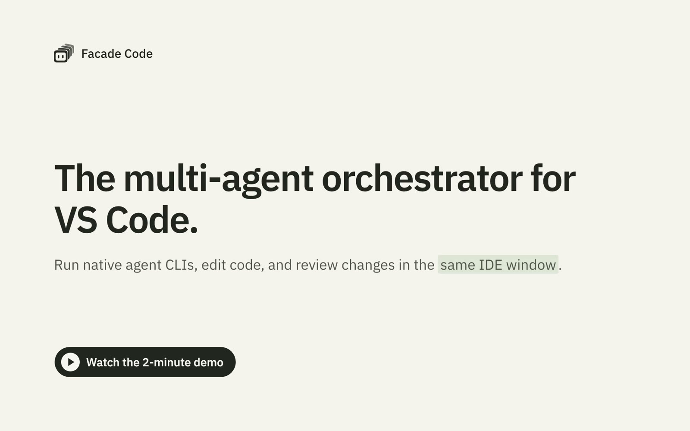

<div align="center">


# Facade Code

**Yapay zekâ kodlama aracılarını kendi makinelerinizde çalıştırın.**

Facade Code, makinelerinizde birden çok yapay zekâ kodlama CLI'sı çalıştırır. Aracılar birbirini bulabilir, ileti gönderebilir, ekranları okuyabilir ve terminallere yazabilir. Onları Shell, VS Code veya MCP destekli bir uygulamadan yönetebilirsiniz. Her makine kendi Orchestrator'ını çalıştırır ve diğerlerine SSH ile bağlanır.

[](https://facadecode.com)
[](https://marketplace.visualstudio.com/items?itemName=facade.facadecode)
[](https://open-vsx.org/extension/facade/facadecode)
[](https://github.com/y5ez3g/facadecode/releases)
[](https://github.com/y5ez3g/facadecode/issues)

[English](../../../README.md) · [简体中文](../zh-CN/README.md) · [繁體中文](../zh-TW/README.md) · [Português (Brasil)](../pt-BR/README.md) · [Español](../es/README.md) · [Русский](../ru/README.md) · [Deutsch](../de/README.md) · [日本語](../ja/README.md) · [Bahasa Indonesia](../id/README.md) · [Français](../fr/README.md) · [한국어](../ko/README.md) · **Türkçe** · [Tiếng Việt](../vi/README.md) · [Polski](../pl/README.md)

<p>
  <a href="https://upstar.dev/t/editors/week/2026-11-09">
    <picture>
      <source media="(prefers-color-scheme: dark)" srcset="https://upstar.dev/badge/y5ez3g/facadecode/award/editors-dark.svg">
      
    </picture>
  </a>
</p>

</div>

[](https://facadecode.com)

## Kurulum

### Shell

Tek satırlık kurucular, bağımsız paketleri içeren ilk sürümle birlikte kullanılabilir.
Shell paketleri macOS, Linux ve Windows için x64 ve arm64 desteği sunar.

Bu komutu macOS veya Linux'ta çalıştırın.

```sh
sh -c 'script=$(curl -fsSL "$1") && sh -c "$script" --' facade-install https://github.com/y5ez3g/facadecode/releases/latest/download/install.sh
```

Windows'ta bu komutu PowerShell'de çalıştırın.

```powershell
$response = Invoke-WebRequest -UseBasicParsing 'https://github.com/y5ez3g/facadecode/releases/latest/download/install.ps1'; & ([ScriptBlock]::Create([Text.Encoding]::UTF8.GetString($response.RawContentStream.ToArray())))
```

Kurucu `facade` ve `facade-mcp` komutlarını PATH'e ekler. Güncellenen PATH'i kullanmak için yeni bir terminal açın. Güncellemek için `facade upgrade` komutunu çalıştırın. Gerekli CLI'ları her makineye kurup oturum açın. Yerleşik seçenekler Claude Code, Codex, Antigravity, Muse Code, OpenCode ve Pi'dir.

Başlatıcısının adı da `facade`'dır. İkisi de kuruluysa Shell, PATH'te ilk bulunan programı kullanır. Önizleme kaldırıldığında komut adı Orchestrator'a kalır. `facade version` komutunu çalıştırın. `facade <version>` biçimindeki satır Shell komutunu kullandığınızı doğrular.

### VS Code

```sh
code --install-extension facade.facadecode
```

Uzantı, Orchestrator'ı beraberinde getirir. Etkinlik çubuğundan **Facade Code**'u açın ve **Yeni Aracı**, **Go to Agent** veya **Resume Agent**'ı seçin. macOS, Linux ve Windows için x64 ve arm64 paketleri hazırlanır.

[Marketplace](https://marketplace.visualstudio.com/items?itemName=facade.facadecode) · [Open VSX](https://open-vsx.org/extension/facade/facadecode) · [VS Code](../../../extension/GUIDE.md)

### MCP

`facade-mcp` komutunu bir stdio MCP sunucusu olarak ekleyin. Bu örnek bir `mcpServers` nesnesi kullanır.

```json
{
  "mcpServers": {
    "facade": { "command": "facade-mcp" }
  }
}
```

Dış bağlantı, ilk araç çağrısında Guest olarak katılır. İleti gönderdikten sonra `send_message` sonucundaki `read_messages` çağrısıyla yanıtı bekleyin.

## Birden çok makinede çalışma

```sh
facade start --name ada -d codex
facade list
facade attach ada
```

`facade list` çıktısındaki adresi kullanın. Başka bir makineyi her zamanki SSH hedefiniz ve seçeneklerinizle kaydedin. WSL veya bir Dev Container'a dışarıdan erişmek için SSH'yi ortamın içinde kurup aynı şekilde kaydedin. Facade'i doğrudan bu ortamda da çalıştırabilirsiniz.

```sh
facade machine add -p 2222 aaron@devbox.lan
facade start --machine devbox --folder /work/app --worktree feat-x claude
```

Facade gerektiğinde uzak makineye ilgili sürümü kurar. Facade uzak makinede sabit kurulum yolunu kullanır. Elle kurmanız gerekirse yerel Orchestrator ile aynı sürümü kullanın. VS Code'daki **Go to Agent**, çalışan bir aracının terminalini açar. Çalışma alanı açılan aracıları, yardımcılarını ve Pin'leri hatırlar. Terminal sekmesi kapandığında aracı çalışmaya devam eder. **Resume Agent** ve `facade resume` kayıtlı çalışmaları gösterir.

> **YOLO varsayılan olarak açıktır.** YOLO açıkken bir aracı bağlı makinelerdeki diğer aracılara erişebilir. CLI'nın kendi onaylarını ve korumalı alanını korumak ve MCP erişimini çağıranın oluşturma ağacıyla sınırlamak için makinenin `facade.json` dosyasına `"yolo": false` yazın. Değişiklik bir sonraki başlatma veya resume işleminde uygulanır. `facade status` dosya yolunu gösterir.

[Ürün belgeleri (Çince)](../../facade-code.md) · [Terimler sözlüğü](../../core/GLOSSARY.md)

## Facade Code IDE (Preview)

**Birden çok proje. Tek pencere.**

Projeleri, özellik çalışma ağaçlarını ve aracı ekiplerini özel bir çalışma alanı çubuğunda düzenleyin. Aracılar arka planda çalışmaya devam ederken ilgili dosyaları ve terminalleriyle projeler arasında geçiş yapın.

IDE önizlemesini indirin: [macOS (Apple silicon, .dmg)](https://github.com/y5ez3g/facadecode/releases/download/facade/0.1.2/facade-code-0.1.2-darwin-arm64.dmg) · [Windows (x64, .exe)](https://github.com/y5ez3g/facadecode/releases/download/facade/0.1.2/facade-code-0.1.2-win32-x64-user-setup.exe) · [Linux (Ubuntu x64, .deb)](https://github.com/y5ez3g/facadecode/releases/download/facade/0.1.2/facade-code-0.1.2-linux-x64.deb) · [Tüm sürümler](https://github.com/y5ez3g/facadecode/releases)

IDE önizlemesi mevcut düzenleyicinizin yanında kurulur ve kendi ayarlarıyla uzantılarını kullanır. Uzantıları [Open VSX](https://open-vsx.org) üzerinden gelir; Remote Development ve C/C++ gibi birkaç tescilli Microsoft uzantısı yalnızca resmi Microsoft derlemelerinde çalışır. Mimari ve spesifikasyonlar [`docs/ide/`](../../ide/) altındadır.

## Kaynaktan Derleme

- **Uzantı:** Paketi derlemesi için kodlama aracınıza [`extension/AGENTS.md`](../../../extension/AGENTS.md) dosyasını verin.
- **Orchestrator / Shell.** [Derleme yönergeleri](../../../core/README.md).
- **IDE:** Uygulamayı derlemesi için kodlama aracınıza [`docs/ide/RELEASE.md`](../../ide/RELEASE.md) dosyasını verin.

Katkıda bulunma yönergeleri ve dal disiplini için [`CONTRIBUTING.md`](../../../CONTRIBUTING.md) ve [`docs/ide/ENGINEERING.md`](../../ide/ENGINEERING.md) dosyalarına bakın.

## Geri Bildirim

- **Hatalar ve fikirler:** [GitHub Issues](https://github.com/y5ez3g/facadecode/issues) veya IDE içinde **Yardım > Sorun Bildir**.
- **Güvenlik açıkları:** Lütfen [`SECURITY.md`](../../../SECURITY.md) dosyasına göre gizli olarak bildirin.

## Lisans

Yukarı akış VS Code ile eşleşen MIT. Microsoft'un telif hakkı bildirimi ve Facade Code katkıda bulunanların bildirimleri için [`LICENSE.txt`](../../../LICENSE.txt) dosyasına bakın.

<sub>Facade Code bağımsız bir üründür ve gösterilen üçüncü taraf araçların sağlayıcılarına bağlı değildir, onlar tarafından onaylanmamıştır veya desteklenmemektedir. Tüm üçüncü taraf ticari markaları ve logoları ilgili sahiplerine aittir.</sub>
