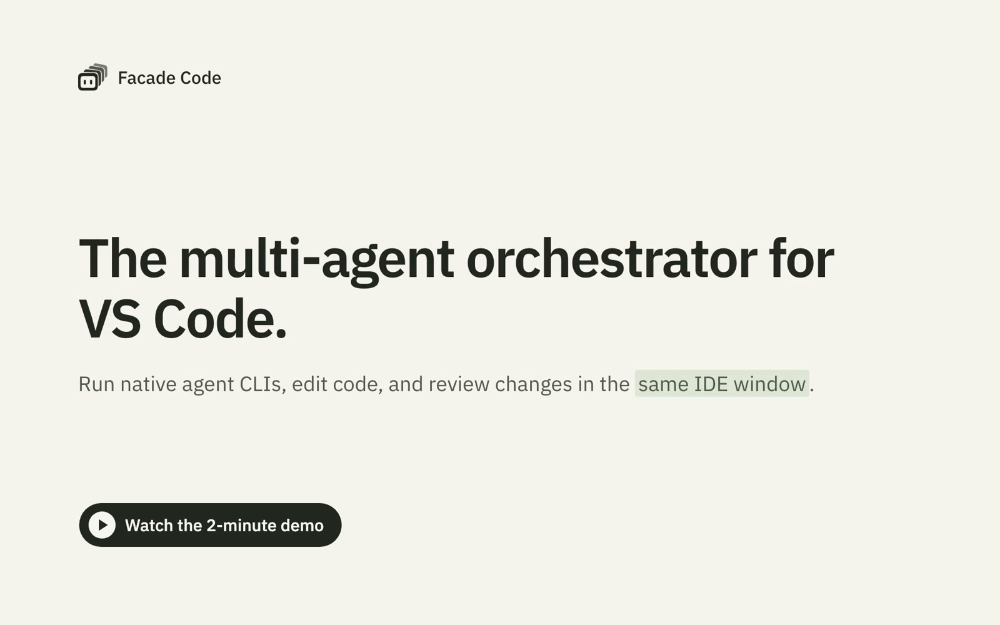

<div align="center">


# Facade Code

**The multi-agent orchestrator for VS Code.**

Run native agent CLIs, edit code, and review changes in the same IDE window. Use your own accounts and coding plans, and let agents collaborate across windows and machines.

[](https://facadecode.com)
[](https://github.com/y5ez3g/facadecode)
[](https://github.com/y5ez3g/facadecode/blob/main/extension/GUIDE.md)
[](https://github.com/y5ez3g/facadecode/issues)

</div>

[](https://facadecode.com)

> Works with Claude Code, Codex, Antigravity, Muse Code, OpenCode, and Pi. Qwen Code support is under development. For verified configurations and known limitations, see [Status and Known Limitations](https://github.com/y5ez3g/facadecode/blob/main/extension/GUIDE.md#status-and-known-limitations).

## Install

Install **Facade Code** from the [Visual Studio Marketplace](https://marketplace.visualstudio.com/items?itemName=facade.facadecode) or [Open VSX](https://open-vsx.org/extension/facade/facadecode). VS Code automatically installs the companion **Window Component** alongside it. The Window Component always runs on your local computer—even for remote windows—allowing Facade to recognize windows across reloads and connect them together.

Packages are available for macOS (Intel x64 and Apple silicon), Linux (x64 and ARM64), and Windows (x64 and ARM64).

**Prerequisites**: Install and sign in to at least one supported CLI where your workspace runs: on your local computer for local projects, or on the remote host for Remote - SSH. For OpenCode, use version 2.x (`@opencode/cli`): Facade Code does not launch 1.x (`opencode-ai`) and explains how to upgrade. Git is required if you use worktrees.

**Agents run without approval prompts by default.** By default, `facade.yolo` is enabled, allowing agents to run commands and modify files without asking for confirmation. Turn it off to restore each CLI's standard approval prompts and supported sandbox; this change applies to agents started afterwards. Pi has no approvals or sandbox, so it runs without asking even with `facade.yolo` off. OpenCode's default permissions allow every tool, so it also runs without asking unless you configure its permissions. To open settings, select **Configure Agents...** from the panel's `...` menu. Facade also trusts the folder an agent starts in, equivalent to accepting the CLI's own workspace trust prompt. With `facade.yolo` on, agents can also stop, message, and type into every agent across your Facade windows. Custom CLIs are the exception to launch mapping and folder trust: `facade.yolo` does not alter how they start, and Facade grants them no folder trust.

## Quick Start

1. **Open a folder**: Open your project directory via **File > Open Folder...**.
2. **Start an agent**: Click **Facade Code** in the Activity Bar, select **New Agent...**, and choose an installed CLI. The agent opens in an editor terminal tab; type prompts as you would in any terminal.
3. **Add more**: Launch additional agents the same way. Click any card in the panel to focus its terminal, or run **Go to Agent...** to search by name.
4. **Let agents collaborate**: Instruct an agent in plain English, for example: "Start a Codex agent to write the tests, and have it message you when it is done."

## Agent Panel

**Your agents and your IDE, in the same window.**

The **Facade Code** panel in the Activity Bar shows all agents in your window. Each card displays the agent's name, its CLI, and a status dot, with ⓘ details showing its title, folder, and creator.

- **Start and configure.** Click **New Agent...** to choose a CLI. In the picker, select **Change Name...** to name your session or **Change Working Location...** to pick a folder or create a Git worktree.
- **Navigate terminals.** Click any card to show its editor terminal tab, or run **Go to Agent...** from the Command Palette to search agents by name. Closing a tab hides it; open the card's gear menu and choose **End Agent** to end the session.
- **Pin and resume.** Use **Pin Agent** to keep essential agents at the top of the panel and restore them when the workspace opens again. Use **Resume Agent...** in the panel header to search history and restore past conversations in their original folders.

For details on agent cards, resuming sessions, pinning, git worktrees, and window reloads, see the [feature guide](https://github.com/y5ez3g/facadecode/blob/main/extension/GUIDE.md#one-panel-for-every-agent).

## Agent Use

**Let agents operate other agents, just like you.**

You do not need special commands to have agents collaborate—simply ask any agent in your own words.

- **Delegate tasks.** Tell an agent to start another agent for a specific task, for example: "Start a Codex agent in a new worktree to write tests, and message me when finished." The new agent appears in the panel without taking focus.
- **Work as a team.** Have one agent write code and another review the changes. When agents message each other, the text appears in the recipient's terminal marked with a 📨 icon.
- **Help stuck agents.** If an agent needs input or gets stuck at an interactive CLI prompt, other agents can inspect its screen, type answers, or send you a notification in VS Code.

For details on cross-agent messaging, automatic retries, and workspace files, see the [feature guide](https://github.com/y5ez3g/facadecode/blob/main/extension/GUIDE.md#a-team-that-works-together).

## Agent Mesh

**Connect agents across windows, machines, and locations.**

Facade Code connects agents across your Facade windows on this computer. Open a [VS Code Remote SSH](https://code.visualstudio.com/docs/remote/ssh) window to extend that collaboration to another machine.

- **Work across windows.** Open multiple project folders in separate VS Code windows. With `facade.yolo` on, agents in one window can see, message, and direct agents in any other window on your computer; with it off, agents reach only their own group.
- **Connect over SSH.** In a [VS Code Remote SSH](https://code.visualstudio.com/docs/remote/ssh) window, agents run directly on the remote machine with its tools, files, and accounts, and can be started and directed by local agents.
- **Check in from your phone.** In a Claude Code terminal, type `/remote-control` to enable [Claude Code Remote Control](https://code.claude.com/docs/en/remote-control), then connect using the Claude app on iOS or Android. From your phone, ask for progress updates and let that session coordinate other agents through Facade.

<sub>Remote Control requires a supported Claude Code version, an eligible plan, and full-scope sign-in. See its [setup requirements](https://code.claude.com/docs/en/remote-control#requirements).</sub>

## Settings

| Setting | Default | What it does |
|---|---|---|
| `facade.yolo` | On | Runs agents without approval prompts. Turn off to use each CLI's normal approvals and supported sandbox. Applies to new agents only. |
| `facade.collaboration.enabled` | On | Lets agents start and stop each other, send messages to each other and to you, and read and type in each other's terminals. Applies to new agents only. |
| `facade.claude.path` | Empty | Path to Claude Code. Leave empty to use `claude` from the terminal environment's PATH. |
| `facade.codex.path` | Empty | Path to Codex. Leave empty to use `codex` from the terminal environment's PATH. |
| `facade.antigravity.path` | Empty | Path to Antigravity. Leave empty to use `agy` from the terminal environment's PATH. |
| `facade.muse.path` | Empty | Path to Muse Code. Leave empty to use `muse` from the terminal environment's PATH. |
| `facade.opencode.path` | Empty | Path to OpenCode. Leave empty to use `opencode` from the terminal environment's PATH. |
| `facade.pi.path` | Empty | Path to Pi. Leave empty to use `pi` from the terminal environment's PATH. |
| `facade.<cli>.enabled` | On | Controls whether the CLI is offered for new agents. Turning it off does not stop agents that are running. |
| `facade.<cli>.launch` | `{}` | Advanced: additional command-line `arguments` and `environment` variables for the CLI. **Show Agent Launch...** shows what each agent starts with. |
| `facade.custom` | `{}` | Your own CLIs, by ID, each with a `path` and a `launch`: `start` for a new conversation, `resume` for a saved one (required; it must contain `${sessionId}`), and `environment`. An ID cannot be a built-in one: `claude`, `codex`, `agy`, `muse`, `opencode` or `pi`. |

`<cli>` is `claude`, `codex`, `antigravity`, `muse`, `opencode` or `pi`. These are machine settings: for a remote window, set them in the remote host's settings.

For example, a CLI started as `my-cli --fast` and resumed as `my-cli resume <session ID>`:

```json
"facade.custom": {
  "my-cli": { "path": "my-cli", "launch": { "start": ["--fast"], "resume": ["resume", "${sessionId}"] } }
}
```

## Status and Known Limitations

For tested configurations and known limitations, see the [feature guide](https://github.com/y5ez3g/facadecode/blob/main/extension/GUIDE.md#status-and-known-limitations).

## Building from Source

Provide [`extension/AGENTS.md`](https://github.com/y5ez3g/facadecode/blob/main/extension/AGENTS.md) to your coding agent to build the extension. For contribution guidelines, see [`CONTRIBUTING.md`](https://github.com/y5ez3g/facadecode/blob/main/CONTRIBUTING.md).

<!-- repository-only:start -->

### Working on it

Read [AGENTS.md](AGENTS.md) before changing anything. The [extension's specification](../docs/extension/README.md) defines
the target; [Verification](../docs/extension/engineering/VERIFICATION.md) defines the required evidence.

Use Node 24 (`.nvmrc`). Install the locked dependencies, then compile, build and test, all inside `extension/`:

```sh
npm ci
npm run compile
npm run bundle
npm run package
npm run test:package
npm test
npm run test:integration
```

`npm run test:package` checks the VSIX that `npm run package` makes, so run that first. Integration tests use an isolated
editor profile, a temporary Facade root, disposable repositories and a fake program for each built-in CLI, in an official VS Code: set
`VSCODE_EXECUTABLE` to its executable (on macOS the standard `/Applications/Visual Studio Code.app` is used when it is there).
On Linux run them under `xvfb-run -a`; on Windows run them in the signed-in desktop session. `npm run test:remote` runs
them over Remote-SSH to the hosts of an SSH configuration; [AGENTS.md](AGENTS.md) lists its variables.
Never use the owner's live windows as test subjects. Use `npm install` when deliberately changing dependencies and retain the
updated lockfile. `npm run watch` rebuilds the bundles as source changes; `npm run compile` also checks types and builds the
unit tests.

The execution bundle is assembled in `build/extension/`, including its native PTY backend for the build machine's
OS/architecture. The local window dependency is assembled in `build/window/` without native code. Packaging produces
both VSIX files under `build/vsix/`. Install the window component on the client and the execution component where the
workspace runs; unpublished test installations supply both packages. Integration tests load both components and use a
separate `build/extension-it/` for execution fixtures. A local build does not establish support on another platform.

Extension CI builds packages for macOS x64 and ARM64, Linux x64 and ARM64, and Windows x64 and ARM64 on native
runners. All six targets passed the 0.1.1 checks, including package tests and isolated editor journeys with fake CLIs;
the archive catalog records the source, CI run and original published bytes. Real-model and remote checks remain
separate evidence. Each target uploads its tested VSIX and the universal Window Component.

### Releases

A release starts from a pushed tag `extension/<version>` that names `package.json`'s version. The `Extension release`
workflow builds and tests that tag on all six native runners, then puts every platform VSIX, the universal Window Component
and `SHA256SUMS` on the tag's GitHub Release, with the changelog's section as its notes; the newest extension version is
marked Latest. It downloads the Release again and checks every file. Only then, after approval in the `extension-stores`
environment, it publishes the Release's own files to VS Code Marketplace and Open VSX, the Window Component first, skipping
files a store already has or says it has, and waits until both stores serve the same bytes. Running it manually from
`main` for a tag whose Release is complete finishes the stores without rebuilding, with `main`'s release script. The environment holds the `VSCE_PAT` and `OVSX_PAT` secrets.

An existing Release keeps its files: a file of the same name with other bytes stops the run, and only missing files are
added. `node scripts/release.mjs` does the work: `github --tag <tag> --input-dir <dir>`, `stores --tag <tag>`, and
`github --backfill`, which puts the versions first published to the stores (listed in `archive/catalog.json` with their
original Marketplace files and SHA-256) on Releases of their own, byte for byte. Catalog validation requires the
historical three-platform set before 0.1.1 and all six platforms from 0.1.1, with one Window Component.

Historical backfills preserve the published bytes. In particular, `0.0.2`'s original CI source used version `0.2.0`;
the shipped VSIX files say `0.0.2`, with matching runtime bundles and platform native files. Its catalog entry records
that version override and the original CI commit rather than claiming a newly rebuilt historical release.

<!-- repository-only:end -->

## Feedback

- **Bugs & ideas**: [GitHub Issues](https://github.com/y5ez3g/facadecode/issues).
- **Security vulnerabilities**: Please report privately according to [`SECURITY.md`](https://github.com/y5ez3g/facadecode/blob/main/SECURITY.md).

## License

MIT. See [`LICENSE.txt`](https://github.com/y5ez3g/facadecode/blob/main/extension/LICENSE.txt). Facade Code builds on Visual Studio Code; inherited source and bundled third-party materials retain their own notices in [`ThirdPartyNotices.txt`](https://github.com/y5ez3g/facadecode/blob/main/extension/ThirdPartyNotices.txt).

<sub>Facade Code is an independent product and is not affiliated with, endorsed by, or sponsored by the providers of the third-party tools shown. All third-party trademarks and logos belong to their respective owners.</sub>
